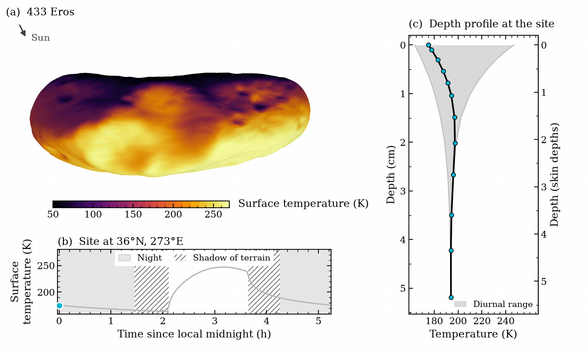
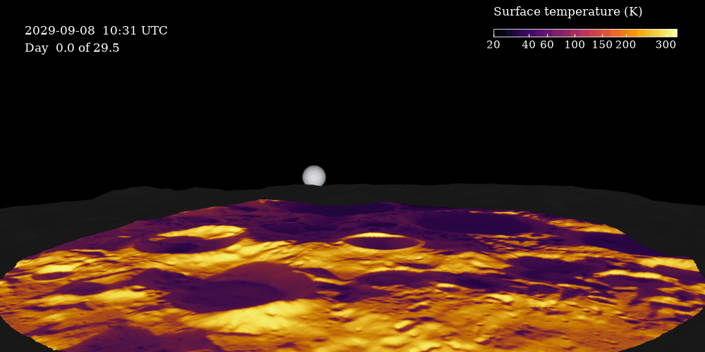
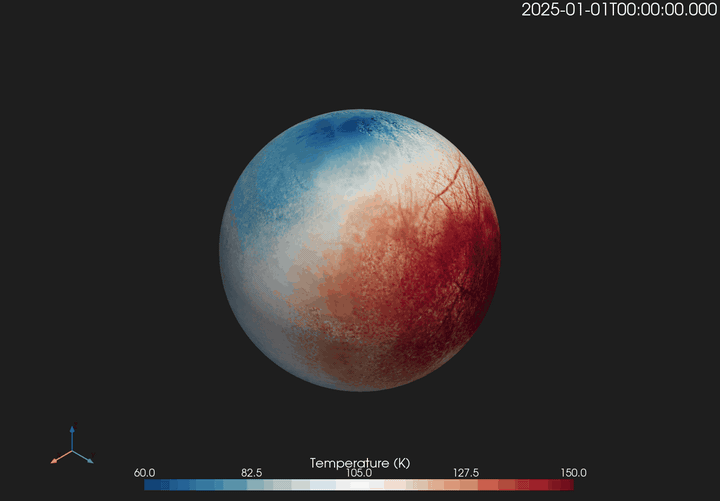
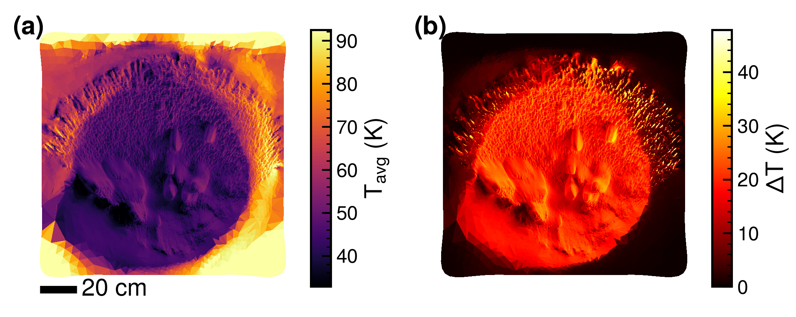

# PTM3D: Planetary Thermophysical Model 3D

[](LICENSE)

PTM3D computes surface and subsurface temperatures of airless bodies on 3D terrain.
It couples ray-traced illumination (Intel Embree, NASA SPICE geometry), a 1D heat-conduction
column under every mesh face, and face-to-face exchange of scattered sunlight and thermal
infrared. The model runs on CPUs, and an OpenCL GPU is optional.



*Surface temperature of 433 Eros over one rotation (5.27 h) at a heliocentric distance of 1.76 AU, computed on the shape model of Gaskell (2021; NASA Planetary Data System, [doi:10.26033/d0gq-9427](https://doi.org/10.26033/d0gq-9427)) with a thermal inertia of 150 J m⁻² K⁻¹ s⁻¹ᐟ². Panels (b) and (c) show the surface temperature and the subsurface temperature profile at a site at 36° N, 273° E, which is shadowed by the surrounding terrain after sunrise and before sunset. Temperatures in panel (a) are interpolated to the mesh vertices for display.*



*Surface temperature of the lunar south polar region (poleward of 87° S) over one solar day in southern summer, computed with radiation exchange between surfaces on a mesh derived from LOLA topography (Smith et al., 2010; NASA Planetary Data System, [doi:10.1029/2010GL043751](https://doi.org/10.1029/2010GL043751)). The view is across the pole toward the Earth, which is drawn at its true position, angular size and phase. The terrain is lit from the direction of the Sun, and temperatures are interpolated to the mesh vertices for display. Terrain shown in gray is not simulated.*

<table>
<tr>
<td width="60%">



</td>
<td width="40%">

*Global Europa surface temperatures over one Europan day (3.55 Earth days),
computed with SPICE geometry, per-face albedo, and Jupiter's reflected light
and thermal emission included.*

</td>
</tr>
</table>



*Moon3D testbed crater scan (509,337 faces, mean facet edge about 2.5 mm, domain 1.33 m on a side) placed at the IM-2 landing
site (84.79°S), seen from directly above (east to the right, north up; the scale bar applies to both panels):
(a) time-averaged surface temperature over one synodic month with
face-to-face radiation exchange; (b) the warming that radiation exchange adds relative to an
otherwise identical run without it. (Same data as Fig. 12 of Hayne et al., JGR Planets, in revision, which shows an oblique view.)*

## Obtaining the code

Clone the repository with git and change into the new directory.

```bash
git clone https://github.com/phayne/ptm3d.git      # with an SSH key: git@github.com:phayne/ptm3d.git
cd ptm3d
```

The clone is about 50 MB. All later commands are run from this top-level `ptm3d` directory,
the repository root. If the repository is not public, sign in to GitHub with an account that
has been given access. `git clone` then asks for a personal access token in place of a
password, or uses your credential helper or SSH key. Without git, download the source archive
from the repository page (**Code**, then **Download ZIP**). It unpacks into a directory named
`ptm3d-main`, which is then the repository root.
[INSTALL.md](INSTALL.md#1-obtaining-the-code) describes both routes, updating the code, and
how to install git.

## Install

The commands below build the CPU version on macOS or Linux. On Windows, use WSL2 and follow the
Linux steps. [INSTALL.md](INSTALL.md) gives the full procedure, including the NAIF CSPICE
toolkit, which must be downloaded separately because no package manager provides it.

```bash
brew install cmake embree eigen cfitsio yaml-cpp libomp pkg-config        # or the apt line in INSTALL.md
export CSPICE_ROOT=/path/to/cspice                                         # NAIF CSPICE, see INSTALL.md
cmake -S . -B build -DCMAKE_BUILD_TYPE=Release -DPTM_ENABLE_GPU=OFF -DPTM_ARCH_NATIVE=OFF \
      -DCSPICE_ROOT="$CSPICE_ROOT"
cmake --build build --target ptm_thermal_sim -j
```

## First run

Run these commands from the repository root.

```bash
python3 scripts/fetch_kernels.py --bodies moon                  # SPICE kernels, about 44 MB
./build/bin/ptm_thermal_sim --config examples/quickstart_moon_diurnal.yaml
```

This example simulates one lunation on a global Moon of 1,280 faces, after a spin-up of 80
diurnal cycles. It takes about 10 seconds on four cores. The per-face results are written to
`output/quickstart_moon_diurnal/statistics/`, and the warmest face reaches 385.0 K at equatorial
noon. The [first tutorial](docs/tutorials/01_quickstart.md) reads these files and explains each
line of the run log.

## Documentation

The pages are listed in the order we recommend reading them.

| Page | Contents |
|---|---|
| [INSTALL.md](INSTALL.md) | Obtaining the code, dependencies, build options, SPICE kernels, science data, verification |
| [docs/tutorials/](docs/tutorials/README.md) | Quickstart, crater radiation exchange, output files, GUI, and four Jupyter notebooks (Moon, Europa, asteroids) |
| [docs/USER_GUIDE.md](docs/USER_GUIDE.md) | Command line, output formats, Python package |
| [docs/configuration.md](docs/configuration.md) | Every configuration key and its default |
| [docs/KNOWN_LIMITATIONS.md](docs/KNOWN_LIMITATIONS.md) | Processes and cases the model does not treat, to be read before a long simulation |
| [docs/VALIDATION.md](docs/VALIDATION.md) | Comparisons with analytic solutions, Diviner and Apollo data |
| [docs/thermal-model.md](docs/thermal-model.md), [docs/illumination-model.md](docs/illumination-model.md), [docs/radiation-exchange.md](docs/radiation-exchange.md) | Physics and numerics of each stage |
| [docs/ENVIRONMENT.md](docs/ENVIRONMENT.md) | Environment variables, including the opt-in fine-mesh illumination settings |
| [data/README.md](data/README.md) | Science datasets, provenance and licenses |
| [gui/README.md](gui/README.md) | The desktop GUI |
| [CHANGELOG.md](CHANGELOG.md) | Changes between releases |

## Capabilities

PTM3D has built-in properties for the Moon, Mercury and Europa, and handles any other body
through orbital elements, SPICE kernels or JPL Horizons. Illumination is ray traced, with a
finite solar disk, eclipses, and reflected light and thermal emission from a primary body
(Earthshine, Jupiter-shine). Heat conduction is solved in Crank-Nicolson columns with
temperature-dependent conductivity and heat capacity and depth-dependent density. Radiation
exchange uses face-to-face view factors (sparse or hierarchically compressed) and two-band
(visible and infrared) radiosity coupled to the thermal solution, with optional sub-facet
roughness (beaming). The products are per-face temperature and flux statistics, per-step
frames, subsurface depth maps and the ice-stability depth. A Python package and a desktop GUI
read these files.

## Validation summary

Details and figures are in [docs/VALIDATION.md](docs/VALIDATION.md).

- For the bowl-shaped crater of Ingersoll et al. (1992), the temperature of the shadowed floor
  is within 0.1 K (≤0.26%) of the analytic solution and the flux in shadow is within 1.2%, on
  a mesh of 15,840 faces.
- For the Diviner equatorial diurnal cycle and the Apollo 15/17 heat-flow probes, every
  reference point that carries an uncertainty lies within its ±5 K bar (largest residual
  4.91 K). The reference values come from the Hayne et al. (2017) compilation, which shares an
  author with PTM3D.
- For Diviner seasonal temperatures at a Haworth cold-trap site (240 m cells), the median bias
  in summer maximum temperature on the cold-trap floor (n = 2,970) is −0.80 K (IQR 11.19 K)
  with sub-facet roughness, and −10.30 K (IQR 10.38 K) without it.

## Citation

Please cite the software ([CITATION.cff](CITATION.cff)) and the supporting datasets on Zenodo:
concept DOI [10.5281/zenodo.21693403](https://doi.org/10.5281/zenodo.21693403) (CC-BY-4.0).
The thermal and radiation methods follow Hayne et al. (2017, [10.1002/2017JE005387](https://doi.org/10.1002/2017JE005387)),
Hayne & Aharonson (2015, [10.1002/2015JE004887](https://doi.org/10.1002/2015JE004887)) and
Paige et al. (2010, [10.1126/science.1187726](https://doi.org/10.1126/science.1187726)).
The hierarchical (H-matrix) view factors follow Potter et al. (2023, [10.1016/j.jcpx.2023.100130](https://doi.org/10.1016/j.jcpx.2023.100130)).

## License and support

PTM3D is distributed under the MIT license ([LICENSE](LICENSE)). Questions and bug reports can
be posted on the repository's Issues tab. For a build or run problem, include your OS and
compiler, the CMake configure summary, and the first 40 lines of the run log. The contact is
Paul Hayne (paul.hayne@colorado.edu).

We thank Sam Potter for the H-matrix algorithms ([fluxpy](https://github.com/sampotter/fluxpy)),
NASA NAIF for SPICE, Intel for Embree, and the LRO Diviner team. We also acknowledge NASA
Lunar-VISE, Europa Clipper, PSIE and the Moon3D project.
