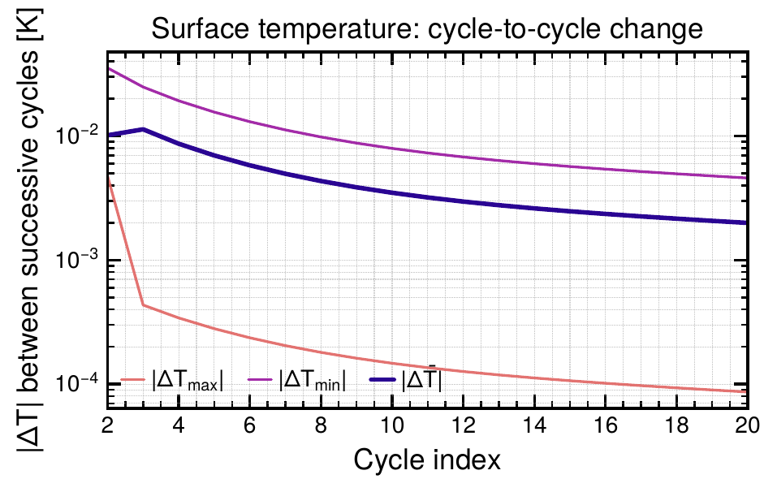
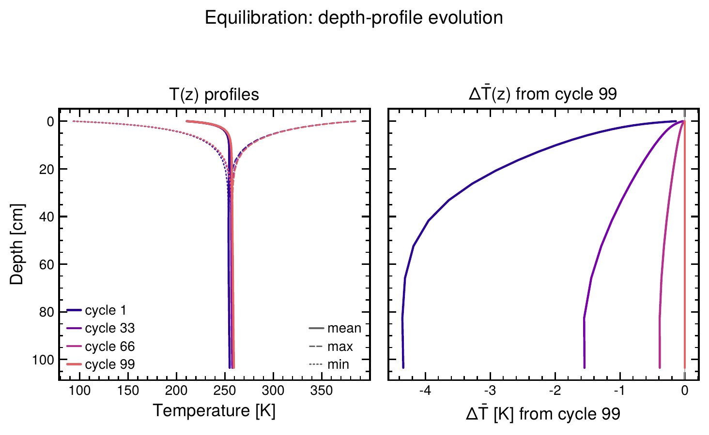
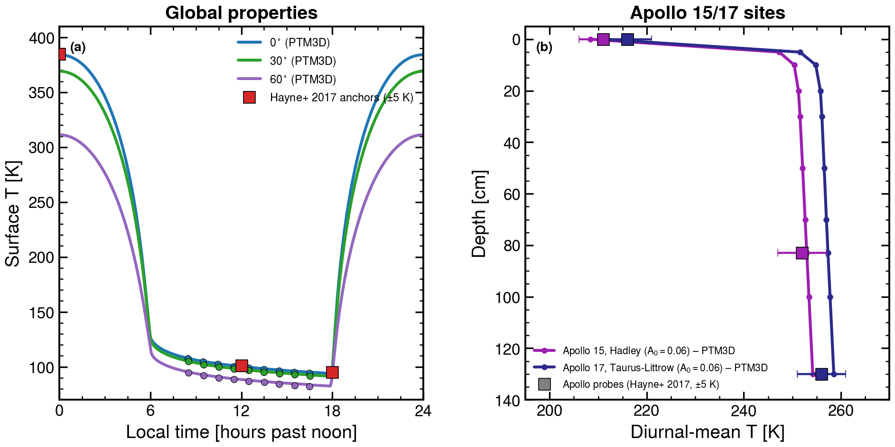
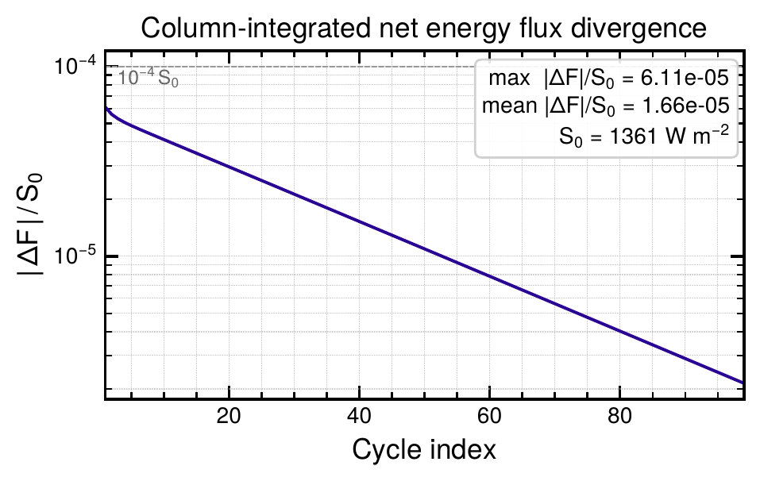
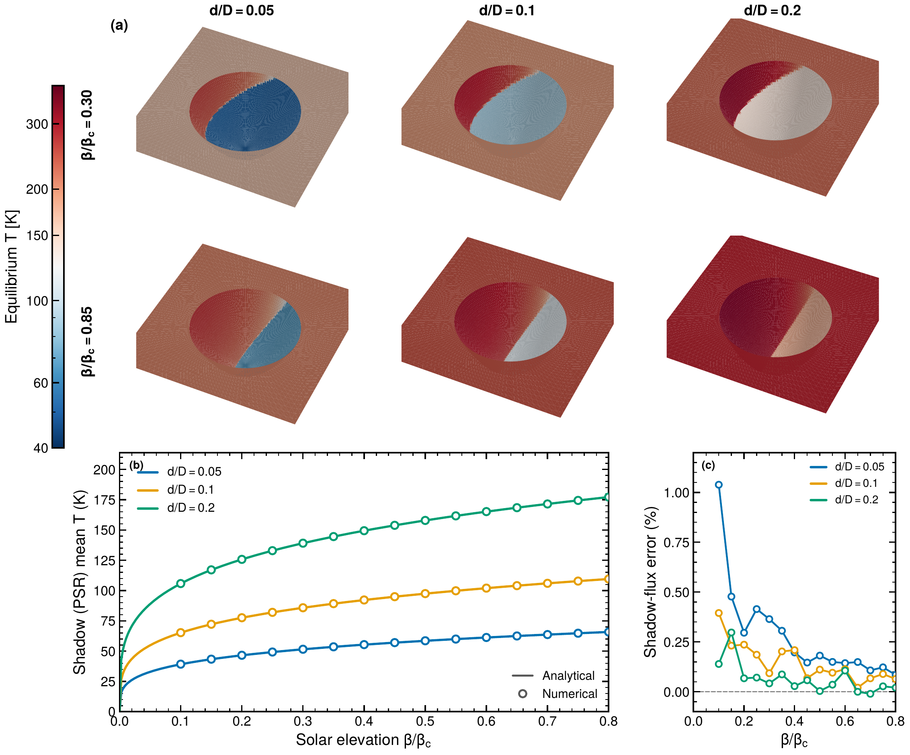
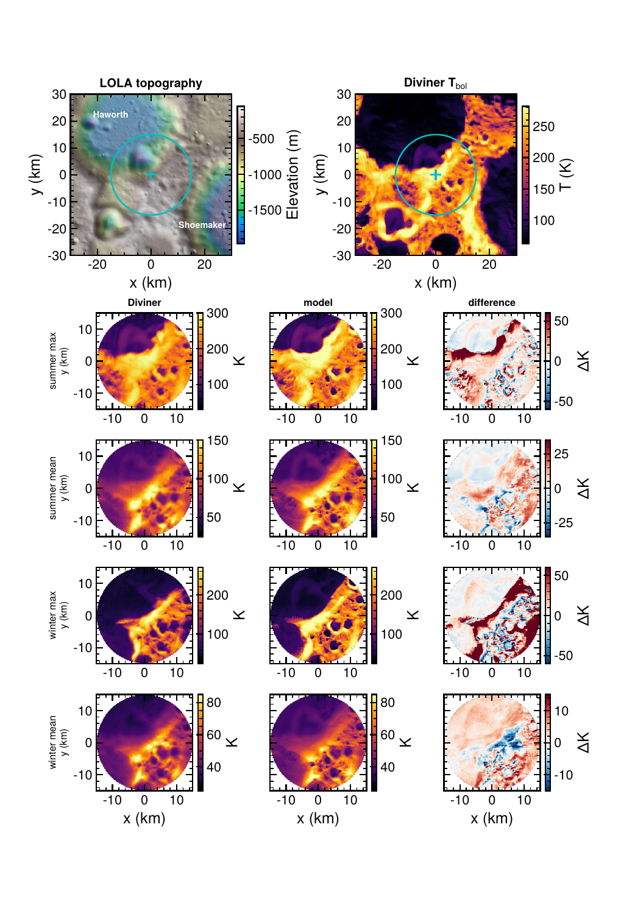
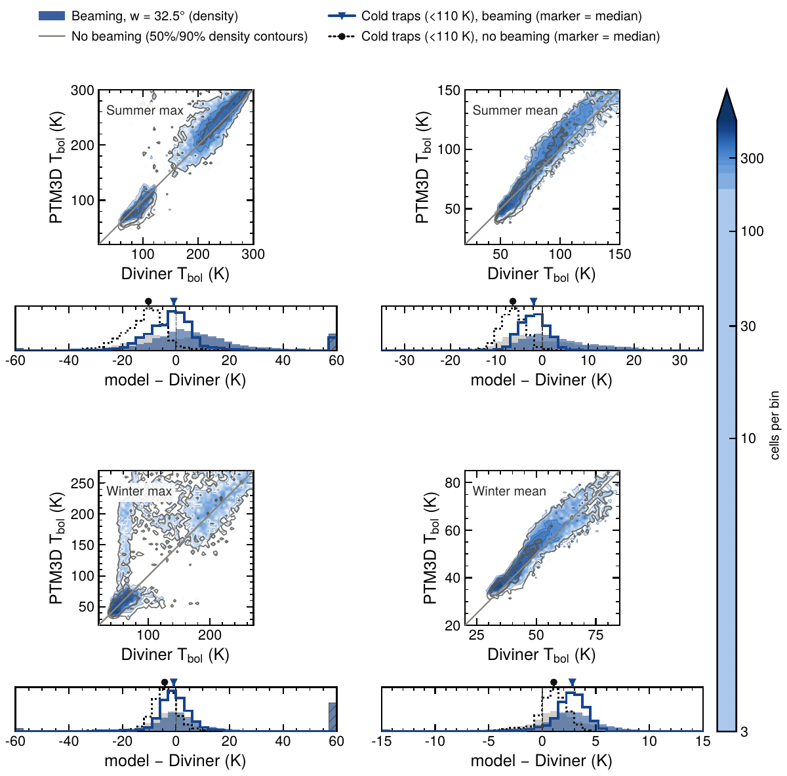

# Validation

This page reproduces the validation figures of the Moon3D paper (Hayne et al., JGR Planets,
revised version), with captions adapted from the paper. The figure numbers are those of the
paper, and the numbers quoted here are taken from it.

The Diviner comparison (Figs. 8 and 9) and the polar results of the paper were computed with
this release of the model, using the CPU solver and the optional fine-mesh illumination
settings described in [ENVIRONMENT.md](ENVIRONMENT.md). Figures 3 to 7 were computed with
previous releases of the same model.

## Manuscript Fig. 3: diurnal-cycle convergence

Change in the maximum, minimum and mean equatorial surface temperature from each spin-up cycle
to the next. Surface temperatures converge to |ΔT| ≲ 0.01 K after two cycles.

## Manuscript Fig. 4: subsurface equilibration

Equatorial temperature profiles over successive spin-up cycles. The deepest layers approach
their converged value exponentially and are within 2 K of it after about 30 cycles.

## Manuscript Fig. 5: diurnal cycle and subsurface temperatures vs. Diviner and Apollo

**(a)** Modeled surface temperature at the equator, 30°N and 60°N over one lunation (global
resolution-6 icosphere, Hayne et al. 2017 Table 1 properties, Bond albedo 0.12) against Diviner
nighttime brightness temperatures and the Hayne et al. (2017) noon, midnight and minimum
reference points. **(b)** Diurnal-mean subsurface temperature at the Apollo 15 (26.13°N) and
Apollo 17 (20.19°N) latitudes, each with a site Bond albedo of 0.06, against the heat-flow-probe
measurements (Langseth et al. 1976).

All reference points that carry an uncertainty lie inside their ±5 K bars. In (a) the largest
residual at the three Hayne et al. (2017) reference points is 1.05 K. The 27 Diviner nighttime
points, which carry no error bars, differ from the model by at most 1.61 K (RMS 0.75 K). In (b)
the largest residual is 4.91 K (Apollo 17 surface). The reference points were digitized from
the Hayne et al. (2017) compilation, which shares an author with PTM3D. The deep Apollo 17
point is compared at the probe depth of 130 cm, although the compilation plots it at 13 cm.

## Manuscript Fig. 6: energy conservation

Column-integrated net flux divergence relative to the solar constant. The energy residual is
below 0.01% of the absorbed flux per diurnal cycle after one cycle and about one part in a
million after 100 cycles (max |ΔF|/S₀ = 6.11×10⁻⁵, mean 1.66×10⁻⁵ over a 100-cycle run).

## Manuscript Fig. 7: Ingersoll bowl-crater test

Radiative-equilibrium temperatures in a spherical-cap crater (15,840 faces; d/D = 0.05, 0.10,
0.20; Bond albedo 0.12, emissivity 0.95) computed with the view-factor module used in
simulations, against the analytic solution of Ingersoll, Svitek & Murray (1992). **(a)** Renders at two solar
elevations. **(b)** Mean temperature of the permanently shadowed interior against solar
elevation. **(c)** Error of the shadow flux. The temperature of the shadowed interior agrees
with the analytic solution within 0.1 K (≤0.26%) and the shadow flux within 1.2%.

The short test `build/bin/test_bowl_crater`, which is run during installation and in continuous
integration, is a different and smaller test. It compares the analytic centroid view factors of
a 1,404-face crater with the closed form (0.49%) and checks reciprocity. It does not use the
view-factor module of the simulations, which Fig. 7 tests through `bowl_crater_ptm`.

## Manuscript Fig. 8: Diviner seasonal comparison, maps

Seasonal comparison of Diviner and modeled bolometric temperatures at the Haworth SE-rim site
(88.18°S, 6.04°E), over a ±15 km window at the 240 m native resolution of the Diviner seasonal
product (Williams et al. 2019). The model includes beaming by sub-facet roughness. The top row
shows the LOLA topography and the Diviner summer-maximum map, with the comparison window
marked. The rows below show summer maximum, summer mean, winter maximum and winter mean. The
columns show Diviner, the model reduced to the same seasonal statistic, and their difference
(model minus Diviner). The simulation uses the Monte Carlo view factors, a site-centered mesh graded to 50 km with an occluder
ring to 200 km, and one output step per day over a full year.

## Manuscript Fig. 9: Diviner seasonal comparison, per-cell scatter

Modeled versus Diviner bolometric temperature for every valid 240 m cell of Fig. 8, for the
four seasonal statistics, with roughness beaming (colored density) and without it (gray
contours). Radiation exchange is included in both.

The cells are divided by Diviner's annual maximum temperature into cold traps (below 110 K,
n = 2,970 cells), the margin of the shadow boundary (110 to 200 K, n = 2,251) and sunlit
terrain (200 K and above, n = 7,044). For each group we report the median and interquartile
range (IQR) of model minus Diviner. On the cold-trap floor the median bias in summer maximum
temperature is −0.80 K (IQR 11.19 K) with roughness beaming and −10.30 K (IQR 10.38 K) without
it. With beaming, the medians for summer mean, winter maximum and winter mean are −1.88, −0.85
and +2.81 K. Radiation exchange accounts for nearly all of the warmth of the floor. On the
cold-trap floor, the per-cell median difference in summer maximum between the simulation
without beaming and one without radiation exchange is +40.5 K.

Three effects limit the comparison. The daily output cadence underestimates instantaneous
maxima by about 1.6 K. The view-factor estimate rejects nearly coplanar pairs of faces, which
removes a few tenths of a kelvin of exchange between neighbors on the deepest floor cells.
Diviner bolometric temperatures are uncertain by several kelvin at the lowest cold-trap
temperatures.
