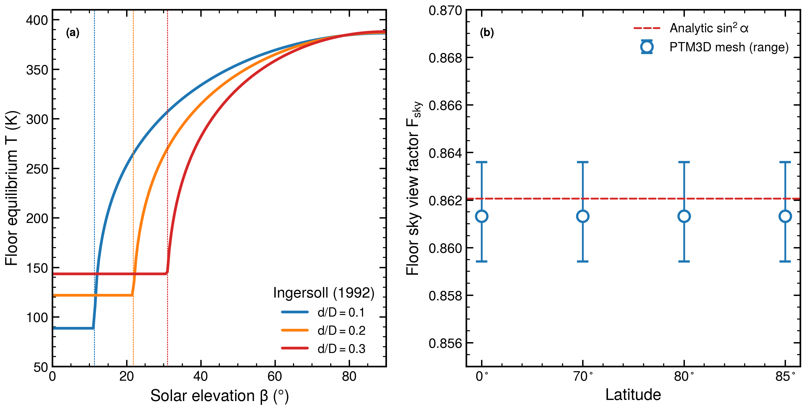

# Radiation Exchange Module

This document describes how PTM3D models the exchange of radiation between mesh faces. It covers
the construction of the view factors, the solution of the band-separated radiosity system, and
the coupling of the resulting indirect flux to the one-dimensional thermal solver at each surface
element. The configuration keys, defaults and thresholds quoted here are those the model uses.

## 1. Physical context

On airless bodies, faces in complex topography exchange thermal infrared radiation and scatter
incident sunlight toward one another. In permanently shadowed regions such as polar craters this
indirect radiation is often the dominant heat source and controls cold-trap temperatures and
volatile stability. The module captures it by solving for multi-bounce radiative transfer among
all mutually visible faces.

The module takes its inputs from the illumination model, which supplies the direct solar flux
$Q_{\text{solar}}$, the primary-body reflected flux $Q_{\text{refl}}$ and the primary-body thermal
IR flux $Q_{\text{IR}}$. It exchanges surface temperatures and absorbed indirect flux with the 1D
conduction solver, where the indirect flux is added to the surface boundary condition.

## 2. Surface energy balance

At the surface ($z = 0$) of face $i$ the thermal model solves

$$Q_{s,i} + k_0 \frac{T_1 - T_0}{\Delta z_0} = \varepsilon_i \sigma T_0^4$$

where $T_0$ is the surface temperature, $T_1$ the first subsurface node temperature, $k_0$ the
surface conductivity, $\Delta z_0$ the first layer thickness, $\varepsilon_i$ the broadband IR
emissivity and $\sigma = 5.670374419 \times 10^{-8}$ W m<sup>-2</sup> K<sup>-4</sup>. The surface
temperature is found by Newton-Raphson iteration on

$$f(T_0) = Q_{s,i} + k_0 \frac{T_1 - T_0}{\Delta z_0} - \varepsilon_i \sigma T_0^4 = 0$$

with derivative $f'(T_0) = -k_0/\Delta z_0 - 4\varepsilon_i \sigma T_0^3$.

The absorbed surface flux combines four components:

$$Q_{s,i}(t) = \bigl[Q_{\text{solar},i}(t) + Q_{\text{refl},i}(t)\bigr](1 - \alpha_i) + Q_{\text{IR},i}(t)\varepsilon_i + Q_{\text{indirect},i}(t)$$

- $Q_{\text{solar},i}(t)$: direct solar flux (W m<sup>-2</sup>), from SPICE ephemerides with
  finite solar-disk integration, Embree shadow ray tracing and eclipse geometry.
- $Q_{\text{refl},i}(t)$: solar flux reflected from the primary body (Earthshine, Jupiter-shine),
  from phase angle and a Lambertian sphere model.
- $Q_{\text{IR},i}(t)$: thermal IR from the primary body, scaled by the solid-angle factor
  $(R_p/d)^2$ and the primary's effective temperature.
- $\alpha_i$: visible-wavelength albedo. Optionally incidence-angle dependent, by either the
  Hayne et al. (2017) polynomial $\alpha(\theta) = \alpha_0 + a(\theta/(\pi/4))^3 + b(\theta/(\pi/2))^8$
  or the analytic Hapke directional-hemispheric form, selected in the `thermophysical:` block.
- $\varepsilon_i$: broadband IR emissivity (equal to absorptivity by Kirchhoff's law).
- $Q_{\text{indirect},i}(t)$: absorbed indirect flux from this module, already weighted by the
  appropriate absorptivity in each band.

## 3. Band-separated radiosity

PTM3D solves the radiosity system in two spectral bands by default
(`radiation.band_separated: true`): a visible band that scatters sunlight with the Bond albedo
$A_i$, and a thermal-IR band that scatters with $\rho_i = 1 - \varepsilon_i$. The two bands share
the same view-factor operator and the same iterative kernel, and their absorbed fluxes are summed.

**Visible band.** Sunlight scattered between faces. There is no emission source and the system is
temperature-independent:

$$(I - A F)\mathbf{B}_{\text{vis}} = A\mathbf{Q}_{\text{solar}}, \qquad Q^{\text{vis}}_{\text{ind},i} = (1 - A_i)\sum_j F_{ij} B_{\text{vis},j}$$

**Thermal-IR band.** Self-emission and its multiple reflections:

$$(I - \rho F)\mathbf{B}_{\text{ir}} = \mathbf{E}, \qquad E_i = \varepsilon_i \sigma T_i^4, \qquad Q^{\text{ir}}_{\text{ind},i} = \varepsilon_i \sum_j F_{ij} B_{\text{ir},j}$$

**Total.** The surface boundary condition receives

$$Q_{\text{indirect},i} = Q^{\text{vis}}_{\text{ind},i} + Q^{\text{ir}}_{\text{ind},i}$$

The direct term $(1 - A_i)Q_{\text{solar},i}$ remains in the surface boundary condition of the
thermal solver (§2), so it is not counted twice.

Here $A$ and $\rho$ denote diagonal matrices of the per-face visible albedo and IR reflectivity.
Band separation requires a per-face Bond albedo. If none has been supplied, the model issues a
warning and uses the gray solution described below.

**First-bounce source albedo.** The first scattering event acts on the collimated direct beam.
The visible source term therefore uses the direct-beam albedo applied in the surface boundary
condition, which is the incidence-angle-dependent value when one is configured. The operator and
the absorptivity $1 - A_i$ keep the diffuse Bond value.

**Gray solution.** Setting `radiation.band_separated: false` recovers the single-band gray system

$$(I - \rho F)\mathbf{B} = \mathbf{E} + \rho\mathbf{Q}_{\text{solar}}, \qquad Q_{\text{indirect},i} = \varepsilon_i \sum_j F_{ij} B_j$$

in which sunlight scatters with the thermal reflectivity $1 - \varepsilon$ rather than the Bond
albedo. The two formulations agree exactly when $A = 1 - \varepsilon$.

## 4. View factors

### 4.1 Definition

The view factor $F_{ij}$ is the fraction of radiation leaving face $i$ that is intercepted by
face $j$:

$$F_{ij} = \frac{1}{A_i} \int_{A_i} \int_{A_j} \frac{\cos\theta_i \cos\theta_j}{\pi r^2} V_{ij} \thinspace dA_j \thinspace dA_i$$

where $\theta_i$ and $\theta_j$ are the angles between the two surface normals and the line
joining the area elements, $r$ is their separation and $V_{ij} \in \lbrace 0, 1\rbrace$ is the
binary visibility function. View factors satisfy reciprocity $A_i F_{ij} = A_j F_{ji}$ and the
sum rule $\sum_j F_{ij} + F_{\text{sky},i} = 1$, where $F_{\text{sky},i}$ is the fraction of the
hemisphere open to space.

### 4.2 Construction methods

Two methods of construction are available. The default is a deterministic pairwise builder. A
Monte Carlo ray-gather builder is selected with `radiation.use_monte_carlo_vf: true`.

**Pairwise builder.** Each retained face pair is evaluated by one of two estimators, chosen by
the near-field criterion given below. The tables in this section also quote the dimensionless
separation $N_s = r/\sqrt{A_{\text{eff}}}$ with $A_{\text{eff}} = \sqrt{A_i A_j}$.

*M1, centroid approximation* (far field) evaluates the integrand at the face centroids:

$$F_{ij} \approx \frac{A_j}{\pi} \frac{\cos\theta_i \cos\theta_j}{r^2}$$

with $`\cos\theta_i = \hat{n}_i \cdot \hat{r}_{ij}`$ and $`\cos\theta_j = -\hat{n}_j \cdot \hat{r}_{ij}`$,
$\hat{r}_{ij}$ the unit vector from centroid $i$ to centroid $j$. A single Embree ray verifies
visibility. This follows the M1 formulation of Rezac & Zhao (2020).

*M2, symmetric double-area quadrature* (near field) samples both faces at the
centroids of $m \times m$ equal-area sub-triangles, $m$ = `nearfield_quadrature_order` (default 3,
so $m^2 = 9$ points per face and $m^4 = 81$ kernel evaluations per unordered pair):

$$A_i F_{ij} \approx \frac{A_i A_j}{\pi m^4} \sum_{p=1}^{m^2} \sum_{q=1}^{m^2} \frac{\cos\theta_{i,p} \cos\theta_{j,q}}{r_{pq}^2}$$

The sample points form an open quadrature in which no point lies on an edge or a vertex, so a
pair of faces that share an edge never evaluates the integrable $1/r^2$ singularity at $r = 0$.
The double sum is a single quantity for both directions and is accumulated in the same order for
both, so reciprocity $A_i F_{ij} = A_j F_{ji}$ holds exactly in floating-point arithmetic rather
than only in the refinement limit.

Grazing sample pairs are rejected by the same $10^{-6}$ cosine cut as M1 and contribute zero.
The sum is divided by the total $m^4$ pair count, not by the number of pairs that pass the cut.
Dividing by the smaller number would condition the estimate on detection and inflate the near
field.

`nearfield_quadrature_order` counts sub-triangles per edge. The key `subdivision_level` found in
older configuration files counted lattice refinements and is not recognized. The two numbers are
not interchangeable.

**Near-field criterion.** Both builders treat a pair as near field when

$$ r < w \thinspace \left( \sqrt{A_i} + \sqrt{A_j} \right) $$

with $w$ = `nearfield_window_factor` (default 4) and $r$ the centroid separation. The key
`method` can be set to `CENTROID` or `SUBDIVISION` to fix the estimator for all pairs.

The appropriate length scale is the sum of the two face sizes, because the error of the centroid
approximation is set by the larger of the two solid angles. A criterion based on the geometric
mean of the areas, such as $N_s = r / (A_i A_j)^{1/4} \le 5$, does not respond to a contrast in
area. The table compares the M1 error under the two criteria, against the same quadrature carried
to convergence ($m = 32$, about $1.05 \times 10^6$ kernel evaluations per pair).

| $A_j / A_i$ | geometric-mean criterion ($N_s = 5$) | sum criterion ($w = 4$) |
|---|---|---|
| 1 | $N_s = 5$, M1 $+3.49$ percent | $N_s = 8$, M1 $+1.38$ percent |
| 100 | $N_s = 5$, M1 $+16.7$ percent | $N_s = 12.6$, M1 $+2.3$ percent |
| 10000 | $N_s = 5$, M1 $+150$ percent | $N_s = 40$, M1 about $+2$ percent |

For a 100:1 contrast in linear size, as in a mesh with a fine core and a coarse surrounding ring,
the geometric-mean criterion assigns to the far-field estimator pairs for which it is in error by
150 percent. The error has one sign, because M1 always overestimates a near pair, so the wider
window reduces terrain coupling. The value $w = 4$ is conservative. M2 converges to M1 in the far
field, so a window that is too wide costs computation time but not accuracy.

The key `adaptive_ns_threshold` is not recognized. The sensitivity to $w$ was evaluated on
`lunar_crater_80N.ply` with `vf_dump_sparse` (12,800 faces, `--max-neighbors 500`, so that the
estimator is the only variable).

| $w$ | nnz | mean $\sum_j F_{ij}$ | total mass | vs $w = 8$ |
|---|---|---|---|---|
| 0 (pure M1) | 904,256 | 0.0047792 | 61.174 | $+1.877$ percent |
| 2.5 (equal to $N_s = 5$ on an equal-area pair) | 904,506 | 0.0046940 | 60.083 | $+0.0138$ percent |
| **4.0 (default)** | 904,385 | 0.0046931 | 60.071 | $+0.0068$ percent |
| 8.0 | 904,357 | 0.0046926 | 60.065 | — |

The build time is 0.3 s at every setting, so the near-field kernel does not control the cost of
the view-factor build on this mesh. In the coupled thermal validation case
`baseline_crater80N_vfbuild_sparse`, changing from the geometric-mean criterion to the sum
criterion alters `temperature_max` on 2,562 of 12,800 faces, with a median change of
$-1.5 \times 10^{-4}$ K and a largest change of $0.019$ K. The change is a cooling, as the sign
of the M1 bias requires.

**Shared kernel and conservation bound.** Both view-factor builders evaluate the M2 integral with
the same kernel (`src/cpp/radiation/nearfield_quadrature.h`). On a closing concave crease the
quadrature diverges. Without a bound it gives $F_{ij} = 4.59$ at a $10°$ dihedral and $16.75$ at
$5°$, where the reference values are $0.84$ and $0.93$. The row-sum renormalization of §4.5 would
absorb this excess by reducing the sky view factor of that face to zero. The kernel therefore
limits each pair to $A_i F_{ij} \le \min(A_i, A_j)$, which is a conservation bound and not a
tuning parameter. Each application of the bound is counted, and a message on standard error
names the builder in which it occurred.

The key `nearfield_quadrature_order` sets the quadrature order in both builders, in different
ways.

| builder | order on a pair |
|---|---|
| sparse (`view_factor.cpp`) | exactly `nearfield_quadrature_order` |
| H-matrix (`hmatrix_view_factor.cpp`) | `nearfield_quadrature_order` raised to $\lceil w d/r \rceil$ where that is larger, capped at 16, with $d = \sqrt{A_i} + \sqrt{A_j}$ and $w$ = `nearfield_window_factor` |

The configured value is therefore the quadrature order in the sparse builder and a lower limit in
the H-matrix builder. Raising it refines both, and the H-matrix builder is never coarser than the
sparse builder on the same pair. A fixed order in the H-matrix builder is less accurate, as shown
by a comparison against a Richardson $m = 8/16$ double-area reference on `lunar_crater_80N.ply`
(60 faces, 10,319 near pairs).

| H-matrix quadrature order | mass-weighted error | worst pair | kernel evaluations/pair |
|---|---|---|---|
| adaptive only | $+0.734$ percent | $-8.33$ percent | 142 |
| fixed $m = 3$ | $+2.899$ percent | $+31.75$ percent | 81 |
| $\max(3, \text{adaptive})$, the default | $+0.729$ percent | $+7.10$ percent | 191 |

The two builders share the near-field criterion but differ in their grazing-angle culls and in
neighbor selection. Case `[H4]` of `test_vf_production` bounds the resulting difference.

**Monte Carlo ray-gather builder.** For each source face, `mc_rays_per_face` cosine-weighted rays
are cast over the hemisphere and the first face struck by each ray is counted, giving
$`F_{ij} \approx \text{hits}_j/N`$. The result is a sparse CSR matrix with row sums $\le 1$ by
construction, and the radiosity solver uses it without modification. This builder is intended for
meshes beyond the practical H-matrix build limit of several million faces, where the memory of
the H-matrix build and the adaptive-neighbor cap both become limiting. The default 100,000 rays
per face gives roughly 10% relative error on $`F_{ij} \sim 10^{-3}`$.

### 4.3 Visibility testing

Visibility between face pairs is tested by ray tracing with Intel Embree. An M1 pair is tested
with a single ray between the centroids. An M2 near pair is also tested with a single
centroid-to-centroid ray. The quadrature points do not carry their own visibility, so a partially
occluded near pair is treated as either fully visible or fully occluded. The ray is traced in
canonical $\min(i,j)$ order so that the result cannot depend on the direction of the query.
During H-matrix construction the rays are traced in SIMD packets, 16 wide with AVX-512
(`rtcIntersect16`) or 8 wide with AVX2 (`rtcIntersect8`), selected at run time according to the
processor.

Pairs that face away from each other, or that are within numerical noise of grazing
($\cos\theta_i < 10^{-6}$ or $\cos\theta_j < 10^{-6}$), are rejected before any ray is traced.
Ray origins are lifted off the source face by $\max(0.001 r, 0.5\ \text{m})$, capped at $0.1 r$,
with a matching margin at the far end. Pairs closer than the resulting minimum are treated as
mutually visible without a trace. On sub-meter meshes these metric offsets are coarse relative to
the facets (see [KNOWN_LIMITATIONS.md](KNOWN_LIMITATIONS.md)).

### 4.4 Neighbor selection

Computing all $N^2$ pairs is prohibitive, so a subset of partners is selected for each face.

**Adaptive selection** (default, `adaptive_neighbors: true`). For each face $i$:

1. Collect candidates within $R_{\text{search}} = f_R \sqrt{A_i}$ (`search_radius_factor`,
   default 10) using a spatial grid.
2. Score each candidate by its radiative potential
   $\hat{F}_{ij} \propto A_j |\cos\theta_i||\cos\theta_j| / r^2$.
3. Take candidates in descending order until `captured_energy_target` (default 0.95) of the total
   potential is captured.
4. Enforce `min_neighbors` (default 20) and `max_neighbors` (default 500).
5. Track the total memory so that the matrix stays within the memory budget.

**Fixed selection** takes the top `max_neighbors` candidates by potential.

A conservative cluster-level cull (`use_cluster_cull`, default on) removes candidate clusters
whose average normal is strongly back-facing before the per-face ranking.

### 4.5 Row-sum renormalization

The M1 point estimator overestimates in the near field, so on fine or strongly concave meshes
some rows sum to more than 1. The radiosity gain then exceeds unity and the iteration diverges.
The solver therefore computes the row sums once with a single $F\mathbf{1}$ product and stores

$$w_i = \frac{1}{\max(1, \sum_j F_{ij})}$$

applying $w_i$ after every $F\mathbf{x}$ product. Rows already summing to $`\le 1`$ are untouched.
The number of renormalized rows, the maximum row sum and the mean row sum are reported when the
radiation module starts. Setting `PTM_DUMP_VF_ROWSUMS` writes the per-face row sums for
inspection.

### 4.6 Sparse storage

The sparse matrix is stored in Compressed Sparse Row form: `values_` (non-zero $F_{ij}$),
`col_indices_` (partner index) and `row_ptrs_` (size $N+1$). Operations are `matvec`
($\mathbf{y} = F\mathbf{x}$), `matvecTranspose`, `get(i,j)`, `getRow(i)` and `rowSums`.

### 4.7 Offline view-factor assembly and symmetrization

For meshes on which the built-in builders are impractical, an offline pipeline builds the matrix
once and the simulation loads it through `PTM_HMATRIX_VF_REPLACE`. The ray tracer
`tools/vf_referee/mc_ref_pp` treats every face in turn as a ray source and writes the raw
per-partner hit fractions. The assembler `tools/vf_referee/assemble_vf.py` then symmetrizes them
into a reciprocal CSR matrix, applies a reciprocity-preserving $\Sigma F \le 1$ congruence, and
writes the v2 header (face count, float64 geometry hash, `indptr`, `nnz`, columns, values).

**Orientation.** The offline ray tracer launches rays from the side of each face that the
thermal model illuminates, using the same orientation convention
(`src/cpp/mesh/face_orientation.h`). It stops with an error on a mesh for which more than 1% of
the faces would have to be reversed, unless it is instructed to expect this. A matrix traced from
the wrong side of the faces contains the view factors of the underside of the surface, although
its reciprocity, row sums and nonzero counts all appear normal. The simulation stops with an
error if the orientation recorded in a loaded matrix differs from its own.

**Near-field rise filter.** The sixth argument of `mc_ref_pp`, `keps` (default 0.2), discards
hits whose rise above the source face is below `keps` times the face edge, in order to reject
the face's own relief. It also discards some real near partners. The matrices for the Moon3D
paper (Hayne et al., in revision) were built with `keps = 0.01`. This setting belongs to the
offline ray tracer and is distinct from `PTM_ILLUM_RISE_KEPS`.

**Symmetrization estimator.** Every undirected pair $\lbrace i,j\rbrace$ is sampled twice, once
from each end. Neither directed estimate is exact. Rays leave the centroid of the source face,
and the rise filter removes some near partners, so the estimate of a small neighbor from a large
face is biased. The default (`--symmetrize-divisor tried`) averages the two with equal weight:

$$S_{ij}^{\text{sym}} = \tfrac{1}{2}\left(\hat{S}_{i\to j} + \hat{S}_{j\to i}\right)$$

With equal weights, the row of a small face adjacent to large faces is biased toward their low
reverse estimates. On the Moon3D mesh this lowered the peak radiative-equilibrium temperature of
cold traps by a median of 2.2 K. The pooled divisor (`--symmetrize-divisor pooled`) weights each
direction by its rays per unit area,

$$G_{ij} = \frac{h_{ij} + h_{ji}}{n_i/A_i + n_j/A_j},$$

which is reciprocal by construction and has lower variance. The crater matrix of the Moon3D paper
used `pooled`. Its Haworth matrix used `tried`, for which the two estimators agree (median ratio
1.0004, 95th percentile 1.011).

For `tried` the divisor is 2, the number of ray directions tried, and a direction that registered
no hit contributes a zero. This is significant because in the far field neither direction
registers hits reliably. Dividing instead by the number of directions that registered a hit
conditions the estimate on detection and inflates it by

$$\frac{\mathbb{E}[S^{\text{asm}}]}{S^{\text{true}}} = 2 - \frac{p_1 + p_2}{2},
\qquad p_k = \Pr(\text{direction } k \text{ registers} \ge 1 \text{ hit})$$

which is 1 where both directions are well sampled and exactly 2 where neither is. The size of
the bias is governed by $\lambda = N_{\text{rays}} F_{ij}$, so it scales with the fineness of the
mesh and not with distance in meters. A matrix assembled with the hit-count divisor carries
far-field entries up to twice their true value and must be re-assembled from its raw sweeps.

**Preconditions for the divisor.** The sweep must cover every face exactly once, and the
assembler must not apply a minimum-hit filter that discards a direction that did register hits.
A missing face halves every pair that touches it, and a duplicated face doubles it. The assembler
checks both conditions. It counts the records per source face and stops with an error on an
incomplete sweep unless `--allow-incomplete-sweep` is given, and it does not accept
`min_hits > 1`.

**Provenance.** Each assembly writes `<out>.csr.provenance.json`, which records the estimator,
the ray budget, the minimum-hit setting, the mesh identity and the sweep coverage. A CSR matrix
without this file was assembled with the hit-count divisor described above.

**Limits of the reciprocity and row-sum checks.** A matrix whose entries are twice too large
satisfies both reciprocity and $\Sigma F \le 1$. In the case examined the reciprocity residual
was $2.7\times10^{-8}$, which is float32 round-off, and the peak row sum was 0.18, far below the
limit. The matrix is symmetrized and then scaled by a symmetric congruence, so it is exactly
reciprocal by construction whatever the scale of its entries. These two properties constrain the
relative values within a row but not their magnitude. The bowl-crater test of §10 does not
exercise the offline pipeline either, because it builds its view factors with the built-in
calculator. The magnitude is tested against closed-form geometry in
`tools/vf_referee/test_vf_assembler_gate.py`, which carries a coaxial parallel disk with
$F = a^2/(a^2+H^2) = 0.250000$ through the whole pipeline and checks that the result is
independent of the ray budget. Run this test after any change to the assembler or the ray tracer.

## 5. H-matrix compression

For large meshes the full sparse matrix becomes expensive to store and to multiply. Following
Potter et al. (2023), the module offers hierarchical-matrix compression
(`radiation.use_hmatrix: true`), in which the storage and the cost of a product grow
asymptotically as $O(N \log N)$ under the usual admissibility conditions. This scaling has not
been benchmarked in PTM3D.

### 5.1 Spatial partitioning

Faces are partitioned recursively with a 3D octree, which is preferred over a 2D quadtree because
crater geometry has significant vertical extent. Each node stores its face indices, a 3D bounding
box and the box diagonal as its diameter. Subdivision stops at `max_tree_depth` (default 10) or
`min_block_size` (default 64 faces).

### 5.2 Admissibility

For each pair of leaf clusters $(X, Y)$, the block is compressible when

$$\max\bigl(\text{diam}(X), \text{diam}(Y)\bigr) \le \eta \cdot \text{dist}(X, Y), \qquad \eta = 0.8$$

with $\text{dist}$ the 3D distance between cluster centers. Inadmissible blocks are subdivided
recursively for up to `max_hierarchical_levels` (default 2) further levels. A cluster-level
visibility cull uses the average normals to skip pairs that cannot see each other.

### 5.3 Block types

- ZeroBlock: clusters cannot see each other.
- LowRankBlock: $F \approx U\Sigma V^T$ with $U$ ($m \times k$) and $V$ ($n \times k$),
  $k \ll \min(m,n)$.
- SparseBlock: CSR storage for small or near-field blocks.
- DenseBlock: full dense storage.
- HierarchicalBlock: recursively subdivided.
- DiskBlock: out-of-core storage for very large meshes.

### 5.4 Low-rank compression

**Adaptive Cross Approximation (ACA)** is the default and is substantially faster than SVD. It
builds the factorization directly by greedy sampling of rows and columns:

1. Start from pivot row $i_0 = 0$.
2. For rank $k = 0, 1, \ldots$: compute row $i$, subtract the current rank-$`k`$ approximation,
   find the pivot column $j$ of maximum residual, stop if
   $|r_{ij}| < \tau_{\text{ACA}}\lVert F\rVert$ or $|r_{ij}| < 10^{-15}$, otherwise compute
   column $j$ and add the rank-1 update.
3. The result costs $O(k(m+n))$ storage.

The parameters are `aca_tolerance` (default $10^{-3}$), `aca_max_rank` (default 50) and
`aca_min_block_size` (default 100). Smaller blocks use SVD.

**SVD** is used for small blocks and for blocks on which ACA fails. The block is formed and
truncated with `Eigen::JacobiSVD`, or with a randomized SVD (oversampling $p = 10$, $q = 2$ power
iterations), at `hmatrix_tolerance` (default $10^{-2}$) keeping at most `hmatrix_max_rank`
(default 50) singular values.

**Subdivision of large admissible blocks.** When ACA on a large admissible block would be too
expensive, or fails, the builder bisects the face-index lists and applies ACA to the compact
sub-clusters instead of setting the block to zero (`hmatrix_subdivide_admissible`, default on, or
the environment variable `PTM_HMATRIX_SUBDIVIDE`). Setting such blocks to zero would remove the
coupling between crater floors and walls on meshes above roughly 100k faces.

### 5.5 Serialization

- `.hmat`: H-matrix, magic `0x484D4154`. It stores the block structure, the low-rank factors and
  the sparse blocks.
- `.vfm`: sparse matrix, magic `0x5646464D`. The CSR arrays are written directly.

`RadiationExchangeManager::loadViewFactors()` recognizes both formats.

### 5.6 Memory-mapped loading

For precomputed H-matrices on very large meshes (default threshold 500k faces) the module can
memory-map the file and load blocks on demand during `matvec` instead of reading the whole file
into memory.

## 6. Radiosity solver

### 6.1 Jacobi iteration

Jacobi iteration is used when the operator is an H-matrix, which has no efficient row access, or
when Gauss-Seidel acceleration is off:

$$\mathbf{B}^{(k+1)} = \mathbf{E} + \rho\mathbf{Q}_{\text{solar}} + \rho\left(w \odot F\mathbf{B}^{(k)}\right)$$

initialized with $\mathbf{B}^{(0)} = \mathbf{E} + \rho\mathbf{Q}_{\text{solar}}$, where $w$ is the
row-sum renormalization of §4.5. Each iteration costs one matrix-vector product, which is
asymptotically $O(N \log N)$ for the H-matrix (not benchmarked here) and $O(\text{nnz})$ for the
sparse matrix.

### 6.2 Gauss-Seidel iteration

Gauss-Seidel iteration is used when the operator is a sparse CSR matrix with row access and
`use_acceleration` is on (the default):

$$B_i^{(k+1)} = E_i + \rho_i Q_{\text{solar},i} + \rho_i \sum_j F_{ij} B_j^{(\ast)}$$

where $B_j^{(\ast)}$ is the most recently updated value (the current sweep for $j < i$, the previous
one for $j > i$). It converges in fewer sweeps than Jacobi because updates propagate within a sweep.

### 6.3 Fused two-band Jacobi

When band separation is active and row access is unavailable, the two bands are advanced together
with a single width-2 matrix-vector product per iteration, which reads the CSR arrays once for
both. Each band keeps its own initialization, update, renormalization, convergence test and sweep
count, and is held fixed once its own residual falls below the tolerance. The per-band sweep
counts of the first solve are written to the log once.

### 6.4 Convergence

Each band stops when

$$\frac{\max_i |B_i^{(k+1)} - B_i^{(k)}|}{\max_i |B_i^{(k+1)}|} < \tau_{\text{solver}}$$

(`convergence_tolerance`, default 0.01) or at `max_iterations` (default 100). The diagnostics
are available through `getLastIterations()`, `getLastResidual()` and `didConverge()`.

The CPU solvers apply this test at every iteration. On the GPU the test requires a transfer from
the device to the host, so it is applied every `convergence_check_interval` iterations and the
solver can stop only at a multiple of that interval. With the default value of `0` the interval
is chosen for each matrix (`gpu::opencl::resolveConvergenceCheckInterval`) by comparing the cost
of one Jacobi traversal, $\approx \text{nnz}/2.05\times10^{10}\thinspace\mathrm{s}$, with the
~3.7 ms of one convergence read. Above ≈7.6e7 stored non-zeros a traversal is the more expensive
of the two and the solver checks every iteration. Below that size it checks every 10 iterations.
Both constants were determined on a Radeon Pro W6800X (509,337-face lunar CSR at 495,163,704 nnz,
and a 12,800-face bowl crater). A positive `convergence_check_interval` sets the interval
directly. See [ENVIRONMENT.md](ENVIRONMENT.md) `PTM_RAD_GPU_CHECK_INTERVAL` for the diagnostic
override.

The absorbed flux is recovered from the converged radiosity by the fixed-point identity
$w \odot F\mathbf{B} = (\mathbf{B} - \mathbf{E} - \text{source})/\rho$, which avoids a second
matrix-vector product. Where the reflectivity approaches zero, the normalized incoming flux of
the last iterate is used instead.

### 6.5 Energy-balance check

After a solution the module can verify global conservation:

$$\text{imbalance} = \left|\sum_i \varepsilon_i \sigma T_i^4 A_i - \sum_i \left(\varepsilon_i Q_{\text{solar},i} + Q_{\text{indirect},i}\right) A_i\right|$$

available as `RadiositySolver::checkEnergyBalance()`.

### 6.6 GPU acceleration (OpenCL)

With `radiation.use_gpu: true` (or `--rad-use-gpu`) the radiosity system is solved on the GPU
through OpenCL. The GPU solver uses a CSR sparse matrix-vector product for $F\mathbf{B}$, parallel
Jacobi iteration with a periodic convergence check, and warm starts from the previous solution in
the gray case. The kernels are `spmv_kernel`, `spmv_vector_kernel`, `spmv_chunk_kernel`,
`spmv_vector_chunk_kernel`, `max_reduction_kernel`, `emission_kernel`, `solar_source_kernel`,
`jacobi_kernel` and `indirect_flux_kernel`. The chunked variants split very large matrices across
multiple dispatches so that the number of stored entries is not limited by a single allocation.

The solutions at different timesteps are independent, so a batch of timesteps can be divided
among several devices (`gpu_devices`, `gpu_device_ids`, `gpu_batch_size`,
`gpu_inter_batch_pause_ms`), in the same way as for the thermal solver.

**Band separation on the GPU** requires a sparse view-factor matrix, and it runs on either a
single device or several. It does not require row sums below 1. The GPU Jacobi kernel applies the
row renormalization of §4.5 on the device, from a per-face buffer uploaded with the matrix, so
the GPU and the CPU iterate the same operator $\rho\thinspace(\hat{\mathbf n}\odot F)$. The
condition that is checked is the one under which Jacobi iteration converges,

$$\text{gain} \thickspace=\thickspace \rho_{\max}\thinspace\max_i \min\Bigl(\textstyle\sum_j F_{ij},\thinspace 1\Bigr) \thickspace<\thickspace 1,$$

which the renormalization already limits to $\rho_{\max}$. It can fail only for a perfect
reflector ($A \geq 1$ or $\varepsilon \leq 0$), for which no solver converges. When the
sparse-matrix requirement or the gain condition is not met, the log reports it and the
band-separated system is solved on the CPU, which has no such restriction. A two-band request is
never replaced by the gray kernel.

**Replacement view-factor matrix on the GPU.** `PTM_HMATRIX_VF_REPLACE` installs the replacement
matrix as the GPU sparse operator when `radiation.use_gpu: true`, and as the CPU operator when it
is false:

```sh
PTM_HMATRIX_VF_REPLACE=/path/to/corrected.csr \
ptm_thermal_sim --config run.yaml     # with radiation.use_gpu: true, use_hmatrix: false
```

The log reports which of the two was used (`[PTM_HMATRIX_VF_REPLACE] ROUTE = GPU (radiation.use_gpu in the
config)`) and then the GPU mode that was engaged. `PTM_HMATRIX_VF_REPLACE_GPU` and
`PTM_HMATRIX_VF_REPLACE_CPU` override the choice in either direction. Setting both stops the run
with an error. The same checks of mesh identity, row sums and non-negativity are applied in both
cases.

**Order of initialization.** The matrix is always installed first as the CPU `SparseVFOperator`,
because the loader runs from the `RadiositySolver` constructor, before the configuration has
been set. At that point `setConfig()` has not been called and `config_.use_gpu` holds its default
of `false`. `initGPU()` is the first point at which the configuration is available, and the
choice between CPU and GPU is made there. It converts the CPU operator to a GPU
`ViewFactorMatrix`, widening the stored `float` values to `double`, and points `F_ptr_` at it for
the upload.

The CPU operator is retained throughout. If no GPU mode can be engaged, because there is no
device or the matrix does not fit in GPU memory, `F_ptr_` and the float64 copy are released and
the solution continues on the CPU operator with the fused width-2 two-band Jacobi iteration. The
same release follows a successful upload, since the device then holds the matrix and the host
copy is not read again. Clearing `F_ptr_` also keeps any later CPU fallback on the fused Jacobi
iteration rather than Gauss-Seidel, because `solveTwoBand` selects Gauss-Seidel when `F_ptr_` is
non-null.

### 6.7 Cost of the GPU radiosity solver

The timings in this section were obtained on four AMD Radeon PRO W6800X Duo GPU dies with two
view-factor matrices from lunar applications. The campaign projection at the end of the section
is derived from them.

**Traversals.** The unit of radiosity cost is the number of times the matrix is read, which is
not the Jacobi iteration count. Every solution also requires one final matrix-vector product to
convert the converged radiosity into absorbed flux. `PTM_RAD_COST_REPORT` counts the dispatches.

| route | lunar polar site A (2.485e9 nnz) | Moon3D testbed mesh, 509k (4.95e8 nnz) |
|---|---|---|
| CPU (fused width-2 Jacobi) | 2.000 traversals/solve | 2.792 |
| GPU, unfused + absolute criterion | 7.000 | 9.927 |
| GPU, fused only | 4.000 | — |
| GPU, relative criterion only | 6.000 | — |
| GPU, fused + relative (current) | **3.500** | **4.375** |

Fusing the two bands and using the relative convergence criterion reduce the GPU's excess of
traversals over the CPU from 3.50x to 1.75x on lunar polar site A and from 3.56x to 1.57x on the
Moon3D testbed mesh. The two changes are close to multiplicative (1.75 x 1.17 = 2.04 against the
2.00 obtained with both).

**Wall-clock time per sweep.** The time of a sweep is taken between the log lines
`--- Radiation Iteration N ---` and `Computing indirect flux ... 100%`, which are written in the
same way in every configuration. The progress bar is not suitable for timing, because with
several GPUs it is written once per sweep. Each variant was timed over four sweeps, and the
quoted spread is the standard deviation.

| variant | site A sweep (s) | g = CPU/variant | Moon3D sweep (s) | g |
|---|---|---|---|---|
| CPU | 134.62 ± 0.88 | 1.000 | 7.11 ± 0.30 | 1.000 |
| GPU N=1, unfused + absolute | 82.23 ± 1.47 | 1.637 | 5.20 ± 0.10 | 1.367 |
| GPU N=1, fused only | 75.34 ± 0.58 | 1.787 | — | — |
| GPU N=1, relative only | 72.10 ± 0.85 | 1.867 | — | — |
| GPU N=1, fused + relative | **66.27 ± 0.14** | **2.032** | **3.53 ± 0.10** | **2.014** |
| GPU N=4 pool, unfused + absolute | 29.53 ± 0.19 | 4.559 | — | — |
| GPU N=4 pool, fused + relative | **26.74 ± 0.57** | **5.034** | — | — |

**Relation between traversals and time.** The reduction in traversals overstates the saving in
time. Traversals fell by 2.00x on the polar site but the sweep time by only 1.24x (1.10x at N=4).
On the Moon3D mesh the two figures are 2.27x and 1.47x. A width-2 traversal does not cost the
same as one single-band traversal. It shares the reads of the CSR values and columns (8 bytes per
stored entry) but doubles the gather from the radiosity vector, the arithmetic and the output
writes. In the fusion-only variant, one fused traversal costs 1.60x a single-band one (time ratio
0.916 against a traversal ratio of 0.571), so fusing two traversals into one saves a factor of
1.09x and not 1.75x. The change of criterion removes whole single-band traversals at unchanged
unit cost, and its saving in time (1.14x) is close to its saving in traversals (1.17x).

The sparse matrix-vector product of the radiosity solver is therefore limited by the gather from
the radiosity vector and not by the reading of the CSR arrays. Halving the matrix reads is worth
far less than halving the traversals, and further optimization should address the gather (column
ordering, blocking) rather than the traversal count.

**Projected effect on a multi-window campaign.** Applying g(N=4) to the timing profile of a
lunar polar site A window (99.19-min CPU window, radiosity 67.4 %, GPU setup cost of +46.3 s per
window at N=4) over 472 windows gives the following projection.

| variant | window (min) | campaign (days) |
|---|---|---|
| GPU N=4, unfused + absolute | 47.8 | 15.7 |
| GPU N=4, fused + relative | 46.4 | **15.2** |
| Amdahl ceiling (radiosity free) | 33.1 | 10.9 |

This recovers about 9 % of the difference from the Amdahl limit. The gain is small because at
N=4 radiosity is already only ~31 % of the window, and because of the gather limitation described
above.

**Agreement between the CPU and GPU solutions.** Compared with the CPU solution of the same run,
the largest temperature difference max\|Δ\| is 0.0066 K on lunar polar site A (weak coupling,
max Σ_j F_ij = 0.2) and 0.271 K on the Moon3D testbed mesh (strong coupling). In both cases 14 of
the 22 statistics products are identical, and the 8 that differ are those derived from the
radiosity. The differences are 92–96 % of one sign on the polar site and 99.6–99.9 % on the
Moon3D mesh. The relative criterion changed the Moon3D difference only slightly (0.279 K to
0.271 K). At these scales the CPU/GPU difference is dominated by the difference between float32
and float64 arithmetic, not by the iteration at which the solver stops. The millikelvin agreement
on the polar site does not carry over to a strongly coupled mesh.

## 7. Thermal-radiation coupling

Surface temperatures depend on indirect flux and indirect flux depends on surface temperatures,
so the two are solved by an outer Picard iteration.

### 7.1 Algorithm

Starting from the temperatures of the initial thermal solve (computed without indirect flux), for
each coupling iteration $k = 1, 2, \ldots, k_{\max}$:

1. **Compute the time-varying indirect flux.** For each timestep, take the current surface
   temperatures and direct solar flux, solve the radiosity system, and store
   $Q_{\text{indirect},i}(t)$.
2. **Select faces for a thermal re-run** (§7.2).
3. **Check convergence** (§7.3).
4. **Re-run the 1D thermal model** on the selected faces over all timesteps with

   $$Q_{s,i}(t) = \bigl[Q_{\text{solar},i}(t) + Q_{\text{refl},i}(t)\bigr](1 - \alpha_i) + Q_{\text{IR},i}(t)\varepsilon_i + Q_{\text{indirect},i}(t)$$

   warm-started from the previous iteration's temperature profile.

   The re-run uses the same integrator as the whole-mesh solution. On the CPU this is the
   SIMD-batch integrator (the default), applied to the batches that contain a selected face.
   With `--no-simd-batch` the re-run uses the scalar integrator. The two must match because the
   flux sampling of the scalar integrator lags by half a substep, so a face re-run with a
   different integrator changes temperature even at zero exchange (0.26 K on a convex asteroid
   with 2.4e-5 W/m² of indirect flux). On the coupled faces of the 80 N crater the mean error
   against a 32x finer time step is 0.08 K, compared with 0.14 K for a scalar re-run.
   `scripts/test_rethermal_zero_exchange.py` tests this property.
5. **Update** the temperatures and return to step 1.

### 7.2 Face selection

Two selection criteria are available through `coupling_select_mode`.

**`physics`** (default) uses a linearized temperature-response predictor:

$$\widehat{\Delta T}_i = \frac{(1-\alpha_i)\Delta F_i}{4\varepsilon\sigma T_{\text{eff},i}^3}, \qquad T_{\text{eff},i} = \max\bigl(\max_t T_i(t), 40\ \text{K}\bigr)$$

with $`\Delta F_i = \max_t Q^{(k)}_{\text{indirect},i}(t) - \max_t Q^{(k-1)}_{\text{indirect},i}(t)`$
for $k > 0$ and $\max_t Q^{(0)}_{\text{indirect},i}(t)$ at $k = 0$. A face is re-run when
$\widehat{\Delta T}_i$ exceeds the selection threshold, or when its temperature change in the
previous re-run still exceeds it. Faces whose temperature has stopped changing and whose flux is
stable are not re-run. Because the response scales as $T^{-3}$, cold shadowed floors and warm
slopes are treated differently without a separate criterion.

**`legacy`** selects on absolute flux. Face $i$ is re-run when
$\max_t Q_{\text{indirect},i}(t) > \tau_Q$ (`coupling_flux_threshold`, default
0.1 W m<sup>-2</sup>).

### 7.3 Coupling modes and window dependence

Every quantity used by the coupling loop to select faces and to stop is a maximum over the
output window. These quantities are
$\max_t Q_{\text{indirect},i}$, $\max_t T_i$, $\max_{i,t}|T^{(k)} - T^{(k-1)}|$, and the count of
faces whose window-maximum change exceeds the tolerance. A shorter window therefore gives every
face a lower score, selects fewer faces, and can stop the iteration earlier, so that the
converged field depends on where the boundaries of a chunked run fall. `coupling_mode` controls
this dependence.

| Mode | Selection threshold | Exit criteria |
|---|---|---|
| `bounded` (default) | absolute `coupling_select_dt` (default 0 K, i.e. every face carrying any indirect flux) | maximum per-face temperature change below `coupling_temp_threshold`, or $k_{\max}$ |
| `fixed` | as `bounded` | always runs $k_{\max}$ iterations |
| `legacy` | `coupling_temp_threshold` × `coupling_select_safety` | as `bounded`, plus a face-fraction exit when fewer than `coupling_face_fraction` of faces are still changing |

`bounded` removes the window dependence from both the selection and the exit. The threshold is
absolute and the face-fraction exit is disabled, so a chunked run agrees with the single-shot
field to within the `float32` rounding of the checkpoint. `fixed` also fixes the iteration count.
This is the only way to make the result strictly independent of the decomposition, at the cost of
running every iteration. `legacy` retains the window dependence and is provided only to reproduce
a run published with it. It can be selected without editing a configuration through
`PTM_COUPLING_MODE`.

Setting `coupling_select_dt` above 0 trades accuracy for speed on very large meshes and
reintroduces the window dependence up to that magnitude per face. A warning is issued when it is
set. A warning is also issued when `coupling_face_fraction` is set outside `legacy`, where it has
no effect.

Convergence in `bounded` and `fixed` is evaluated with
$\Delta T_{\max} = \max_{i,t}|T_i^{(k)}(t) - T_i^{(k-1)}(t)|$, which bounds the residual on every
face. The `legacy` face-fraction criterion has no such bound. It can stop while up to
`coupling_face_fraction` of the mesh is still changing by an arbitrary amount.

### 7.4 The radiation-exchange face set

`RadiositySolver::solve()` returns $Q_{\text{indirect},i}$ for every face, and the classification
of faces does not enter the solution. The exchange set is applied afterwards as a mask that
determines which of the computed values are passed to the thermal step. The indirect flux of
every excluded face is set to exactly 0 W m<sup>-2</sup>.

| Key | Flag | Default | Meaning |
|---|---|---|---|
| `exchange_selection` | `--rad-exchange-selection` | `all` | `all` keeps every face's computed flux; `shadow` keeps only faces in shadow for at least `min_shadow_fraction` of the run |
| `min_shadow_fraction` | `--rad-min-shadow-fraction` | 0.3 | consulted in `shadow` mode only |

`all` is the default and the only setting with a physical justification. The radiosity solution
is a self-consistent global linear solution, so discarding part of it is a loss of information
rather than an approximation. It also adds no cost, because the exchange set does not restrict
the radiosity solution.

`shadow` evaluates the shadow fraction of each face over the illumination series of the run
itself, whose length is $n_{\text{equilibration steps}} + n_{\text{output steps}}$. A
warm-started chunk has no equilibration samples, so the criterion depends on how the run is
divided into chunks. A chunk that falls in local daytime removes faces from radiation exchange
and sets their indirect flux to zero. A two-chunk test cannot detect this, because a
half-lunation window still spans enough night for every face to pass the criterion, so
independence of the decomposition should be verified with three chunks or more. `shadow` is
provided to reproduce a run published with it, and should then be paired with
`coupling_mode: legacy`. A warning gives the number of faces whose flux will be set to zero. The
mode can be selected without editing a configuration through `PTM_EXCHANGE_SELECTION`.

`min_shadow_fraction` has no effect in `all` mode, and a warning is issued when it is set there.

The choice between `all` and `shadow` also changes single-shot results for any window in which
the mask excludes faces (a short warm-started window, or `equilibration_orbits: 0`). The faces
excluded under `shadow` are warmer under `all`, because restoring a positive absorbed flux can
only raise a temperature.

### 7.5 Convergence parameters

| Quantity | YAML key | Flag | Default |
|---|---|---|---|
| $k_{\max}$ | `max_coupling_iterations` | `--rad-coupling-iter` | 16 |
| $\tau_T$ | `coupling_temp_threshold` | `--rad-coupling-temp-tol` | 0.5 K |
| $\tau_Q$ | `coupling_flux_threshold` | `--rad-coupling-flux-tol` | 0.1 W m<sup>-2</sup> (`legacy` selection only) |
| $f_{\text{threshold}}$ | `coupling_face_fraction` | `--rad-coupling-face-frac` | 0.01 (`legacy` coupling mode only) |
| selection mode | `coupling_select_mode` | `--rad-coupling-select-mode` | `physics` |
| safety factor | `coupling_select_safety` | `--rad-coupling-select-safety` | 0.5 (`legacy` coupling mode only) |
| coupling mode | `coupling_mode` | `--rad-coupling-mode` | `bounded` |
| $\tau_{\text{sel}}$ | `coupling_select_dt` | `--rad-coupling-select-dt` | 0 K (`bounded`/`fixed` only) |

An unrecognized `coupling_mode` or `exchange_selection` stops the run with an error when the
configuration is read, before the illumination calculation.

#### 7.5.1 Choosing $k_{\max}$ from the view-factor spectrum

The default of 16 for $k_{\max}$ is based on the spectrum of the view-factor matrix. Linearize
the outer loop (radiosity, then thermal re-run) about a converged state. The temperature
response of the thermal re-run to a flux perturbation is
$G \le D^{-1}$ with $D = \mathrm{diag}(4\varepsilon\sigma T^3)$, with equality in the
radiative-equilibrium limit, since conduction only reduces the response. The response of the
radiosity to a temperature perturbation is $\varepsilon F (I - \rho_r F)^{-1} D$ with
$\rho_r = 1-\varepsilon$. The iteration matrix is therefore

$$M = G\thinspace\varepsilon F (I-\rho_r F)^{-1} D,$$

which is similar to $\varepsilon F (I-\rho_r F)^{-1}$ because the $T^3$ factors cancel. The
asymptotic sweep-to-sweep convergence rate is then a property of the geometry alone:

$$r \thickspace\le\thickspace \frac{\varepsilon\thinspace\rho(F)}{1 - (1-\varepsilon)\thinspace\rho(F)},\qquad
\rho(F) = \text{spectral radius of the view-factor matrix}.$$

The table compares the predicted rate with the rate observed on two meshes.

| mesh | max row sum | $\rho(F)$ | predicted $r$ | measured $r$ |
|---|---|---|---|---|
| 509k-face lunar mesh (`..._corrected_pp.csr`, 495.2M nnz) | 1.0000 | 0.7766 | 0.7676 | **0.7451** |
| 12,800-face `lunar_crater_80N` (tutorial 04) | 0.13988 | 0.13409 | 0.1282 | **0.077–0.128** |

On the 509k-face mesh the sweep-to-sweep increment first falls below 2 K at sweep 12, below 1 K
at sweep 16, and below 0.1 K at sweep 23. A run limited to 5 sweeps is in error by up to +26.2 K
on its worst face. The truncation error has one sign. A truncated run is too cold on the most
enclosed faces, and 99.4 % of the faces that change become warmer when the limit is raised.
Cold-trap area statistics change by <0.03 pp. The warmest faces are more sensitive: the number of
faces above 400 K rises from 1056 to 1168 and the global maximum from 460.7 to 477.1 K.

**Choice of test mesh.** The 80 N crater does not represent a strongly coupled mesh. Its maximum
row sum is 0.14 against 1.00, it reaches 0.01 K by sweep 5, and $k=20$ differs from $k=5$ by
0.0013 K. A coupling-convergence study on that mesh would conclude that 5 sweeps are sufficient,
which does not hold for a closed lunar enclosure. The test mesh should be chosen by its row-sum
distribution.

Read the maximum row sum from `vf_rowsum_dump` rather than from the run log. The log line
`[Radiosity] View-factor row sums Σ_j F_ij: max=…` is printed with few digits, so the crater's
0.13988 appears there as `max=0.1`.

**Spectral-radius advisory.** Before the first sweep of a coupled run, the model estimates by
power iteration the spectral radius of the view-factor operator that the solver applies,
$\mathrm{diag}(1/\max(1,\sum_j F_{ij}))\thinspace F$. The renormalized operator is used because
the radiosity solver renormalizes every row of $F\mathbf{x}$ after each product, and iterating
the raw $F$ would overstate $\rho$ on the meshes for which the renormalization is needed. The log
then gives ρ, the implied $r$, and an upper bound on the number of sweeps needed to reach
increments of 1 K and 0.1 K. A warning is issued when `max_coupling_iterations` is below the 1 K
count. The bound extrapolates a purely geometric decay from a first-sweep increment equal to the
subsolar radiative-equilibrium temperature, so it is an overestimate. On the 509k-face mesh it
gives 23 sweeps where the observed crossing is at 16. The estimate is advisory and does not alter
the run. `PTM_RHO_ADVISORY=0` disables it (it takes 3.0 s at 495M nnz on a 48-core host).

### 7.6 Other coupling behavior

**Warm-started thermal re-runs.** Each iteration is initialized from the temperature profile of
the previous iteration, which reduces the number of timesteps needed to reach the new
equilibrium.

**Per-face albedo consistency.** The coupling loop uses the same per-face albedo maps as the
initial thermal solution.

**Under-relaxation.** `PTM_RAD_COUPLING_RELAX` applies a Picard under-relaxation factor, for
meshes on which the coupling iteration converges poorly. The default of 1.0 applies no
relaxation.

**Post-coupling checkpoint.** When `thermal.final_state_file` is set, the checkpoint written by
the initial solution is rewritten after the coupling loop with the coupled end-of-window
temperature profile on every face that was re-run, so that a resumed chunk does not start those
faces from an uncoupled state. This applies to the GPU thermal solver only. The CPU re-run does
not keep the `T(z)` profile, so with a CPU solver the checkpoint retains the uncoupled profile of
the initial solution on the re-run faces, and the log reports this.

### 7.7 Indirect flux during equilibration

The coupling loop of §7.1 supplies indirect flux over the output window. The equilibration
phase that precedes it runs before any radiosity solution exists, so its surface forcing does
not include the indirect term. On a face whose only heat source is infrared radiation from
neighboring faces, the deep column then equilibrates against the geothermal flux alone, reaches
$T_{\text{geo}} = (Q_b/\varepsilon\sigma)^{1/4}$, and warms through the output window. Every
statistic taken over that window is biased cold.

By default PTM3D therefore estimates the indirect flux of the equilibration phase and applies it.

**Estimation.** The run performs a radiosity sweep over the window, reduces it to the per-face
time mean over the output window

$$\langle q_{\text{ind}}\rangle_i = \frac{1}{N_{\text{out}}} \sum_{t \in \text{window}} Q_{\text{indirect},i}(t),$$

repeats the whole-mesh thermal solution with $\langle q_{\text{ind}}\rangle_i$ added to the
absorbed flux at every equilibration step, and then restarts the coupling loop. The output window
is not modified, since it already carries the time-varying indirect flux from the coupling, so
the indirect flux is not counted twice. Equilibration sets the deep column, whose response time
is many diurnal cycles, so the cycle-mean forcing is the quantity that determines it. Neglecting
the diurnal modulation of the indirect term is correct at leading order.

This sequence is one pass. `thermal.eq_indirect_passes` (default 1) sets the number of passes.
Pass 2 recomputes $\langle q_{\text{ind}}\rangle$ from the field produced by pass 1 and
re-equilibrates against it, and so on. This is a fixed-point iteration with no early
termination. The log gives the pass-to-pass change in $\langle q_{\text{ind}}\rangle$, from which
the convergence on a given mesh can be judged.

**Choice of estimator.** `thermal.eq_indirect_source` selects the sweep that is averaged, and
this choice has a larger effect than the number of passes.

* `auto` (default) averages the iteration-0 sweep of the coupling loop. The emitting faces in
  that sweep have not yet received any output-window indirect flux themselves, so
  $\langle q_{\text{ind}}\rangle$ is low (13.3% low on the 80 N crater) and remains low at any
  number of passes.
* `converged` averages the sweep after the coupling loop has converged. This is the flux that the
  output window carries, so the iteration-0 bias is removed. It costs one extra coupling loop per
  pass.

The table gives the mean equilibrated deep-column temperature on the 12,800-face
`lunar_crater_80N` mesh distributed with the code, for a 25-lunation equilibration at 2
steps/day, a 1-lunation output window and the CPU solver. The mean is taken over the 1,086 faces
that receive no direct and no reflected sunlight at any time in the run.

| `eq_indirect_source` | 1 pass | 2 passes | 3 passes | 4 passes | wall clock vs `off` |
|---|---|---|---|---|---|
| `off` | 28.53 K | — | — | — | 1.00× |
| `auto` | 118.672 K | 118.956 K | 118.958 K | 118.958 K | 1.21× / 1.47× / 1.71× / 2.01× |
| `converged` | 122.570 K | 122.626 K | 122.626 K | — | 1.94× / 2.86× / 3.78× |

The iteration converges at 2 passes for `auto` (pass 3 changes the deep column by 0.0015 K, 190×
less than pass 2) and at 1 pass for `converged` (pass 2 changes it by 0.056 K). The `auto` fixed
point is 3.61 K below the `converged` one at any number of passes. The `converged` fixed point
agrees with the manual two-run `eq_indirect_flux_file` procedure described below to better than
0.0001 K.

The default is nevertheless 1 pass for both estimators, on grounds of cost. The second `auto`
pass gains 0.284 K in the deep column for +0.26× in wall-clock time, while changing the estimator
(`converged` at one pass) gains 3.90 K for +0.73×. Per kelvin the second pass is roughly five
times more expensive, and the comparison worsens as the equilibration lengthens. An `auto` pass
is a whole-mesh solution over the equilibration span, while a `converged` pass adds a coupling
loop over the output window only, so the two costs scale differently. On this crater the second
`auto` pass costs +12% of the run at `equilibration_orbits: 1` and +21% at 25. The point at which
a second pass costs more in absolute time than changing the estimator therefore depends on the
equilibration length, and the cost estimate printed at the start of the run should be consulted
for the case at hand. Increasing the number of passes is worthwhile only once
`eq_indirect_source: converged` is set. `eq_indirect_passes: 2` remains available and is a true
fixed point.

The consequence for the output window is small when the window is one lunation long (the second
`auto` pass changes the window mean of the dark faces by 0.0004 K and `converged` by 0.019 K),
because one lunation gives the deep column almost no time to affect the surface. These settings
control the deep column, and their effect at the surface appears in a long or seasonal window.

**Per-run accuracy report.** The values above apply to one mesh. At the end of the coupling loop
both quantities needed for the comparison are available for the mesh being run (the
$\langle q_{\text{ind}}\rangle$ it installed on the equilibration forcing, and the converged
coupling loop's). The model evaluates the difference and converts it to a temperature through
the radiative derivative of each face,

$$\delta T_i \simeq \frac{\delta \langle q_{\text{ind}}\rangle_i}{4\varepsilon\sigma T_{\text{rad},i}^3},
\qquad T_{\text{rad},i} = \left(\overline{T_i^4}\right)^{1/4},$$

using the radiative mean over the output window rather than $\overline{T}$, which on a strongly
modulated sunlit face differs by tens of kelvin. The report separates the faces that are never
sunlit from the sunlit ones, because the temperature of a never-lit column is set by this term
alone and a mesh-wide average conceals the effect. It also gives the cost of `converged` in
minutes for that run, estimated from the timings of its own phases, as a range. The extra
coupling loop runs on a re-equilibrated field and needs at least as many Picard iterations as the
one already timed, in practice one more.

The linearization was compared with the deep-column results above at three magnitudes spanning
two orders. It gave 3.80, 3.54 and 0.06 K where the re-equilibrated runs gave 3.910, 3.614 and
0.056 K, an agreement within 7%. It is a first-order estimate and is labeled as such in the log.

**Cost.** Each `auto` pass is one extra radiosity sweep and one extra whole-mesh thermal
solution. Each `converged` pass is one extra whole coupling loop and one extra whole-mesh thermal
solution. The fraction of wall-clock time depends on the share of those phases in a given run, so
the table above applies to its own case. On the 20,000-face `lunar_crater_85N` mesh a single
`auto` pass took 12–25%. The expected cost is printed at the start of the run.

**Conditions of application.** The pass runs when radiation coupling is active and the window has
an equilibration phase. It is skipped, with a message giving the reason, when
`thermal.initial_state_file` is set or when `equilibration_orbits` leaves no equilibration steps.
A warm-started chunk has no equilibration phase and inherits the column equilibrated by the first
chunk. On a mesh with no significant view between faces the pass still runs, obtains
$\langle q_{\text{ind}}\rangle = 0$, reports it, and leaves the run identical to `off`.

**Sources and precedence.**

| Setting | Effect |
|---|---|
| `thermal.eq_indirect_source: auto` | Default. Internal pass using the iteration-0 sweep of the coupling loop, as above. |
| `thermal.eq_indirect_source: converged` | Internal pass using the converged coupling loop. Removes the iteration-0 low bias and costs one extra coupling loop per pass. |
| `thermal.eq_indirect_source: off` | Equilibration carries no indirect term. Provided to reproduce results obtained without the correction. Also selectable through `PTM_EQ_INDIRECT_SOURCE`. |
| `thermal.eq_indirect_passes: N` | Number of passes, for either estimator. Default `1`. Must be ≥ 1, and `0` is not accepted as a synonym for `off`. Also selectable through `PTM_EQ_INDIRECT_PASSES`. |
| `thermal.eq_indirect_flux_file` | Explicit override, which takes precedence over the other settings. Reads a per-face `'QIND'` file (magic `0x51494E44`, `uint32` face count, then one `float64` per face) written by the `thermal.indirect_mean_out_file` of an earlier run. Use it to fix a run to a specific forcing. |

`thermal.indirect_mean_out_file` writes the same quantity that the internal pass computes, but
always from the converged coupling loop. Supplying that file through `eq_indirect_flux_file` in a
second run is the manual equivalent of `eq_indirect_source: converged` and reaches the same fixed
point (122.626 K on the crater case above, agreeing to better than 0.0001 K). The configuration
setting is preferred unless the intermediate file is needed for another purpose.

The size of the correction depends on the relation between the equilibration cadence and the
output cadence. When the two are equal, the selective re-run of the coupling loop integrates the
whole span again, including the equilibration steps, so it largely compensates for the omission
and the correction is small (0.1 K in the deep column on the crater case). When the cadences
differ, as in most long simulations, the re-run covers the output window only and the
equilibration phase is not revisited. The correction is then large: 54 K to 126 K in the deep
column, and +10.2 K in the window-mean surface temperature of a permanently shadowed crater
floor.

### 7.8 The spin-up seed and indirect flux (`thermal.seed_indirect`)

§7.7 corrects the forcing during equilibration. It does not correct the temperature profile from
which the equilibration starts. The spin-up seed (`src/cpp/thermal/eq_seed.h`) is built from the
absorbed direct forcing of each face, and in a coupled run its surface estimate is not applied
(status `fallback-radiation-coupled`), because the forcing depends on neighboring faces whose
contribution is not yet known. A face heated only by indirect flux therefore starts at the
geothermal equilibrium temperature (25.28 K on Moon3D). Two equilibration lunations are far
shorter than the response time of the deep column, so the column ends about 50 K too cold at
depth. In the runs for the Moon3D paper, seeding with the indirect flux raised the equilibrated
cold-trap mean temperature by 2.0 to 2.2 K (median). The leading-order argument of §7.7 does not
hold for these faces.

`thermal.seed_indirect` acts only in the repeated equilibration of §7.7, which is the first point
at which an estimate of the indirect flux exists.

| value | seed forcing | surface estimate |
|---|---|---|
| `series` (default) | absorbed flux plus the time-varying indirect flux of the averaged sweep, over whole diurnal cycles of the output window. The spin-up forcing of the repeated equilibration carries the same series, folded by phase onto the spin-up steps | lumped estimate, applied |
| `mean` | absorbed flux plus per-face $\langle q_{\text{ind}}\rangle$ on every sample | not applied. The seed is the upper estimate $T_{\text{rad}}(\langle F\rangle + \langle q\rangle)$, which by Jensen's inequality lies above $\langle T\rangle$ (24.8 K median on Moon3D never-lit faces). For diagnostic comparison only |
| `off` | absorbed flux only | not applied |

`off` (also `--seed-indirect off`) reproduces results obtained without the indirect seed. The
value in effect, its source (default / config / cli) and whether it acted are written to
`provenance.txt` (`seed_indirect`, `seed_indirect_source`, `seed_indirect_effect`), and the value
to `config_used.yaml`, so that the setting of any output directory can be identified and
repeated. A coupled run with the default writes one `[eq-seed] DEFAULT CHANGED` line to the log,
which names the `off` setting.

The default cannot act when radiation is off, when there is no internal equilibration pass
(`eq_indirect_source: off`, an `eq_indirect_flux_file`, or no equilibration span), with the CPU
scalar solver, in a warm-started chunk (whose column comes from the checkpoint), when
$\langle q_{\text{ind}}\rangle = 0$, or when the output window is shorter than one diurnal cycle.
In these cases the seed is the same as for `off`, and one line in the log reports it. An explicit
`series`/`mean` that cannot act stops the run with an error. The validation suite verifies that
such runs are identical to `off` (`scripts/ptm_validate_baseline.py`, default validation case,
run with `--expect-differ-if-log`).

With `off`, the equilibration forcing uses the constant $\langle q_{\text{ind}}\rangle$ of §7.7.

On the CPU solver, each thermal re-run of a subset of faces in the coupling loop seeds its
columns in the same way (`PTM_CPU_RETHERMAL=seed-series`, the default). The value `reseed`
selects the upper-estimate seed instead. On the 80°N crater distributed with the code, with a
1-cycle spin-up, this reduces the difference of never-lit mean temperatures from a 40-cycle
reference from 1.75 K to 0.38 K.

## 8. Anisotropic beamed emission

### 8.1 The model

By default every face emits as a Lambertian surface. `radiation.beaming: true` enables the
Smith (1967) statistical-roughness model. A surface with a Gaussian distribution of micro-slopes
of RMS slope $w$ emits thermal IR preferentially toward the Sun, because its Sun-facing
micro-facets are the warmest. The model supplies a directional factor

$$\chi(\cos\theta_{\text{sun}}, \cos\theta_e, \cos\psi; w) = \frac{\text{rough-surface radiance toward } \hat{d}}{\text{Lambertian radiance toward } \hat{d}}$$

normalized so that its $\cos\theta_e$-weighted hemispherical mean is exactly 1 (pure angular
redistribution, with the face still emitting $\varepsilon\sigma T^4$ in total). $\chi \to 1$
everywhere as $w \to 0$, so a vanishing slope is the Lambertian case exactly. In polar craters
the effect redistributes emission from sunlit walls toward the shadowed floor in a way that
depends on the direction of the Sun, which is the motivation for including it.

The correction is applied at each timestep, after the radiosity solution, over a reduced list of
sunlit-wall $\to$ shadowed-floor pairs built once per run from the same view-factor matrix that
the radiosity solver uses. This includes an external matrix installed by
`PTM_HMATRIX_VF_REPLACE`, and the run stops with an error rather than combine two matrices. The
correction is assigned to the thermal-IR band, so that `indirect_solar + indirect_ir` remains
equal to the coupled total. This identity is checked on every two-band run, and a warning is
issued if it fails.

### 8.2 Configuration keys

Two keys are required.

| Key | Default | Role |
|---|---|---|
| `radiation.beaming` | `false` | Enables beaming. Emission is Lambertian unless this is `true`. |
| `radiation.rms_slope_deg` | `0.0` | RMS sub-facet slope $w$, in degrees. |

- `beaming: true` with `rms_slope_deg` unset or $\le 0$ stops the run with an error at startup.
  The run does not revert to Lambertian emission.
- `beaming: false` with a nonzero `rms_slope_deg` runs with Lambertian emission and reports this
  in one line of the log. The slope may be left in a file as a record of the value to use when
  beaming is enabled.
- A configuration with no `beaming` key and `rms_slope_deg > 0` still enables beaming, for
  compatibility with older files in which the slope was the only setting. The parser writes a
  `[config] NOTE` requesting the explicit key. New configurations should set `beaming`
  explicitly.

`beam_vf_threshold` (default $10^{-7}$) sets the smallest renormalized view factor kept as a beam
pair.

### 8.3 Literature values of $w$

$w$ is a physical property of the surface, not a tuning parameter. Published RMS sub-facet slopes
for lunar regolith span roughly 20–37°.

| $w$ | Source |
|---|---|
| **32.5°** | Jhoti et al. (2024), Table 1, lunar highlands. The value used for the polar result of §8.5, and the recommended value. |
| ~20° | Bandfield et al. (2015), Diviner-derived global regolith roughness. |
| ~37° | Rubanenko et al. (2020), steep-slope end of the published range. |

The polar result in §8.5 was obtained at the literature value 32.5° without adjustment.

### 8.4 Mesh-scale criterion for beaming

Beaming is a sub-facet model. $\chi$ represents roughness that the mesh does not resolve. The
unresolved elements are thermally isolated from one another, so that the Sun-facing elements are
hot and the shaded ones cold within what the model treats as a single isothermal facet. This
isolation begins at scales of millimeters to centimeters on lunar regolith, which is the scale
characterized by the published RMS slopes of §8.3.

The criterion for enabling beaming is therefore a comparison of two lengths. Beaming should be
enabled only when the facet scale is much larger than the thermal-isolation scale (~mm–cm). At or
below that scale the mesh already resolves the anisothermality explicitly, and beaming would
count it twice. The resolution of the Moon3D mesh is comparable to the roughness scale, so
beaming should be off for small local meshes of that kind.

The facet scale is taken as $\sqrt{\bar{A}}$, the square root of the mean face area, computed
for each mesh (or from `total_area_m2 / n_faces` in the provenance file of its view-factor
matrix).

| Mesh | faces | total area | $\sqrt{\bar{A}}$ | beaming |
|---|---|---|---|---|
| `sunlit_radcore_r50` (50 km core) | 140,091 | 7845 km² | **237 m** | **ON** (5 orders above the roughness scale) |
| `haworth_radcore_r32c` (32 km core) | 99,665 | 3279 km² | **181 m** | **ON** |
| lunar polar site A 3 km core | 2,397,890 | 28.70 km² | **3.46 m** (mean edge 4.68 m) | **ON** |
| `moon3d_c_cartesian_NEW_500k_clean` (509k) | 509,337 | **1.96 m²** | **1.96 mm** | **OFF** (the mesh is at the roughness scale) |

The 509k `moon3d` mesh is a laboratory scan of a testbed crater about 1.2 m across (scanned domain 1.34 × 1.35 m) with a mean facet edge of about 2.5 mm. It
resolves the sub-facet structure that $\chi$ represents, and beaming on that mesh would count the
same physics twice.

Site and regional meshes, with facets of meters and larger, are the case for which beaming was
developed and validated.

**Configurations.** Configurations for lunar polar sites and regions should include

```yaml
radiation:
  beaming: true
  rms_slope_deg: 32.5      # Jhoti et al. (2024) Table 1, lunar highlands
```

Beaming is not enabled in the following configurations.

- The year-long configurations of the Moon3D paper, which use the 509k mesh in the table above.
  The facets are smaller than a centimeter, and beaming would count twice the roughness that the
  mesh already resolves.
- `examples/validation/baseline_crater80N_*.yaml`. These are the regression baselines
  (`scripts/ptm_validate_baseline.py`), whose results must not change.
- `examples/tutorial04_crater80N_*.yaml`. These are teaching configurations whose printed numbers
  are quoted in the tutorial text.
- Europa and asteroid configurations. The model is parameterized on lunar regolith roughness and
  was validated on polar-crater geometry. There is no basis for applying $w = 32.5°$ to an icy or
  small-body surface.

### 8.5 Validated effect on temperatures (`sunlit_radcore_r50`)

The table compares model temperatures without and with beaming against the Diviner data of
Williams et al. (2019), on the 140,091-face lunar polar hybrid mesh at $w = 32.5°$, with an
offline-assembled view-factor matrix, 5 coupling sweeps, and the summer maximum temperature.

| Temperature class | bias without → with beaming | RMSE without → with beaming |
|---|---|---|
| deep cold, < 110 K | **−7.31 → +1.36 K** | 31.40 → 28.98 K |
| PSR, < 200 K | +0.89 → +7.06 K | 41.12 → 39.44 K |
| margin, 110–200 K | +11.59 → +14.49 K | 51.10 → 49.90 K |
| sunlit, ≥ 200 K | +8.75 → +8.78 K | 21.36 → 21.23 K |

The cold bias of the coldest class is largely removed, and the sunlit faces are unchanged
(+0.04 K).

Beaming adds heat everywhere, so it improves the comparison only where the model was too cold,
and it degrades the comparison in the three classes that were already too warm.

| Temperature class | bias change | effect |
|---|---|---|
| deep cold, < 100 K (summer) | −7.31 → +1.36 K | improved |
| PSR, < 200 K (summer) | +0.89 → +7.06 K | degraded by 6.2 K, the largest change in the table |
| margin, 110–200 K (summer) | +11.59 → +14.49 K | degraded by 2.9 K |
| deep column, winter | +14.41 → +17.56 K | degraded by 3.1 K |
| sunlit, ≥ 200 K | +8.75 → +8.78 K | unchanged |

The RMSE nevertheless falls in every class of the first table, because the distribution narrows
even where the mean bias worsens. A lower RMSE therefore does not indicate an improvement in
every class. The winter and margin means also rise (winter_mean from 4.89 to 5.35 K).

Beaming does not address the winter and margin warm biases listed above, which remain
unexplained.

### 8.6 Cost summary

On the same mesh of 140k faces, beaming costs about +10% in wall-clock time and ~5.4–5.5 GiB of
host memory. The memory is the term that limits scaling, because it grows with the number of
nonzero entries of the view-factor matrix and not with the number of faces. §8.7 gives the
details and the procedure for determining the cost on another mesh.

### 8.7 Cost table

The values in this section are timings of actual runs. A run with beaming enabled writes a
`[beam-cost]` block at its end, so the cost can be determined on any mesh without differencing
two runs.

**Wall-clock time of a full simulation.** The runs use `sunlit_radcore_r50` (140,091 faces,
offline-assembled CSR matrix with 573.0 M nonzeros) in 2 chunks each, and are identical except
for beaming. With `max_coupling_iterations: 5` the run takes 1746 s without beaming and 1930 s
with it, an increase of 184 s (+10.5%). The `[beam-cost]` block accounts for 176.9 s of the 184 s
(96.2%), so the terms below represent nearly all of the overhead.

| Term (2 chunks, 1115 beamed timesteps) | cost |
|---|---|
| beam-pair build | 5.76 s |
| energy audit | 0.64 s |
| per-timestep `addBeamedFlux` | 153.8 / 152.8 ms/call |
| pair-list memory (per chunk) | 5.53 / 5.42 GiB |

**Distribution of the cost.** The following values are from a short test run on the same mesh
and matrix, with 193.6 M beam pairs and 16 beamed timesteps.

| Item | Cost | Scales with |
|---|---|---|
| $\chi$ table build | 0.049 s, once | nothing (fixed 48 × 48 × 65 grid) |
| beam-pair build | 2.34 s, once per chunk | pairs (12 ns/pair) |
| energy audit | 0.31 s, once per chunk | active pairs |
| per-timestep `addBeamedFlux` | 155.7 ms/call | pairs (0.80 ns/pair/call, 48 threads) |
| beaming total, this test | 5.19 s | |

Three features of the implementation determine these costs.

1. Quantities that depend only on the emitter are computed once per face per timestep.
   $\cos\theta_\odot$, its $\chi$-table axis, and the emitter's $\varepsilon_j\sigma T_j^4$
   source depend on the emitter and the timestep and not on the receiver, and there are ~10³
   pairs per emitter.
2. The pair list is stored in CSR form, ordered by receiver. A `BeamPair` record occupies 24 B,
   and the flux of a receiver is accumulated in a single sum.
3. The energy audit accumulates a weighted histogram of $\chi$ in one parallel pass and
   interpolates its three weighted percentiles from the cumulative weight. The audit is always
   performed, because it is the only place where a run reports its $\chi$ closure and its energy
   admissibility. It agrees with an exact sorted evaluation to six significant figures on the
   mean, on $D_j$, and on the admissibility ratio, and to 5 × 10⁻⁶ on the p05.

The pair build and the energy audit are performed once per chunk, and the per-timestep pass once
per beamed timestep (1115 across both chunks of the runs above). The per-timestep term therefore
dominates a long run and the setup terms a short one.

**Memory.** The pair list takes `24 B/pair` (`BeamPair`: one `int`, two `float`, a `float[3]`,
with the receiver given by the CSR row). The transient memory of the energy audit is a per-thread
histogram plus one shared $D_j$ array.

| Mesh class | faces | CSR nnz | beam pairs | pair list (24 B) | audit transient |
|---|---|---|---|---|---|
| `sunlit_radcore_r50` (validated) | 140,091 | 573.0 M | **193.6–247.4 M (measured)** | **4.33–5.53 GiB** | ~4 MB |
| `haworth_radcore_r32c` | 99,665 | 567.8 M | 192–245 M (est.) | 4.3–5.5 GiB (est.) | ~4 MB |
| lunar polar site A 3 km core | 2,397,890 | 2.485 G | 0.84–1.07 G (est.) | **18.8–23.9 GiB (est.)** | ~22 MB |

The estimates apply the retention range found on r50 (33.8–43.2% of the nonzeros of the CSR
matrix pass the receiver, emitter and geometry filters) to the nonzero count of each mesh. The
retention depends on the shadow topology of the specific site and window, and the receiver set
itself depends on the window (§8.8), so these values are approximate. The upper limit is 100%
retention, or 24 B × nnz, which is 55.6 GiB for lunar polar site A.

The pair build counts the pairs first, allocates the list exactly, and fills it in parallel, so
it has no transient peak above the size of the list itself.

**Remaining cost.** The remaining per-timestep cost is dominated by the trilinear lookup of
$\chi$. Three further reductions were evaluated on the r50 pair list. None reproduces the present
results exactly. Each would change every beaming result by a few parts in 10⁹, for a modest gain,
and they are not used.

| Candidate | Kernel | relative to the present kernel | Limitation |
|---|---|---|---|
| store $1/\sin\theta_e$ per pair (removes a `sqrt` and a divide) | 0.691 ns/pair | 1.19× faster | results not identical, and 4 B/pair more memory |
| compute $\cos\phi$ in the emitter's tangent frame instead of from $\cos\psi$ | 0.675 ns/pair | 1.22× | results not identical (better conditioned) |
| both, on a packed 20 B/pair record | 0.640 ns/pair | 1.28×, and −17% memory | results not identical |

The present kernel takes 0.821 ns/pair on the same benchmark. Compiling the $\chi$ kernel with
AVX2/FMA would gain a further 1.35× on the lookup in isolation. It is not used for three reasons.
The portable build (`PTM_ARCH_NATIVE=OFF`) disables AVX for every target. The file
`radiation_exchange.cpp` includes `<Eigen/Dense>` and cannot be compiled with a different
instruction set from the rest of the code. FMA contraction also changes the results in the last
digits. This option would require a separate translation unit without Eigen and selection of the
instruction set at run time.

The timings do not favor moving this calculation to the GPU. The kernel is not limited by memory
bandwidth: a pure stream over the pair list runs at 123 GB/s, close to the memory bandwidth of
the test machine, and accounts for only 19% of the kernel. A GPU version would also be a second
implementation of a term that must remain comparable with the CPU to the last digits, and it
would add a long-running kernel to the per-timestep loop.

The 509k `moon3d` mesh does not appear in the table because beaming does not apply to it (§8.4).

**Cost on a multi-million-face mesh.** Extrapolating the per-pair rate above, a mesh of that size
would add of order 0.6 s per beamed timestep and hold ~19–24 GiB of resident host memory. The
cost should be determined on the target mesh, with a short run and the `[beam-cost]` line, before
a long series of runs is started. Memory remains the constraint that determines whether beaming
is feasible on a given mesh.

### 8.8 Limitations

**Chunk dependence.** The emitter and receiver sets are selected from shadow fractions evaluated
over the window being run, so a run with beaming depends on the chunk decomposition even when the
radiation-exchange set does not. On r50, chunk 000 had 126,787 receivers and 247.4 M pairs, and
chunk 001 had 128,794 and 242.5 M. A warning is issued. Run beaming in a single window, or report
the chunk decomposition with the result.

**Coverage by the bowl-crater test.** The Ingersoll test (`test_bowl_crater`) constructs
`RadiositySolver` directly and does not use `RadiationExchangeManager`, so it does not reach
`buildBeamPairs` / `addBeamedFlux`. A passing result of that test gives no information about
beaming.

**Isothermal model only.** The implemented model is the isothermal Smith-$`\chi`$ radiosity
beaming. The anisothermal sub-facet model (`radiation/anisothermal_beaming.h`) is not connected
to the solver. It first requires a closure table for each $`\cos\theta_{\text{sun}}`$, without
which its energy budget is in error by ~+9% at grazing incidence.

## 9. Configuration reference

### 9.1 YAML keys (`radiation:` section)

| Key | Default | Meaning |
|---|---|---|
| `enabled` | false | Master switch for radiation exchange |
| `band_separated` | true | Band-separated visible + IR radiosity; false = gray |
| `exchange_selection` | `all` | Which faces keep the computed indirect flux (§7.4) |
| `min_shadow_fraction` | 0.3 | Shadow-gate threshold, `shadow` mode only |
| `view_factor_file` | "" | Save/load path for the view-factor matrix (relative paths resolve against the config file's directory) |
| `use_hmatrix` | false | H-matrix compression |
| `use_aca` | true | ACA rather than SVD for low-rank blocks |
| `aca_tolerance` | 1e-3 | ACA relative convergence tolerance |
| `aca_max_rank` | 50 | ACA maximum rank |
| `hmatrix_threads` | 0 | H-matrix build thread cap (0 = auto) |
| `adaptive_neighbors` | true | Per-face adaptive neighbor count |
| `captured_energy_target` | 0.95 | Fraction of radiative potential to capture |
| `max_neighbors` | 500 | Ceiling on partners per face |
| `min_neighbors` | 20 | Floor on partners per face |
| `use_cluster_cull` | true | Conservative cluster-level back-face pre-cull |
| `nearfield_quadrature_order` | 3 | Order $m$ of the near-field M2 double-area quadrature (§4.2); 1–8. The exact order on the sparse builder, a floor on the H-matrix builder |
| `nearfield_window_factor` | 4.0 | Near-field criterion for both built-in builders. A pair is near when $r < w (\sqrt{A_i} + \sqrt{A_j})$. 0 selects M1 everywhere, and a very large value selects M2 |
| `use_monte_carlo_vf` | false | Monte Carlo ray-gather view-factor builder |
| `mc_rays_per_face` | 100000 | Rays per face for the Monte Carlo builder |
| `beaming` | false | Enables Smith beamed emission (§8). `true` requires `rms_slope_deg > 0`, otherwise the run stops with an error. Recommended for lunar polar site and regional configurations, and off on sub-cm meshes (§8.4) |
| `rms_slope_deg` | 0.0 | RMS sub-facet slope $w$ in degrees (§8.3). Literature values are 20–37°, and 32.5° is the validated lunar polar value. No effect unless `beaming: true` |
| `beam_vf_threshold` | 1e-7 | Smallest renormalized view factor kept as a beam pair |
| `radiance_prune_eps` | 0.0 | Radiance-weighted pruning threshold, applied at assembly (§11) |
| `max_coupling_iterations` | 16 | Picard iteration cap |
| `coupling_temp_threshold` | 0.5 | Temperature convergence threshold (K) |
| `coupling_flux_threshold` | 0.1 | Flux threshold (W m<sup>-2</sup>), `legacy` selection |
| `coupling_face_fraction` | 0.01 | Face-fraction exit, `legacy` coupling mode |
| `coupling_select_mode` | `physics` | Face-selection criterion |
| `coupling_select_safety` | 0.5 | Safety factor, `legacy` coupling mode |
| `coupling_mode` | `bounded` | `bounded` \| `fixed` \| `legacy` |
| `coupling_select_dt` | 0.0 | Absolute selection threshold (K), `bounded`/`fixed` |
| `use_gpu` | false | OpenCL radiosity solver |
| `gpu_devices` | 1 | Devices in the radiosity pool (0 = all enumerated) |
| `gpu_device_ids` | [] | Explicit device indices; overrides `gpu_devices` |
| `gpu_batch_size` | `auto` (0) | Timesteps per pool dispatch. `auto` is the largest batch that free host memory allows at the start of the sweep (0.25 x (available - reserve), 72 B per face per timestep), capped at the sweep, split in two when each half is >= 150 timesteps, and no smaller than `4 x devices`. See [configuration.md](configuration.md#radiosity-pool-batch-size-gpu_batch_size). The batches are evened over the sweep and rounded up to a whole number of steps per device when that keeps the number of batches and stays within the budget. Steps are assigned to the devices in rotation and a batch waits for the device with the extra step, while an extra batch costs every device a full `gpu_inter_batch_pause_ms`. Otherwise the batch stays uneven and the device that takes the remainder steps rotates from batch to batch. An explicit integer overrides `auto`, and a value below the minimum is raised with a warning. Every step is an independent solution, so results do not depend on the batch size. Small batches divide a sweep into many round trips. On a 472-timestep crater the two-device speedup is 1.37x at batch 8 and ~1.94x for a whole sweep |
| `gpu_inter_batch_pause_ms` | 0 | Pause between consecutive batches on a device |
| `verbose` | false | Detailed progress output |

### 9.2 Command-line flags

```
--radiation-exchange              Enable inter-face radiation exchange
--rad-hmatrix                     Use H-matrix compression
--rad-force-hmatrix               Force H-matrix (vestigial; the large-mesh auto-disable is gone)
--rad-use-gpu                     Use the OpenCL radiosity solver
--rad-verbose                     Print detailed radiation progress
--rad-view-factor-file FILE       Save/load pre-computed view factors
--rad-vf-monte-carlo              Build view factors by Monte Carlo ray-gather
--rad-mc-rays N                   Rays per face for the Monte Carlo builder
--rad-cluster-cull                Enable the cluster-pair visibility pre-cull
--rad-no-cluster-cull             Disable it
--rad-captured-energy F           Captured-energy target (default 0.95)
--rad-max-neighbors N             Fixed neighbor count (disables adaptive selection)
--rad-use-svd                     Use SVD instead of ACA
--rad-aca-tolerance T             ACA relative tolerance (default 1e-3)
--rad-aca-max-rank R              ACA maximum rank (default 50)
--rad-hmatrix-threads N           H-matrix build thread cap (0 = auto)
--rad-exchange-selection MODE     all | shadow
--rad-min-shadow-fraction F       Shadow-gate threshold (shadow mode only)
--rad-coupling-iter N             Maximum coupling iterations (default 16)
--rad-coupling-temp-tol K         Temperature convergence threshold (default 0.5)
--rad-coupling-flux-tol W         Flux threshold, legacy selection (default 0.1)
--rad-coupling-face-frac F        Face-fraction exit, legacy coupling mode (default 0.01)
--rad-coupling-mode MODE          bounded | fixed | legacy
--rad-coupling-select-mode MODE   physics | legacy
--rad-coupling-select-safety F    Safety factor, legacy coupling mode (default 0.5)
--rad-coupling-select-dt K        Absolute selection threshold, bounded/fixed (default 0)
--rad-gpu-devices N|auto          Devices in the radiosity pool (default 1)
--rad-gpu-device-ids 0,1,...      Explicit device indices
--rad-gpu-batch-size N            Timesteps per pool round
--rad-gpu-inter-batch-pause-ms N  Pause between batches on the same device
```

Related environment variables are listed in [ENVIRONMENT.md](ENVIRONMENT.md).

## 10. Validation: bowl crater (Ingersoll et al. 1992)

The module is validated against the analytic two-zone bowl-crater model of Ingersoll, Svitek &
Murray (1992) with the standalone program `bin/test_bowl_crater`. The crater is a spherical cap of
depth-to-diameter ratio $d/D \in \lbrace 0.1, 0.2, 0.3\rbrace$, discretized into 1404 triangles
(20 radial rings × 36 azimuthal divisions), and the test exercises the full view-factor and
radiosity pipeline at four crater latitudes (0°, 70°, 80°, 85°).

Figure C.1 summarizes the result. Panel (a) shows the geometry and the rim-shadow critical solar
elevation $\beta_c = \arctan(2d/D)$. Panel (b) shows the analytic Ingersoll equilibrium floor
temperature $T_f(\beta)$ for the three depth ratios with lunar defaults $A = 0.12$,
$\varepsilon = 0.95$, $T_w = 200$ K, recovering the shoulder at $\beta = \beta_c$ above which the
floor sees direct sun. Panel (c) compares the per-face floor sky view factor $F_{\text{sky}}$
against the analytic spherical-cap value $\sin^2\alpha$. The four latitudes agree with the
analytic mean (0.8621) to within 0.5%, with a per-face spread of ±0.4% about the mean. Panel (d)
reports solver diagnostics. The view-factor density is 99.86%, reciprocity is satisfied for all
1.97 M significant pairs, the CPU radiosity converges in 2 iterations to a residual near
$5 \times 10^{-5}$, and the GPU and CPU solutions agree to 0.0001% relative error.



Any change to the radiation calculation must pass this test.

## 11. Radiance-weighted view-factor pruning (optional, default off)

A per-partner sparse matrix is large because a face couples to many partners, most of which
contribute a negligible view factor. A geometric cutoff (removing small $F_{ij}$, or removing by
distance) is not physically sound, because a large, brightly lit distant wall can contribute more
than a small nearby slope. A physically based cutoff weights each view factor by the radiance
that the partner emits:

> keep partner $j$ for receiving face $i$ when $F_{ij} R_j \ge \epsilon$ (W m<sup>-2</sup>), with
> $R_j = \sigma T_{\max,j}^4 + A_0 \cdot \text{direct solar}_{\max,j}$, the maximum IR plus
> reflected-solar radiance that $j$ presents over the cycle.

Cold partners with small view factors are removed, and warm ones are retained. For a given
number of retained matrix entries this removes the entries with the smallest contributions. The
true $F$ values are kept without renormalization, and the discarded contribution is bounded and
reported.

**Implementation.** Pruning is applied when the view-factor matrix is assembled, in
`tools/vf_referee/assemble_vf.py`. The simulation is unaffected and loads whatever CSR matrix it
is given.

- `--radiance-prune-eps`: threshold in W m<sup>-2</sup>. `0.0` (default) applies no pruning, and
  the output is then numerically identical to an unpruned assembly. Also settable through
  `PTM_RADIANCE_PRUNE_EPS`.
- `--radiance-weight PATH`: the source of the per-face $R$, either the statistics directory of an
  earlier run (`temperature_max.bin` + `direct_solar_max.bin`), or a `.npy`/`.bin` file of
  per-face $R$ built from an illumination estimate without a full thermal run
  ($`T_{\text{eq}} = ((1-A)\cdot\text{direct solar}_{\max}/\varepsilon\sigma)^{1/4}`$,
  $`R \approx \sigma T_{\text{eq}}^4 + A_0 \cdot \text{direct solar}_{\max}`$).
- `--radiance-albedo`: visible-band albedo (default 0.12).

**Configuration key and precedence.** The same threshold is available as
`radiation.radiance_prune_eps` (default 0.0 = off), which is distinct from the storage threshold
`visibility_threshold` applied when the matrix is built. The simulation does not prune. It writes
the value in effect to the log when the radiation module starts. The run scripts read the
configuration key and export it as `PTM_RADIANCE_PRUNE_EPS` for the assembly step that they
invoke. The environment takes precedence: a `PTM_RADIANCE_PRUNE_EPS` that is already set is left
unchanged, and the script sets it from the configuration only when it is unset. A configuration
value of 0.0 exports nothing, so the default behavior is unchanged. When a
`<csr>.prune_receipt.json` file accompanies a replacement CSR matrix, the simulation also writes
a one-line summary of it to the log.

**Pruning report.** Every pruned assembly prints and writes `<out>.csr.prune_receipt.json`, which
lists the matrix entries kept and removed, the file size, the predicted speedup, the discarded
contribution per receiving face (W m<sup>-2</sup>: maximum, p99, mean) and its temperature bound
$\Delta T \approx \delta Q/(4\sigma T^3)$ at the temperature of the face. The effect can
therefore be assessed before the run. The bound is loose, because it uses the maximum radiance of
the partner regardless of timing, and the actual $\Delta T$ is smaller. The decision to prune
should therefore rest on a test over a full window rather than on the bound.

**Applicability.** Pruning is not appropriate on diffuse polar terrain, where cold floors are
heated by the sum of many faint partners and removing them cools the coldest faces, which are
those of greatest scientific interest. On one south-polar window at $\epsilon = 10^{-3}$ it gave
3.2× fewer stored entries and about 2.0× faster radiosity, but per-face $T_{\max}$ changed by
3.3 K in the mean and 22.6 K at most on shadowed floors, while warm rims stayed within 0.6 K.
Pruning is useful on terrain with isolated craters or on warm bodies, where the coupling of a
face is dominated by a few partners of high radiance. It is off by default, and should be enabled
only after a window test on the terrain in question.

## 12. Module architecture

### 12.1 Key classes

| Class | Header | Role |
|---|---|---|
| `RadiationExchangeManager` | `radiation_exchange.h` | Top-level coordinator: face classification, view factors, radiosity |
| `RadiositySolver` | `radiation_exchange.h` | Solves the radiosity system; sparse, H-matrix and GPU backends |
| `ViewFactorCalculator` | `view_factor.h` | Pairwise view factors with Embree; adaptive M1/M2 |
| `ViewFactorMatrix` | `view_factor.h` | CSR storage with `matvec`, row access and binary I/O |
| `computeMonteCarlo` | `mc_view_factor.h` | Monte Carlo ray-gather view-factor builder |
| `HMatrixViewFactor` | `hmatrix_view_factor.h` | Hierarchical matrix: octree partitioning, ACA/SVD compression |
| `IViewFactorOperator` | `radiation_exchange.h` | Abstract matrix-vector interface bridging sparse and H-matrix |
| `FaceSelector` | `radiation_exchange.h` | Shadow-fraction and geometric face classification |
| `RadiationConfig` | `radiation_config.h` | Configuration parameters |
| `FaceClassification` | `radiation_config.h` | Per-face classification results |
| `RadiosityOpenCLSolver` | `gpu/radiosity_opencl.h` | GPU Jacobi solver (OpenCL) |
| Smith beaming helpers | `smith_beaming.h` | Directional emission factor for rough surfaces |

### 12.2 Data flow

```
IlluminationModel
  ├── Q_solar(i,t)     ──┐
  ├── Q_refl(i,t)        │
  └── Q_IR(i,t)          │
                         ▼
              calculateAbsorbedFlux()
                         │
                         ▼
              Initial thermal solve ──► T_i(t)
                         │
          ┌──────────────┘
          ▼
  Radiation-thermal coupling loop:
          │
          ├─► RadiositySolver::solve(T, Q_solar)
          │       │
          │       ├── E_i = eps_i sigma T_i^4
          │       ├── (I - rho F) B_ir  = E
          │       ├── (I - A   F) B_vis = A Q_solar
          │       └── Q_indirect_i = (1-A_i) Sum_j F_ij B_vis_j + eps_i Sum_j F_ij B_ir_j
          │                │
          ├─► Apply the exchange mask, then select faces ◄┘
          │
          ├─► Re-solve thermal with Q_s + Q_indirect
          │
          └─► Convergence check ──► done / next iteration
```

## 13. References

- Potter, S. F., Bertone, S., Schörghofer, N., & Mazarico, E. (2023). Fast hierarchical low-rank
  view factor matrices for thermal irradiance on planetary surfaces. *Journal of Computational
  Physics: X*, 17, 100130. https://doi.org/10.1016/j.jcpx.2023.100130
- Rezac, L. & Zhao, Y. (2020). View factor computation methods for thermal modeling of planetary
  surfaces.
- Ingersoll, A. P., Svitek, T., & Murray, B. C. (1992). Stability of polar frosts in spherical
  bowl-shaped craters on the Moon, Mercury, and Mars. *Icarus*, 100, 40-47. Validation case for
  this module (`test_bowl_crater`).
- Smith, B. G. (1967). Lunar surface roughness: shadowing and thermal emission. *Journal of
  Geophysical Research*, 72, 4059-4067. Anisotropic beamed emission (§8).
- Bandfield, J. L., Hayne, P. O., Williams, J.-P., Greenhagen, B. T., & Paige, D. A. (2015). Lunar
  surface roughness derived from LRO Diviner Radiometer observations. *Icarus*, 248, 357-372.
  RMS sub-facet slope ~20°, the low end of the range in §8.3.
- Rubanenko, L., Mazarico, E., Neumann, G. A., & Paige, D. A. (2020). Ice in micro cold traps on
  Mercury: implications for age and origin. *Journal of Geophysical Research: Planets*, 125,
  e2020JE006494. Steep-slope end of the RMS sub-facet slope range in §8.3.
- Jhoti, E., Paige, D. A., et al. (2024). Lunar roughness and its effect on emission phase
  functions. Table 1 gives the lunar highlands RMS sub-facet slope $w = 32.5°$ used as the
  recommended default in §8.3. Author code archived at doi:10.5281/zenodo.18168035.
- Williams, J.-P., Paige, D. A., et al. (2019). Seasonal polar temperatures on the Moon. *Journal
  of Geophysical Research: Planets*, 124, 2505-2521. The Diviner comparison scored in §8.5.
- Hayne, P. O., et al. (2017). Global regolith thermophysical properties of the Moon from the
  Diviner Lunar Radiometer Experiment. *Journal of Geophysical Research: Planets*, 122, 2371-2400.
  Incidence-angle-dependent albedo.
