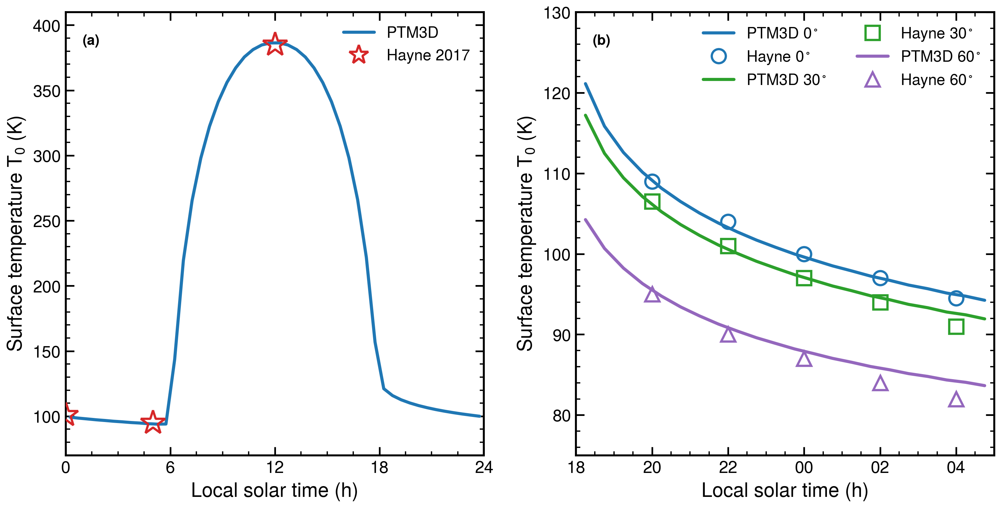
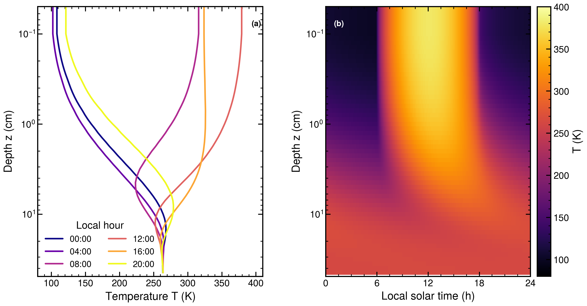
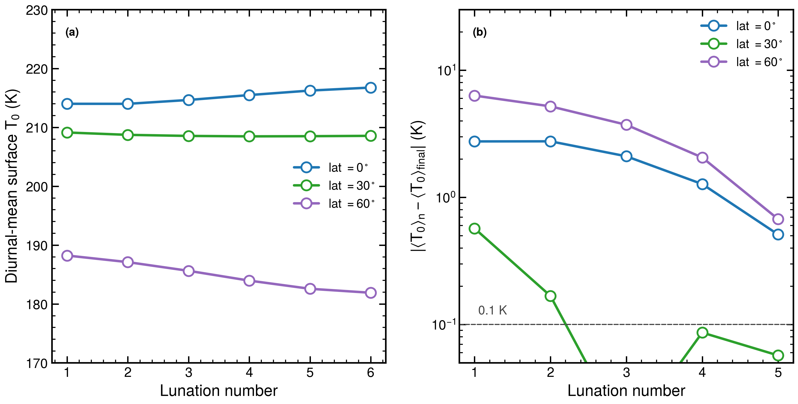
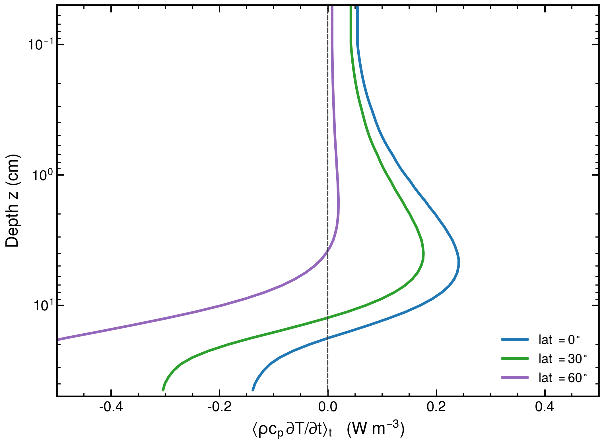
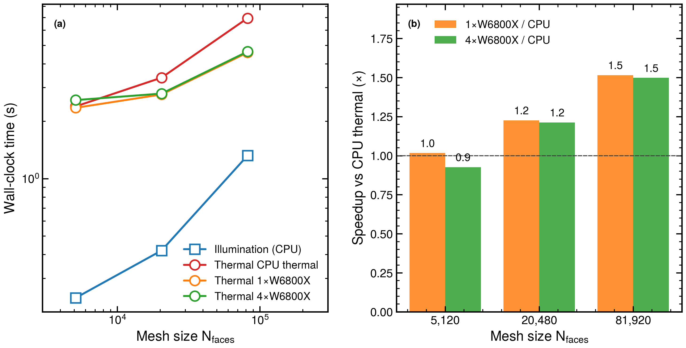

# Thermal Conduction Model

## 1. Overview

The PTM3D thermal model solves the one-dimensional vertical heat conduction equation independently at every triangular mesh face, using temperature- and depth-dependent material properties and a nonlinear radiative surface boundary condition. The solver is coupled to the [illumination model](illumination-model.md) and the [radiation exchange module](radiation-exchange.md) only through a prescribed time series of absorbed surface flux $Q_s(t)$ for each face. The illumination module supplies the direct solar, primary-body reflected, and primary-body thermal IR fluxes, and the radiation exchange module adds the indirect (multi-bounce) flux when it is enabled. By default, lateral conduction between faces is neglected, and face-to-face energy exchange occurs entirely through the radiation exchange module. An optional lateral-conduction treatment is described in §2.1. Phase change and advective transport are not represented.

The model was originally developed for the lunar regolith (Hayne et al., 2017) and has been extended to icy bodies. The numerical implementation relies on the unconditional stability of the Crank–Nicolson scheme for the tridiagonal system that arises on a non-uniform vertical grid.

## 2. Governing Equation

At each face, the temperature $T(z, t)$ in the subsurface satisfies

$$\rho(z)\thinspace c_p(T)\thinspace \frac{\partial T}{\partial t} \thickspace=\thickspace \frac{\partial}{\partial z}\negthinspace\left[\thinspace k(T, z)\thinspace \frac{\partial T}{\partial z} \thinspace\right] \tag{B1}$$

where $\rho$ is bulk density (kg m⁻³), $c_p$ is specific heat capacity (J kg⁻¹ K⁻¹), $k$ is bulk thermal conductivity (W m⁻¹ K⁻¹), $z$ is depth below the surface (m, positive downward), and $t$ is time (s). The equation is parabolic and quasi-linear, with nonlinearity entering only through the temperature dependence of $c_p$ and $k$. There is no internal volumetric source term, and all heat input is supplied through the boundary conditions (§5).

The 1D-vertical assumption is justified when the diurnal thermal skin depth (§4.1, $\delta_1 \lesssim 10$ cm on the Moon) is small compared with the lateral size of mesh faces, which have edges of a kilometer or more on global meshes and a meter or more on regional site meshes. It does not hold on millimeter- to centimeter-scale meshes such as the Moon3D testbed scan (509,337 faces, mean facet edge about 2.5 mm, about 1.3 m across), where small cold traps are warmed by lateral conduction from their surroundings. The default model neglects this heat flow. It can be included as an option (`thermal.lateral_conduction`), and §2.1 gives the criterion for when it is needed.

### 2.1 When to enable lateral conduction

Lateral heat flow between neighboring faces is significant when a feature is small enough that the lateral conductance across it is comparable to the conductance of the surface to radiative and conductive loss,

$$h = 4\varepsilon\sigma T^3 + \Gamma\sqrt{\omega}, \qquad \Gamma = \sqrt{k\rho c_p},$$

where $\omega$ is the diurnal angular frequency (Hayne et al., 2021). Features smaller than the critical size

$$D^{\ast} \approx \frac{8k}{\pi h}$$

are not conductively isolated from their surroundings (Hayne et al., in revision). Because $h$ is dominated by thermal emission on warm surfaces and falls steeply with temperature, $D^{\ast}$ is small where the surface is sunlit and grows by more than an order of magnitude in cold traps. The table gives $D^{\ast}$ for lunar regolith with the surface-layer properties of §3 (Hayne et al., 2017).

| Surface temperature | $D^{\ast}$ |
|---|---|
| 300 K (sunlit) | 0.87 mm |
| 110 K (water-ice stability threshold) | 6.5 mm |
| 70 K | 2.0 cm |
| 50 K (cold trap) | 4.4 cm |

At lunar noon (about 380 K) $D^{\ast}$ falls to 0.70 mm. These values use the surface-layer properties, as in Hayne et al. (in revision). At cold-trap temperatures the diurnal skin depth (about 6 cm at 50 K) is comparable to the depth scale of the density profile, so the denser, more conductive material below also carries lateral heat. With the deep-layer properties, $D^{\ast}$ at 50 K is about three times larger, and the tabulated values should be regarded as closer to lower bounds than upper bounds. Faces much larger than $D^{\ast}$, which include essentially every face on global meshes and on regolith-covered regional meshes at meter scales and coarser, are effectively conductively isolated and exchange heat with their neighbors primarily by radiation. The default one-dimensional treatment is appropriate for them. Faces comparable to or smaller than $D^{\ast}$ are not isolated, and lateral conduction should be included. In rock, with $k \sim 0.1\text{–}1$ W m⁻¹ K⁻¹, $D^{\ast}$ grows to decimeters or meters.

**Effect on cold traps.** In the full-mesh comparison on the Moon3D crater (mean facet edge about 2.5 mm, Hayne et al., in revision), lateral conduction eroded small cold traps and left large ones nearly intact. At the water-ice threshold (110 K), cold traps smaller than 1 cm kept about half of their area, those of 1–5 cm about three quarters, and the single dominant region (equivalent diameter about 91 cm) 99%. Shadowed faces along the margin of that region cooled into the cold-trap class, which nearly canceled the losses. The 110 K cold-trap area changed by only +0.5% in total, while the area changed by −38% at 80 K and −13% at 90 K. At the carbon-dioxide threshold (54 K), where the remaining cold traps are all within a few times $D^{\ast}$ in size, every cold trap smaller than 5 cm vanished and the total area fell by 69%. The net effect at any one threshold therefore depends on the size distribution of the cold traps, not on the mesh resolution alone.

**Lateral-conduction advisory.** Before every thermal run the model compares the facet sizes of the mesh (mean edge length, the same measure used by the lateral solver) with $D^{\ast}$ of the configured surface material at 300 K, 110 K and 50 K, and prints a block prefixed `[lateral-advisor]`. It recommends lateral conduction when facets smaller than $D^{\ast}(50\ \mathrm{K})$ cover more than 1% of the surface area, and reports a borderline case when they cover more than 0.1%, or when facets smaller than $2D^{\ast}(50\ \mathrm{K})$ cover more than 1%. The advisory does not change any setting or output. Set `thermal.lateral_advisor: false` to disable it. The advisory tests what the mesh can resolve and not what it contains. A finely meshed surface whose cold traps are all much larger than $D^{\ast}$ is reported even though lateral conduction changes little there (as at 110 K on the Moon3D crater). A more conclusive test follows the run, by comparing the sizes of the connected cold-trap regions with $D^{\ast}$ at their temperatures. The advisory can also be obtained without running the simulation:

```
ptm advise my_run.yaml
```

or, from Python, `ptm.lateral_advisor.advise_config("my_run.yaml")`. Lateral conduction is never enabled automatically.

**Configuration.**

```yaml
thermal:
  lateral_conduction: true
  lateral_scheme: monolithic   # vertical Crank-Nicolson and backward-Euler lateral terms, solved together
  lateral_picard: 2            # two property updates per substep; needed for energy conservation
  lateral_activation_c: -1     # couple every edge (the Moon3D setting); the default 2 couples only
                               # edges where min(l_i, l_j) < 2 max(D*_i, D*_j)
  use_gpu: false               # lateral conduction runs on the CPU SIMD solver only
```

On the Moon3D crater the default `lateral_activation_c: 2` already couples every edge inside the 110 K and 54 K cold traps, because $D^{\ast}$ is evaluated at the cycle-mean starting temperature of each face, which is cold there. The value `-1` matches the published configuration. A run that starts from a saved warm state evaluates $D^{\ast}$ at that state instead, as reported in the log, and `-1` removes that dependence.

**Cost.** Lateral conduction couples every face column to its neighbors, so each substep solves one linear system across the whole mesh instead of independent tridiagonal systems. It runs only on the CPU SIMD batch solver. The thermal stage takes substantially longer than without lateral conduction, which should be considered before enabling it on a large mesh. On meshes for which the advisory reports that lateral conduction is not needed, it adds this cost for a negligible change in temperature.

### 2.2 Choosing the output cadence

Frame-sampled statistics (`temperature_max`, `direct_solar_max`) record the Sun only at the output epochs. On rough terrain a face can be lit for less than one output step, and such a flash can fall between two frames. The frame-sampled $T_\mathrm{max}$ of the face is then too low, and a cold-trap census counts it as colder than it is. Two kinds of event produce flashes. The Sun may cross a gap between occluders, which lasts about $(\delta + \theta)/\omega$ for a gap of angular width $\delta$, or the solar disk may graze an occluding edge, which can be arbitrarily short. Here $\omega = (2\pi/P_\mathrm{syn})\cos\beta_\odot$ is the Sun's apparent angular rate across the sky ($P_\mathrm{syn}$ the solar day, $\beta_\odot$ the subsolar latitude) and $\theta$ is the angular diameter of the solar disk. Because grazing events have no lower limit on duration, no output step captures every flash, and the angular size of the occluding facets of a mesh does not predict how short its flashes are. On a 4,990-face decimation of the Moon3D crater mesh, the occluder angle and the true event duration were weakly anti-correlated (Spearman −0.20), and 0.44% of the lit area had events shorter than $0.4\theta/\omega$. The recommended output step is therefore a fixed fraction of the disk-crossing time,

$$\Delta t \le 0.4\theta/\omega,$$

and capturing the peak flux of a flash to within 5% requires $\Delta t \le 0.3\theta/\omega$. The table gives these limits for each body at its mean distance, with $\beta_\odot = 0$.

| Body | $\theta$ | $\omega$ | $\theta/\omega$ | $0.4\theta/\omega$ | $0.3\theta/\omega$ |
|---|---|---|---|---|---|
| Moon | 0.533° | 0.508° h⁻¹ | 63 min | 25 min | 19 min |
| Mercury | 1.38° | 0.085° h⁻¹ | 16 h | 6.5 h | 4.9 h |
| Mars | 0.350° | 14.6° h⁻¹ | 1.4 min | 35 s | 26 s |
| Europa | 0.102° | 4.23° h⁻¹ | 1.5 min | 35 s | 26 s |
| Ceres | 0.192° | 39.7° h⁻¹ | 17 s | 7 s | 5 s |

Whether a missed flash is significant depends on the surface. A full-sun flash of duration $\Delta t$ can raise the surface temperature by at most

$$\Delta T_\mathrm{miss} \le \min\left[\frac{2F_\mathrm{abs}}{\Gamma}\sqrt{\frac{\Delta t}{\pi}},\ \frac{F_\mathrm{abs}}{4\varepsilon\sigma T^3}\right], \qquad F_\mathrm{abs} = \frac{S_\odot(1-A)}{r_\mathrm{AU}^2},$$

with $\Gamma$ the surface thermal inertia. At 110 K on Europa (Bond albedo 0.6) this is about 16 K at a 35-minute step and about 6 K at a 7-minute step, so a missed flash there can still cross a volatile threshold. On the Moon the bound exceeds 100 K at any of these steps.

**Output-cadence advisory.** After the illumination stage and before the thermal solution, the model prints a block prefixed `[cadence-advisor]`. It evaluates $\omega$ and $\theta$ from the sun positions of the run, so the subsolar latitude and the distance of the Sun are those of the run. It compares the output step with $0.4\theta/\omega$, and gives the 5% peak-flux limit, the surface thermal response time $\tau = (\Gamma/4\varepsilon\sigma T^3)^2$ at 110 K and 54 K, and $\Delta T_\mathrm{miss}$ at the output step of the run and at the recommended one. It also reports the mesh area of faces lit (direct solar above 1 W m⁻²) in exactly one output frame, or in one or two frames when the step is shorter than $\theta/\omega$. One shadow ray per face toward each of 64 sampled sun positions determines whether any face has an occluder at all. When none does, the advisory reports "not needed". Otherwise the result of this test is not used, since the angular size of the blocking facet does not predict event duration. After the run, the model prints

$$\hat R_\mathrm{ct}(T_\mathrm{thr}) = \frac{A[\text{all faces lit in 1 frame (or 1–2 frames)}]}{A[T_\mathrm{max} < T_\mathrm{thr}]}$$

at 110 K and 54 K, an estimated upper bound on the fractional overstatement of the cold-trap area. All of these values are also written to `provenance.txt`. The advisory does not change any setting or output. Set `illumination.cadence_advisor: false` to disable it. For a completed run, `ptm cadence <run_dir>` (or `ptm.cadence_advisor.postrun()`) recomputes the post-run estimate without running the simulation.

**Accuracy of the estimate.** The table compares the estimate with a 5-minute reference run on the 4,990-face mesh at its native latitude, over one lunation.

| Output step | Area with every sunlit event missed (% of lit area) | Faces lit in 1 frame (% of lit area) | $\hat R_\mathrm{ct}$(110 K) | True overstatement of the 110 K cold-trap area |
|---|---|---|---|---|
| 5.9 h | 2.39% | 4.51% | 4.74% | 2.5% |
| 2.0 h | 0.79% | 1.16% | 1.24% | 0.71% |
| 1.0 h | 0.53% | 0.65% | 1.26% (1–2 frames) | 0.38% |

Over all phases of the illumination in the reference run, the one-frame area was never below the area whose sunlit events were missed entirely for steps $\ge \theta/\omega$ (ratio at least 1.00, median 1.7–3.2). Below $\theta/\omega$ it fell as low as 0.34 of that area, because every full transit is then sampled at least twice. For this reason the advisory uses the one-or-two-frame count for such steps (ratio at least 0.94). The sequence of steps in the table is for a single phase of the lunation. The missed area varies by a factor of 3–10 between phases on a mesh this small, so the values are indicative only. On the full 509,337-face Moon3D mesh, over one lunation against a 10-minute reference run, $\hat R_\mathrm{ct}$ was 0.50% at a 25-minute step and 0.30% at a 15-minute step, against true overstatements of 0.07% and 0.03% at 110 K (0.09% and 0.03% at 54 K). The estimate bounds the effect with a wide margin and is not a correction to be applied.

## 3. Thermophysical Properties

### 3.1 Thermal Conductivity

We adopt the Hayne et al. (2017) formulation, which augments a depth-stratified lattice (contact) conductivity with a $T^3$ radiative term that approximates radiative heat transfer through pore spaces:

$$k(T, z) \thickspace=\thickspace k_c(z)\thinspace\bigl[\thinspace 1 + \chi\thinspace(T / 350\thickspace\text{K})^3\thinspace\bigr] \tag{B2}$$

where $k_c(z)$ is the contact conductivity (§3.3) and $\chi$ is a dimensionless radiative parameter. We use $\chi = 2.7$ following Mitchell & de Pater (1994). The reference temperature 350 K is the value at which the formula was calibrated against laboratory measurements. Above ~250 K the radiative contribution exceeds the lattice term, while at lunar nighttime temperatures (~100 K) it is negligible. Equation (B2) is evaluated as $k = k_c(1 + R_{350} T^3)$ with the precomputed constant $R_{350} = \chi/350^3 \approx 6.3 \times 10^{-8}$ K⁻³.

### 3.2 Heat Capacity

Heat capacity is evaluated as a polynomial in temperature,

$$c_p(T) \thickspace=\thickspace c_0 \thickspace+\thickspace \sum_{j=1}^{N_c} c_j\thinspace T^j \tag{B3}$$

stored as a constant term $c_0$ plus an ordered coefficient list $\lbrace c_j\rbrace$ in the body's `ThermophysicalProperties` record (`planetary_properties.h`). The polynomial is evaluated by Horner's method, which reduces $2N_c$ multiplications to $N_c$ per evaluation, and the evaluation is vectorized where the processor allows (`thermal_model.cpp`). For the Moon we use the four-term polynomial of Hayne et al. (2017), Table A1. For water-ice surfaces we use the linear approximation $c_p(T) \approx 7.49\thinspace T$ (J kg⁻¹ K⁻¹) derived from the heat-capacity data of Giauque & Stout (1936), valid below $`\sim`$270 K.

### 3.3 Density and Contact-Conductivity Stratification

Both the bulk density and the contact conductivity decay exponentially from surface to deep values with a common e-folding scale height $H$:

$$\rho(z) \thickspace=\thickspace \rho_d \thickspace+\thickspace (\rho_s - \rho_d)\thinspace \exp(-z / H), \tag{B4}$$

$$k_c(z) \thickspace=\thickspace k_d \thickspace+\thickspace (k_s - k_d)\thinspace \exp(-z / H). \tag{B5}$$

At $z = 0$, $\rho = \rho_s$ and $k_c = k_s$ (the porous, low-conductivity surface values). As $z \to \infty$, $\rho \to \rho_d$ and $k_c \to k_d$ (the compacted, higher-conductivity deep values). This two-parameter form follows Hayne et al. (2017) for the Moon and is retained for icy bodies with body-specific $\lbrace\rho_s, \rho_d, k_s, k_d, H\rbrace$.

### 3.4 Per-Face Property Maps

Body-uniform defaults can be overridden per face through a `ThermalPropertyMap` (`thermal_property_map.h`), which supports spatially varying thermal inertia, scale height $H$, and Bond albedo, sampled from FITS-format observational maps (e.g., the Diviner-derived $H$-parameter map of Hayne et al., 2017). When a map is supplied, the property of each face is interpolated bilinearly at the latitude and longitude of its centroid.

### 3.5 Body-Specific Defaults

The default values are listed below. The Moon values are those of Hayne et al. (2017), Table A1. The Europa values are appropriate for porous water-ice regolith.

| Symbol | Quantity | Moon | Europa | Units | Source |
|---|---|---|---|---|---|
| $\rho_s$ | Surface density | 1100 | 500 | kg m⁻³ | Hayne et al. (2017); model default |
| $\rho_d$ | Deep density | 1800 | 700 | kg m⁻³ | Hayne et al. (2017); model default |
| $H$ | Density/conductivity scale height | 0.06 | 0.07 | m | Hayne et al. (2017); model default |
| $k_s$ | Surface contact conductivity | $7.4 \times 10^{-4}$ | $9.6 \times 10^{-3}$ | W m⁻¹ K⁻¹ | Hayne et al. (2017); $TI \approx 60$ tiu fit |
| $k_d$ | Deep contact conductivity | $3.4 \times 10^{-3}$ | $5.0 \times 10^{-2}$ | W m⁻¹ K⁻¹ | Hayne et al. (2017); model default |
| $c_p$ coefficients | $\lbrace c_0; c_1, c_2, c_3, c_4\rbrace$ | $\lbrace-3.6125;\thinspace 2.7431,\thinspace 2.36 \times 10^{-3},\thinspace -1.234 \times 10^{-5},\thinspace 8.91 \times 10^{-9}\rbrace$ | $\lbrace 0;\thinspace 7.49\rbrace$ | (J kg⁻¹ K⁻¹ per power) | Ledlow et al. (1992) via Hayne et al. (2017); Giauque & Stout (1936) |
| $\chi$ | Radiative conductivity parameter | 2.7 | 2.7 | – | Mitchell & de Pater (1994) |
| $\varepsilon$ | Broadband IR emissivity | 0.95 | 0.90 | – | Hayne et al. (2017); model default |
| $A$ | Bond albedo | 0.12 | 0.50 | – | Hayne et al. (2017); model default |
| $Q_b$ | Internal heat flux | 0.018 | 0.030 | W m⁻² | Langseth et al. (1976); model default |

The Moon entry also carries an incidence-angle-dependent albedo correction $A(\theta) = A_0 + a(\theta/(\pi/4))^3 + b(\theta/(\pi/2))^8$ with $\lbrace a, b\rbrace = \lbrace 0.06, 0.25\rbrace$ (Hayne et al., 2017), which is the default (`thermophysical.albedo_model`). The Moon3D paper used the Hapke directional-hemispheric albedo instead (single-scattering albedo $w = 0.4964$, which gives $A = 0.12$ at normal incidence), selected with `thermophysical.incidence_angle_albedo: true` or `albedo_model: hapke`. For Europa we use a constant Bond albedo, optionally overridden per face by a high-resolution albedo map (see [illumination-model.md](illumination-model.md)).

## 4. Spatial Discretization

### 4.1 Skin Depth and Grid Scaling

The diurnal thermal skin depth is

$$\delta_1 \thickspace=\thickspace \sqrt{\thinspace\kappa\thinspace P / \pi\thinspace} \tag{B6}$$

where $\kappa = k / (\rho c_p)$ is the thermal diffusivity and $P$ is the diurnal period. $\delta_1$ is the depth at which the diurnal temperature oscillation has decayed by a factor of $e$. In practice $\delta_1$ is evaluated at the surface using $k_s$, $\rho_s$, and a representative $c_p(200~\text{K})$ to set grid scales (`thermal_model.cpp`).

### 4.2 Geometric Depth Grid

The default depth grid is geometrically stretched. The thickness of the uppermost layer is a set fraction of the skin depth, and successive layers grow by a fixed factor:

$$\Delta z_0 = \delta_1 / m, \qquad \Delta z_{i+1} = \Delta z_i\thinspace(1 + 1/n), \qquad z_{\max} = b\thinspace \delta_1 \tag{B7}$$

The defaults are $m = 10$ layers per skin depth and $b = 15$ skin depths to the bottom (`thermal.thermal_m` and `thermal.thermal_b`, defined in `thermal_model.h`). The growth parameter $n$ applies to a fixed grid that is not selected by any configuration. The default grid is the adaptive one of §4.3.

### 4.3 Adaptive Depth Grid

When `ADAPTIVE_GRID = true` (default), the grid is constructed for each face from the local diffusivity profile $\kappa(z)$. The number of layers per skin depth decays with depth, with an e-folding scale of `RES_DECAY_SKINS = 3.0` skin depths, to a minimum of `MIN_LAYERS_DEEP_PER_SKIN = 0.5`. The growth in thickness from one layer to the next is limited to a factor `R_MAX = 2.0`, to prevent aliasing in strongly stretched layers (`generateAdaptiveGrid`, `thermal_model.cpp`). The total depth always reaches $b\thinspace\delta_1$.

The thickness of the deep layers is set by this minimum alone. No constraint of the explicit-stability form $\Delta z \le \sqrt{\kappa\thinspace\Delta t_\mathrm{ref}/F_\mathrm{max}}$ is applied, since the Crank–Nicolson solver is unconditionally stable. Because $\kappa$ cancels against the local skin depth, such a constraint gives $\Delta z/\delta(z) = \sqrt{\pi/(\mathrm{NPERDAY}\cdot F_\mathrm{max})} = 0.517$ at every depth and on every body, and so holds the grid at $\ge 1.935$ layers per local skin depth all the way down. Without it the lunar $b = 32$ column has 28 layers instead of 50. On the 80°N crater of tutorial 04, after 50 equilibration cycles, the two grids differ by 0.05 K in the diurnal minimum of the worst face, and by 0.018 K with radiation coupling.

The deep coarsening is not applied to a column whose grid at $\ge 1.935$ layers per skin depth would have fewer than `MIN_TOTAL_LAYERS_FOR_DEEP_COARSENING = 20` layers. Such a column is confined to the near surface, where there is no deep region to coarsen and the discretization error is concentrated in the top layers. Small asteroids are in this class. For example, 623 Chimaera has 18 layers in its example configuration with a thermal inertia of 200. The test uses the layer count of the uncoarsened grid because the coarsened count depends on $m$ as well as on $b$. A test on the coarsened count would make the number of layers non-monotonic in $m$, which is incompatible with the Richardson extrapolation in `test_grid_convergence`. The log contains one `[grid] NOTE:` line when a column is treated in this way.

### 4.4 Non-Uniform-Grid Finite-Difference Coefficients

On a non-uniform vertical grid, the second-order central approximation of $\partial_z(k\thinspace \partial_z T)$ at interior node $i$ is

$$\frac{\partial}{\partial z}\negthinspace\left(k\thinspace \frac{\partial T}{\partial z}\right)_i \thickspace\approx\thickspace g_{1,i}\thinspace k_{i-1}(T_{i-1} - T_i) \thickspace+\thickspace g_{2,i}\thinspace k_i\thinspace(T_{i+1} - T_i) \tag{B8}$$

with grid coupling coefficients

$$g_{1,i} \thickspace=\thickspace \frac{2\thinspace\Delta z_{i+1}}{D_i}, \qquad g_{2,i} \thickspace=\thickspace \frac{2\thinspace\Delta z_i}{D_i}, \qquad D_i \thickspace=\thickspace \Delta z_i\thinspace \Delta z_{i+1}\thinspace (\Delta z_i + \Delta z_{i+1}). \tag{B9}$$

For uniform spacing this reduces to the familiar $1/\Delta z^2$ stencil. For stretched grids the asymmetric weighting in (B9) preserves second-order accuracy. The coefficients $g_1$, $g_2$, and $D \equiv d_{3z}$ are computed once when the profile is constructed (`thermal_model.cpp`) and reused at every timestep. Cell-centered conductivities $k_{i-1}$ (lower interface) and $k_i$ (upper interface) are used directly without arithmetic or harmonic averaging, consistent with the cell-centered finite-difference convention.

## 5. Boundary Conditions

### 5.1 Surface Energy Balance

At $z = 0$, the surface temperature $T_0$ satisfies the energy balance

$$Q_s \thickspace+\thickspace k_0\thinspace \frac{T_1 - T_0}{\Delta z_0} \thickspace=\thickspace \varepsilon\thinspace \sigma\thinspace T_0^{\thinspace 4} \tag{B10}$$

where $\sigma = 5.670374419\times 10^{-8}$ W m⁻² K⁻⁴ is the Stefan–Boltzmann constant, $\varepsilon$ is the broadband IR emissivity, $k_0$ and $\Delta z_0$ are the surface-layer conductivity and thickness, and $T_1$ is the temperature of the first subsurface node. The absorbed surface flux $Q_s(t)$ is the sum of the contributions of the illumination and radiation exchange modules,

$$Q_s \thickspace=\thickspace (1 - A)\thinspace\bigl[\thinspace Q_{\text{solar}} + Q_{\text{refl}}\thinspace\bigr] \thickspace+\thickspace \varepsilon\thinspace Q_{\text{IR}} \thickspace+\thickspace Q_{\text{indirect}}, \tag{B11}$$

with $Q_{\text{solar}}$, $Q_{\text{refl}}$, $Q_{\text{IR}}$ from [illumination-model.md](illumination-model.md) §3–§5 and $Q_{\text{indirect}}$ from [radiation-exchange.md](radiation-exchange.md) §3 (already weighted by $\varepsilon$ through Kirchhoff's law inside that module).

### 5.2 Newton–Raphson Surface Solver

Equation (B10) is nonlinear in $T_0$ through the $T_0^4$ term and is solved at each timestep by Newton iteration (`thermal_model.cpp`). Defining the residual

$$f(T_0) \thickspace=\thickspace Q_s + k_0\thinspace(T_1 - T_0)/\Delta z_0 \thickspace-\thickspace \varepsilon\thinspace \sigma\thinspace T_0^{\thinspace 4}, \tag{B12}$$

with derivative $f'(T_0) = -k_0/\Delta z_0 - 4\thinspace\varepsilon\thinspace\sigma\thinspace T_0^{\thinspace 3}$, the iterate is updated by full Newton steps with a step limiter, from a bracketed initial guess. Iteration stops when the residual, converted to temperature, is below $10^{-4}$ K (or at floating-point resolution), or after 10 iterations. Convergence typically takes 2 to 3 iterations. The same routine is used by the CPU scalar, CPU SIMD and GPU solvers, and every run reports the largest residual that was accepted (the "surface-BC certificate").

### 5.3 Bottom Boundary

A prescribed conductive heat flux $Q_b$ is imposed at the deepest node, giving the linear update

$$T_n \thickspace=\thickspace T_{n-1} \thickspace+\thickspace Q_b\thinspace \frac{\Delta z_{n-1}}{k_n} \tag{B13}$$

(`thermal_model.cpp`). Body-specific values are listed in §3.5.

### 5.4 Numerical Safety Bounds

Non-finite values are replaced by the value of the previous step. There is no upper temperature bound. The lower bound is the geothermal equilibrium temperature $T_{\text{geo}} = (Q_b/\varepsilon\sigma)^{1/4}$, applied to every layer at every step (24.04 K on the Moon at the default $Q_b$). This bound is reached routinely on never-lit faces. The discrete bottom boundary (B13) uses the conductivity of the last node while the last interior row uses that of the node above it, so a never-lit surface settles a few millikelvin below $T_{\text{geo}}$ and is held at the bound. The effect on reported statistics is at most a few millikelvin. A value equal to $T_{\text{geo}}$ is therefore the bound and not a solution of the equations ([KNOWN_LIMITATIONS.md](KNOWN_LIMITATIONS.md), item 6).

## 6. Temporal Discretization

### 6.1 Crank–Nicolson on the Non-Uniform Grid

Time integration of the interior uses the implicit Crank–Nicolson scheme. The column as a whole is first order in time, because the massless surface node (§5.2) is solved from the $T_1$ of the previous step, and $k$ and $c_p$ are evaluated at $T^n$ without iteration. The error therefore falls linearly with the substep. At the default substep the bias in time-mean temperature is at most about 0.1 K. Substituting (B8) into (B1) and centering the spatial operator at the midpoint $t^{n+1/2}$ yields, for each interior node $i$ and timestep $\Delta t$,

$$T_i^{n+1} \thickspace-\thickspace T_i^n \thickspace=\thickspace \frac{\Delta t}{2\thinspace\rho_i\thinspace c_{p,i}} \Bigl[\thinspace \mathcal{L}\thinspace T^{n+1} \thickspace+\thickspace \mathcal{L}\thinspace T^n \thinspace\Bigr], \tag{B14}$$

with $\mathcal{L}\thinspace T \equiv g_{1,i} k_{i-1}(T_{i-1} - T_i) + g_{2,i} k_i (T_{i+1} - T_i)$. Defining $\alpha = g_{1,i} k_{i-1}$, $\beta = g_{2,i} k_i$, and $\nu = \Delta t / (2\thinspace\rho_i c_{p,i})$, the resulting tridiagonal system $a_i T_{i-1}^{n+1} + b_i T_i^{n+1} + c_i T_{i+1}^{n+1} = d_i$ has

$$a_i = -\nu\thinspace\alpha, \quad b_i = 1 + \nu\thinspace(\alpha + \beta), \quad c_i = -\nu\thinspace\beta, \tag{B15}$$

$$d_i = T_i^n + \nu\bigl[\thinspace\alpha\thinspace T_{i-1}^n - (\alpha + \beta)\thinspace T_i^n + \beta\thinspace T_{i+1}^n\thinspace\bigr]. \tag{B16}$$

The surface and bottom boundary values $T_0^{n+1}$ and $T_n^{n+1}$ (computed as in §5.2 and §5.3) are moved to the right-hand side at the first and last interior rows, and the corresponding off-diagonal entries are set to zero. The material properties $k(T)$, $c_p(T)$, and $\rho c_p$ are updated using $T^n$ before (B15)–(B16) are assembled, which gives a semi-implicit, lagged-coefficient treatment of the nonlinearity.

### 6.2 Thomas Algorithm

The tridiagonal system is solved in $O(N_z)$ operations with the Thomas algorithm (`thermal_model.cpp`). The Crank–Nicolson matrix is strictly diagonally dominant for $\nu > 0$, since $|b_i| = 1 + \nu(\alpha + \beta) > \nu(\alpha + \beta) = |a_i| + |c_i|$, so the algorithm is stable without pivoting. The implicit solution is used for all profiles by default (`IMPLICIT_ALL = true`, `THOMAS_LIMIT = 4096`). The assembly of (B15)–(B16) is vectorized with AVX-512 or AVX2 instructions where available, and the profiles of different faces are solved in parallel with OpenMP. The whole integration can optionally be performed on AMD or Apple GPUs through OpenCL (`gpu/thermal_opencl.cpp`), which has been validated against the CPU solution to within numerical precision.

### 6.3 Adaptive Time Step

Within each output interval the CPU solvers take $n_{\text{sub}} = \lceil \Delta t_{\text{out}} / (P/768) \rceil$ substeps (about 55 minutes on the Moon) and interpolate the absorbed flux linearly to each substep. The GPU solver chooses $n_{\text{sub}} = \lceil \Delta t_{\text{out}}\thinspace\kappa_{\max} / (0.49\thinspace\Delta z_0^2) \rceil$, capped at 200, and holds the flux at the start of the interval constant across its substeps. For this reason the two solvers differ in peak temperature at coarse output cadence ([KNOWN_LIMITATIONS.md](KNOWN_LIMITATIONS.md), item 5). The simulations of the Moon3D paper used the CPU solver.

### 6.4 Event-Aware Refinement

Sharp flux discontinuities, chiefly Jupiter eclipses on Europa, which can reduce the absorbed flux by an order of magnitude in $`\sim`$1 minute, are handled by an event-aware timestep controller (`thermal_model.cpp`). When `EVENT_AWARE_DT = true`, the timestep is also limited so that the linearly extrapolated change in $Q_s$ across the step satisfies $|\Delta Q_s| \le$ `FLUX_DQ_TARGET` ($= 0.1$ W m⁻²), with a minimum of `MIN_EVENT_DT` ($= 0.25$ s). Refinement is triggered when the local flux derivative exceeds `FLUX_DERIV_THRESH` ($= 5\times 10^{-4}$ W m⁻² s⁻¹). For known discontinuities in the flux (e.g., eclipse ingress and egress times marked in the precomputed flux series) the controller also aligns one timestep boundary with each, so that the discontinuity is sampled exactly rather than spread across a Crank–Nicolson step.

## 7. Equilibration

### 7.1 Strategy

Before the output window the thermal model is integrated for `thermal.equilibration_orbits` diurnal cycles of the forcing of the run itself (illumination, shadowing, primary-body flux and, in coupled runs, indirect flux). The same number of cycles is integrated by every solver.

**Initial condition** (`thermal.spinup_seed: physical`, the default). Each face starts from its own conductive steady-state profile. The surface value is the cycle-mean temperature implied by the absorbed flux of the face, and the profile below follows $T(z) = T_0 + Q_b\int_0^z dz'/k(z')$. A permanently shadowed face therefore starts at the geothermal equilibrium temperature rather than at a clear-sky temperature. In radiation-coupled runs the seed of the second whole-mesh pass also includes the time-varying indirect flux of the first radiation solution, folded over whole diurnal cycles (`thermal.seed_indirect: series`, the default, described in [radiation-exchange.md](radiation-exchange.md) §7.8).

**Alternative initial condition** (`spinup_seed: legacy`). An exponential profile relaxing toward radiative equilibrium is provided to reproduce older results,

$$T(z,\thinspace t = 0) \thickspace=\thickspace T_{\text{deep}} + (T_{\text{avg}} - T_{\text{deep}})\thinspace \exp(-z / \delta_1), \tag{B17}$$

with $T_{\text{max}} = ((1-A)\thinspace S/(\varepsilon\sigma))^{1/4}$, $T_{\text{avg}} = T_{\text{max}}/\sqrt{2}$ and $T_{\text{deep}} = T_{\text{avg}} + \min(Q_b\thinspace z/k,\thinspace 50\thickspace\text{K})$, followed in the CPU solvers by an analytic clear-sky pre-conditioning (24 cycles on the Moon, 2 on Europa, 4 on Mercury) with no topography or shadowing.

**Spin-up length.** Surface temperatures converge in a few cycles. The deep column relaxes with an e-folding time of roughly 15 to 23 lunations on the Moon at the default grid. Each run prints an estimate of the number of cycles needed to reach `thermal.equilibration_target_K` (default 0.1 K) and issues a warning when the configured number is smaller (see [configuration.md](configuration.md#equilibration-length-what-the-number-means)).

### 7.2 Decoupled Equilibration Cadence

Because Crank–Nicolson is unconditionally stable, the equilibration cadence can be much coarser than the output cadence without compromising the spin-up. The equilibration cadence is determined by the first of the following that is set (`ptm_thermal_sim.cpp`):

1. **Explicit value.** `EQUILIBRATION_STEPS_PER_DAY` (CLI `--equilibration-steps-per-day`, YAML `thermal.equilibration_steps_per_day`) directly sets $\Delta t_{\text{eq}} = P / N_{\text{eq}}$.
2. **Accuracy target.** `EQUILIBRATION_SAMPLES_PER_DIURNAL_CYCLE` (CLI `--equilibration-samples-per-diurnal`) requests a body-independent number of samples per diurnal cycle. Calibration on a lunar ico3 mesh against a Fourier-stable reference gives maximum surface-temperature errors of ~7 K at 30 samples cycle⁻¹, ~4 K at 120 samples cycle⁻¹ (the GUI default), and ~3 K at 240 samples cycle⁻¹.
3. **Otherwise.** The equilibration cadence matches the output cadence.

At 192 steps per day a sensitivity study on the Moon (`tools/test_equilibration_dt.cpp`) gives a worst-case surface temperature error below 1 K relative to a Fourier-stable reference (~5000 steps day⁻¹) after 24 lunar diurnal cycles, at ~26× less computation time. A coarser equilibration cadence is essential when the output cadence is very fine, as in camera simulations. On a 4.8 M-face lunar mesh with 1-minute output, setting `equilibration_steps_per_day: 24` reduces the equilibration phase from 85,048 to 1,417 steps and the peak memory from 227 GB to 13 GB, with an effect of <2 K at the first output timestep.

## 8. Validation

### 8.1 Lunar Diurnal Cycle vs. Hayne et al. (2017)

We validate the implementation against the Diviner-derived lunar regolith model of Hayne et al. (2017) by running PTM3D on a global icosphere mesh (resolution 7) for a single synodic month with the Moon defaults of §3.5. Figure B.1 shows (a) the equatorial diurnal surface-temperature cycle, (b) the post-sunset cooling curve at three latitudes, (c) a tabular comparison of the first four diurnal moments, and (d) the input parameters.



PTM3D agrees with the Hayne et al. (2017) lunar surface temperatures to within 1.4 K (peak), 1.7 K (midnight), 1.1 K (minimum), and 0.97 K RMS over fifteen Hayne nighttime reference points spanning three latitudes. The figure uses six equilibration orbits on the ico7 topographic mesh with the Hayne (2017) Table A1 thermophysical defaults. The albedo is $A_0 = 0.12$ with the angular-dependent Bond-albedo correction $A(\theta) = A_0 + a(\theta/\pi/4)^3 + b(\theta/\pi/2)^8$ (with $a = 0.06$, $b = 0.25$) applied to a per-face $A_0$ from the LRO-derived Bond-albedo map. All thermophysical parameters ($\rho_s$, $\rho_d$, $H$, $K_s$, $K_d$, $\chi$, $\varepsilon$, $c_p$ polynomial coefficients, $Q_b$) are those of Hayne (2017) Table A1. The vertical depth grid uses the defaults $m = 10$ and $b = 15$ (§4.2), which places the bottom boundary at $\sim 9$ effective skin depths, so that the diurnal wave is fully damped above it.

### 8.2 Subsurface Diurnal Wave

The shape and depth dependence of the diurnal thermal wave provide a second check of internal consistency. Figure B.2 shows the modeled subsurface temperature at the lunar equator. Panel (a) displays $T(z)$ at six local times spanning one synodic day, panel (b) shows the corresponding depth–time map with the diurnal skin depth $\delta_1 = 3.4$ cm (eq. B6) marked, and panel (c) compares the diurnal amplitude to the analytic semi-infinite slab decay $\exp(-z/\delta_1)$. The amplitude decays approximately exponentially within the upper $`\sim`$5 skin depths and the wave acquires a phase lag with depth, both as expected for a linear semi-infinite slab with constant properties. Departures from the analytical solution at depth reflect the depth-dependent $\rho(z)$ and $k(z)$ of (B4)–(B5).



### 8.3 Equilibration Convergence

The accuracy of the equilibration cadence is evaluated with the test program `tools/test_equilibration_dt`, which runs `fastEquilibrate` over 24 lunar diurnal cycles at four latitudes (0°, 30°, 60°, 85°) and reports the maximum and mean per-layer temperature differences from a Fourier-stable reference solution. At the default cadence `EQUILIBRATION_STEPS_PER_DAY = 192` the largest difference is 0.55 K (latitude 85°), within the 1 K tolerance. The error falls roughly linearly with the step, as expected for a first-order scheme (§6.1). Figure B.3 shows the sweep, computed with an earlier version of the code.



### 8.4 Surface Energy Conservation

Figure B.4 shows the closure of the surface energy balance over a synodic month on the ico7 topographic mesh (327,680 faces) after six equilibration orbits. For an equilibrated diurnal cycle the per-face energy budget should satisfy $\langle Q_{\mathrm{abs}}\rangle_t = \langle\varepsilon\sigma T^4\rangle_t - Q_b$. Both the simulation and the accounting in this figure apply the Hayne et al. (2017) angular albedo correction $A(\theta)$ to the per-face base albedo $A_0$, so any residual is a closure error and not a parameter mismatch. The bulk-mean fractional residual is 3.7 %, with a global imbalance of 2.0 % between absorbed and emitted radiation integrated over the synodic month (panel c). For a column in periodic steady state this balance holds exactly whatever the thermal lag, and Jensen's inequality enters only if σ⟨T⟩⁴ is used in place of σ⟨T⁴⟩. A residual of this size after six equilibration orbits most likely reflects heat still going into storage in the deep column, which relaxes over 15 to 23 lunations. This explanation has not been tested.



### 8.5 Computational Performance

Figure B.5 shows wall-clock times for the illumination and thermal modules as a function of lunar icosphere mesh resolution (ico4..ico6, 5,120 to 81,920 faces) on a 2-die AMD W6800X workstation. Each timing is a one–lunar-day, 144–timestep run with no radiation exchange and no equilibration. Three thermal solvers are compared: CPU OpenMP (24 cores), single-die OpenCL GPU, and the four-die OpenCL pool (`--gpu-devices 4`). The CPU illumination benchmark uses Intel Embree.

The post-illumination phase (thermal solver plus statistics export and binary output) scales roughly linearly with mesh size, and the GPU solvers are faster by a factor of 1.5× at ico6 (81,920 faces). The GPU thermal kernel itself is much faster than this end-to-end time (e.g. 252 ms for the ico6 single-GPU run vs 6.9 s post-illumination on CPU). The figure reports the total time because output and statistics dominate at small mesh size. The dashed lines are the model extrapolation in `plots/performance/runtime_estimates.csv`, anchored on a 4 M-face lunar polar run, and the timings follow the model within ±20 %.



### 8.6 Europa Validation

Comparisons with Europa observations are not part of the validation set of this release. The 1D thermal solver is identical for the Moon and Europa. Only the input parameters of §3.5 and the orbital and illumination geometry differ.

## 9. Configuration Reference

The principal parameters of the thermal solver are summarized below. The complete list is in the `Config` class (`thermal_model.h`).

| Parameter | Default | Description |
|---|---|---|
| `chi` | 2.7 | Radiative conductivity parameter $\chi$ (eq. B2) |
| `m` (`thermal_m`) | 10 | Layers in the upper skin depth (eq. B7) |
| `b` (`thermal_b`) | 15 | Skin depths to the bottom layer (eq. B7) |
| `ADAPTIVE_GRID` | true | Use per-profile adaptive grid (§4.3) |
| `RES_DECAY_SKINS` | 3.0 | e-folding scale for resolution decay with depth |
| `MIN_LAYERS_DEEP_PER_SKIN` | 0.5 | Floor on layers per skin depth in the deep (§4.3) |
| `MIN_TOTAL_LAYERS_FOR_DEEP_COARSENING` | 20 | Below this layer count the deep floor is not applied (§4.3) |
| `R_MAX` | 2.0 | Per-step layer-thickness growth cap |
| `EQUILIBRATION_STEPS_PER_DAY` | 192 | Equilibration cadence (§7.2) |
| `MAIN_LOOP_STEPS_PER_DAY` | 768 | Science-window cadence (§6.3) |
| `IMPLICIT_ALL` | true | Force CN+Thomas for all profiles |
| `THOMAS_LIMIT` | 4096 | Profile-size limit for the Thomas path |
| `MULTIRATE_ADAPTIVE_STEP` | true | Enable surface-driven adaptive $\Delta t$ (§6.3) |
| `SURF_DMAX` | 0.1 | Target maximum $\lvert \Delta T_{\text{surf}}\rvert$ per step (K) |
| `DT_GROW`, `DT_SHRINK` | 1.0, 0.1 | Adaptive-step multipliers |
| `MAX_DT_SCALE` | 8.0 | Cap on the adaptive-step multiplier |
| `EVENT_AWARE_DT` | true | Enable flux-event $\Delta t$ refinement (§6.4) |
| `FLUX_DERIV_THRESH` | $5 \times 10^{-4}$ | $\lvert dQ_s/dt\rvert$ trigger threshold (W m⁻² s⁻¹) |
| `FLUX_DQ_TARGET` | 0.1 | Target maximum $\lvert \Delta Q_s\rvert$ per step (W m⁻²) |
| `MIN_EVENT_DT` | 0.25 | Minimum $\Delta t$ during flux events (s) |

The lateral-conduction keys (`thermal.lateral_conduction`, `lateral_scheme`, `lateral_picard`, `lateral_activation_c`, `lateral_cg_rel_tol`, `lateral_zero_coupling`, `lateral_advisor`) are configuration-file keys. They are listed with their defaults in [configuration.md](configuration.md#thermal), and §2.1 explains when to use them.

## 10. Symbols and Units

| Symbol | Meaning | Units |
|---|---|---|
| $T(z, t)$ | Subsurface temperature | K |
| $T_0, T_1, \ldots, T_n$ | Discrete temperatures at depth nodes $0, 1, \ldots, n$ | K |
| $z, \Delta z_i$ | Depth, layer thickness | m |
| $t, \Delta t$ | Time, timestep | s |
| $P$ | Diurnal period | s |
| $\rho(z)$ | Bulk density | kg m⁻³ |
| $\rho_s, \rho_d, H$ | Surface, deep density, e-folding scale (eq. B4) | kg m⁻³, m |
| $c_p(T)$ | Specific heat capacity | J kg⁻¹ K⁻¹ |
| $k(T, z)$ | Bulk thermal conductivity (eq. B2) | W m⁻¹ K⁻¹ |
| $k_c(z)$ | Contact (lattice) conductivity (eq. B5) | W m⁻¹ K⁻¹ |
| $k_s, k_d$ | Surface, deep contact conductivity | W m⁻¹ K⁻¹ |
| $\chi, R_{350}$ | Radiative parameter, $R_{350} = \chi/350^3$ | –, K⁻³ |
| $\kappa$ | Thermal diffusivity, $\kappa = k/(\rho c_p)$ | m² s⁻¹ |
| $\delta_1$ | Diurnal thermal skin depth (eq. B6) | m |
| $g_{1,i}, g_{2,i}, D_i$ | Non-uniform-grid coupling coefficients (eq. B9) | m⁻², m⁻³ |
| $\varepsilon$ | Broadband IR emissivity | – |
| $A, A(\theta)$ | Bond albedo, incidence-angle-dependent albedo | – |
| $\sigma$ | Stefan–Boltzmann constant ($5.670 \times 10^{-8}$) | W m⁻² K⁻⁴ |
| $Q_s$ | Total absorbed surface flux (eq. B11) | W m⁻² |
| $Q_{\text{solar}}, Q_{\text{refl}}, Q_{\text{IR}}, Q_{\text{indirect}}$ | Component fluxes | W m⁻² |
| $Q_b$ | Internal (geothermal) heat flux | W m⁻² |
| $a_i, b_i, c_i, d_i$ | Tridiagonal system entries (eq. B15–B16) | varied |
| $\alpha, \beta, \nu$ | Tridiagonal-coefficient shorthand | varied |

## 11. References

Crank, J., & Nicolson, P. (1947). A practical method for numerical evaluation of solutions of partial differential equations of the heat-conduction type. *Mathematical Proceedings of the Cambridge Philosophical Society*, 43(1), 50–67. https://doi.org/10.1017/S0305004100023197

Giauque, W. F., & Stout, J. W. (1936). The entropy of water and the third law of thermodynamics: The heat capacity of ice from 15 to 273 K. *Journal of the American Chemical Society*, 58(7), 1144–1150. https://doi.org/10.1021/ja01298a023

Hayne, P. O., Bandfield, J. L., Siegler, M. A., Vasavada, A. R., Ghent, R. R., Williams, J.-P., Greenhagen, B. T., Aharonson, O., Elder, C. M., Lucey, P. G., & Paige, D. A. (2017). Global regolith thermophysical properties of the Moon from the Diviner Lunar Radiometer Experiment. *Journal of Geophysical Research: Planets*, 122(12), 2371–2400. https://doi.org/10.1002/2017JE005387

Hayne, P. O., Aharonson, O., & Schörghofer, N. (2021). Micro cold traps on the Moon. *Nature Astronomy*, 5(2), 169–175. https://doi.org/10.1038/s41550-020-1198-9

Hayne, P. O., et al. (in revision). Advanced 3D illumination and thermal modeling for planetary surfaces: Application to the Moon3D test dataset. *Journal of Geophysical Research: Planets*.

Langseth, M. G., Keihm, S. J., & Peters, K. (1976). Revised lunar heat-flow values. *Proceedings of the Lunar Science Conference*, 7, 3143–3171.

Ledlow, M. J., Zeilik, M., Burns, J. O., Gisler, G. R., Zhao, J.-H., & Baker, D. N. (1992). Subsurface emissions from Mercury — VLA radio observations at 2 and 6 centimeters. *Astrophysical Journal*, 384, 640–655. https://doi.org/10.1086/170906

Mitchell, D. L., & de Pater, I. (1994). Microwave imaging of Mercury's thermal emission at wavelengths from 0.3 to 20.5 cm. *Icarus*, 110(1), 2–32. https://doi.org/10.1006/icar.1994.1104

Thomas, L. H. (1949). *Elliptic problems in linear differential equations over a network*. Watson Scientific Computing Laboratory Report. Columbia University.

Vasavada, A. R., Bandfield, J. L., Greenhagen, B. T., Hayne, P. O., Siegler, M. A., Williams, J.-P., & Paige, D. A. (2012). Lunar equatorial surface temperatures and regolith properties from the Diviner Lunar Radiometer Experiment. *Journal of Geophysical Research: Planets*, 117(E12). https://doi.org/10.1029/2011JE003987
