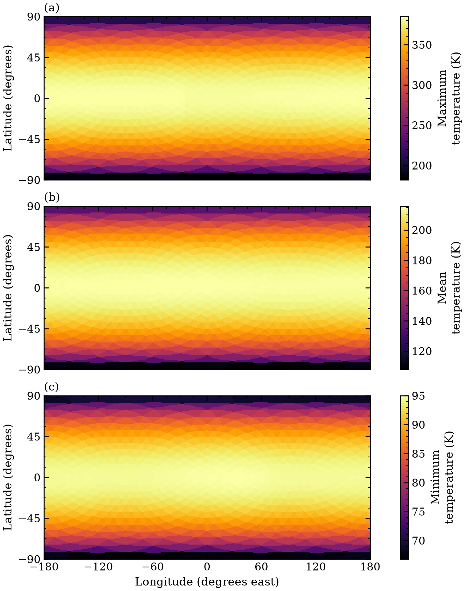
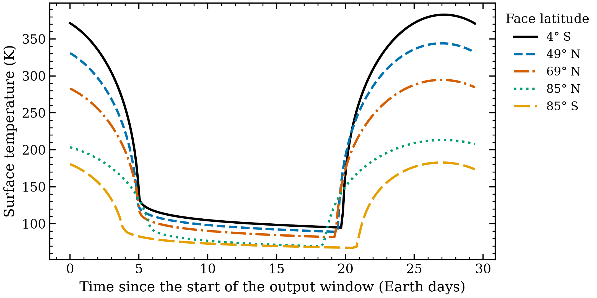

# Tutorial 1: a global Moon over one lunar day

**Configuration:** [`examples/quickstart_moon_diurnal.yaml`](../../examples/quickstart_moon_diurnal.yaml)
**Data:** the Moon SPICE kernels (44 MB)
**Time:** about 10 seconds on four cores, under 1 GB of memory

## What the simulation does

The simulation follows one lunar day (29.53 Earth days) over the whole Moon, represented by a
sphere of 1,280 triangular faces, each about 480 km across.

1. **Spin-up.** The regolith column beneath each face is integrated for 80 lunar days under the
   real solar forcing, sampled 48 times per day, before the output window begins.
2. **Illumination.** At each of the 240 output times, about 3 hours apart, the model finds the
   Sun's position with SPICE, traces shadow rays from every face, and adds the sunlight
   reflected by Earth and Earth's thermal emission.
3. **Heat conduction.** Each column has the lunar regolith profile, with density and
   conductivity increasing with depth and conductivity and heat capacity depending on
   temperature.
4. **Statistics.** The minimum, mean and maximum of temperature and of each flux are recorded
   for every face over the output window.

## Testing the installation (optional)

```bash
cmake --build build --target test_bowl_crater -j && ./build/bin/test_bowl_crater
```

This compares the view factors of a bowl-shaped crater with the analytic solution and ends with
`[test_bowl_crater] PASS: 12 of 12 verdicts passed`. It is a quick test of the radiation
exchange calculation, which tutorial 2 uses.

## Running the simulation

```bash
python3 scripts/fetch_kernels.py --bodies moon
./build/bin/ptm_thermal_sim --config examples/quickstart_moon_diurnal.yaml
```

Look for these lines in the log.

```
Mesh created with 642 vertices and 1280 faces
Equilibration (integrated): 80.00 day/night cycles = 1 pass(es) x 80.00-cycle forcing block  [default]
    lit   (Qs>0)     n=     1280   tau1 = 9.56 cycles   E0 = 99.088 K   cycles needed: median 66.2, p95 68.8
[Statistics] Exported to output/quickstart_moon_diurnal/statistics
Simulation completed in 10.521 seconds
```

### The spin-up estimate

The `cycles needed` line estimates how many lunar days of spin-up each face needs for its
column to settle within `thermal.equilibration_target_K`, 0.1 K by default. The estimate fits
one relaxation time, `tau1`, to each column and tends to ask for more cycles than a convergence
test shows are needed. This simulation integrates 80 cycles, more than the 69 the estimate asks
for, so no warning is printed.

The surface settles much faster than the deeper column. With a spin-up of one lunar day instead
of 80, the maximum temperatures change by less than 0.25 K, but the nighttime minimum changes by
up to 4.9 K and the mean temperature by up to 2.6 K. Run with `--equilibration-orbits 1` to see
the warning and the difference.

## Checking the result

The statistics files hold a 4-byte face count followed by one 4-byte float per face. This reads
them with the Python standard library.

```bash
python3 - <<'PY'
import struct, array
def load(p):
    b = open(p, 'rb').read()
    n = struct.unpack('<i', b[:4])[0]
    a = array.array('f'); a.frombytes(b[4:4 + 4 * n])
    return sorted(a)
for name in ('temperature_max', 'temperature_min', 'temperature_avg'):
    v = load(f'output/quickstart_moon_diurnal/statistics/{name}.bin')
    print(f"{name}: min={v[0]:.1f}  median={v[len(v)//2]:.1f}  max={v[-1]:.1f} K")
PY
```

The expected output is below.

```
temperature_max: min=182.0  median=369.8  max=385.0 K
temperature_min: min=66.8  median=92.6  max=95.0 K
temperature_avg: min=107.8  median=208.2  max=215.7 K
```

Each number has a simple physical explanation. The equatorial noon maximum of 385 K is the
radiative equilibrium temperature near 1 AU for a normal-incidence Bond albedo of 0.12. The
nighttime value near 93 K is the lunar nighttime plateau, set by the heat the regolith stores
during the day. The polar maximum near 182 K reflects sunlight at grazing incidence.

The output directory, about 10 MB, is described in [tutorial 3](03_outputs.md).

## Temperature maps and diurnal curves

The next block draws the maximum, mean and minimum temperature of every face on a map, and the
surface temperature through the lunar day at five faces on the 0° meridian. It needs the `ptm`
package (`python3 -m pip install -e .` from the repository root), matplotlib and scipy. Save it
as a file and run it from the repository root.

```python
import numpy as np
import matplotlib
matplotlib.use("Agg")
from scipy.spatial import cKDTree
from ptm import Results, plots

run = Results("output/quickstart_moon_diurnal")

# A 1-degree map in which each pixel takes the value of the nearest face.
lon = np.arange(-179.5, 180.0, 1.0)
lat = np.arange(-89.5, 90.0, 1.0)
LON, LAT = np.meshgrid(np.radians(lon), np.radians(lat))
pixels = np.stack([np.cos(LAT) * np.cos(LON), np.cos(LAT) * np.sin(LON), np.sin(LAT)], axis=-1)
nearest = cKDTree(run.face_unit_vectors).query(pixels)[1]

plt = plots.styled()
fig, axes = plt.subplots(3, 1, figsize=(plots.DOUBLE_W, 8.6), sharex=True, constrained_layout=True)
for ax, moment, name in zip(axes, ("max", "avg", "min"), ("Maximum", "Mean", "Minimum")):
    T = run.stat("temperature", moment)
    art = ax.pcolormesh(lon, lat, T[nearest], cmap=plots.CMAP_TEMPERATURE, shading="nearest")
    plots.colorbar(fig, art, ax, label=f"{name}\ntemperature (K)")
    ax.set_ylabel("Latitude (degrees)")
    ax.set_aspect("equal")
    ax.set_yticks([-90, -45, 0, 45, 90])
axes[-1].set_xticks(np.arange(-180, 181, 60))
axes[-1].set_xlabel("Longitude (degrees east)")
plots.panel_labels(axes)
plots.save(fig, "output/quickstart_moon_diurnal/temperature_maps.png", dpi=200)

# Surface temperature through the lunar day at five faces near the 0 degree meridian. On this
# coarse mesh the face nearest a requested point can be several degrees from it, so each curve
# is labeled with the latitude of its own face center.
fig, ax = plt.subplots(figsize=(plots.DOUBLE_W, 3.6), constrained_layout=True)
for lat in (0, 49, 69, 85, -85):          # equator to pole: colors and line styles in turn
    face = run.face_at(lat, 0)
    hours, T = run.series("temperature", face=face)
    face_lat = run.lat[face]
    print(f"face {face}: center at latitude {face_lat:.2f}, longitude {run.lon[face]:.2f}")
    label = f"{abs(face_lat):.0f}° {'N' if face_lat >= 0 else 'S'}"
    ax.plot(hours / 24, T, label=label)
ax.set_xlabel("Time since the start of the output window (Earth days)")
ax.set_ylabel("Surface temperature (K)")
ax.legend(title="Face latitude", loc="upper left", bbox_to_anchor=(1.0, 1.0))
plots.save(fig, "output/quickstart_moon_diurnal/diurnal_curves.png")
```

The block prints the five faces it uses. The face nearest the point where the equator crosses
the 0° meridian is centered 4.2° south of the equator and 2.6° west of the meridian.

```
face 916: center at latitude -4.22, longitude -2.56
face 991: center at latitude 49.23, longitude 0.00
face 1023: center at latitude 69.09, longitude 0.00
face 1016: center at latitude 84.89, longitude 0.00
face 1204: center at latitude -84.89, longitude 0.00
```



The three maps vary with latitude only, as they must for a smooth sphere of uniform material in
which every meridian receives the same noon. The faceted edges are the 1,280 faces of the mesh.
The maximum falls from 385 K at the equator to below 200 K at the poles, approximately as the cosine
of the noon solar zenith angle to the quarter power. The minimum varies much less, because the
nighttime temperature is set by the heat stored in the regolith during the day.



The output window begins in the lunar afternoon at the 0° meridian. At the equator the Sun sets
after about five Earth days and rises after about twenty. The night there lasts 14.8 Earth days,
half the lunar day.

The night is shorter at high northern latitudes and longer at high southern latitudes. In this
run the subsolar point lies 1.1° to 1.3° north of the equator during the night, because the
Moon's equator is inclined 1.54° to the ecliptic. The night lasts 12.3 Earth days at 85° N and
16.6 Earth days at 85° S. When the subsolar point is at latitude $\delta$, the night at latitude
$\varphi$ lasts

$$t_\mathrm{night} = P\left[\frac{1}{2} - \frac{\arcsin(\tan\varphi\thinspace\tan\delta)}{180^\circ}\right]$$

where $P$ is the length of the lunar day, 29.53 Earth days. This equation treats the Sun as a
point. The model follows the whole solar disk, so near the pole its nights are several hours
shorter. Over a year $\delta$ ranges from −1.54° to +1.54°, and the night at 85° lasts from
about 11.8 to 17.7 Earth days. Near the pole the Sun sets slowly at grazing incidence, so the
surface cools well before sunset.

At every latitude the night begins with a rapid drop over a few hours. A slow, nearly linear
cooling follows, fed by heat conducted up from below the surface. The temperature at sunrise is
a sensitive measure of the thermal inertia of the upper regolith.

## Going further

- Set `mesh.resolution: 4` (5,120 faces) for a sharper map.
- Set `simulation.timesteps: 480` for a 1.5-hour output cadence.
- Open `output/quickstart_moon_diurnal` in the GUI ([tutorial 4](04_gui.md)).
- Convert the output for ParaView with
  `python src/python/vtk_converter.py output/quickstart_moon_diurnal output/qs_paraview`
  (needs the `vtk` package).
