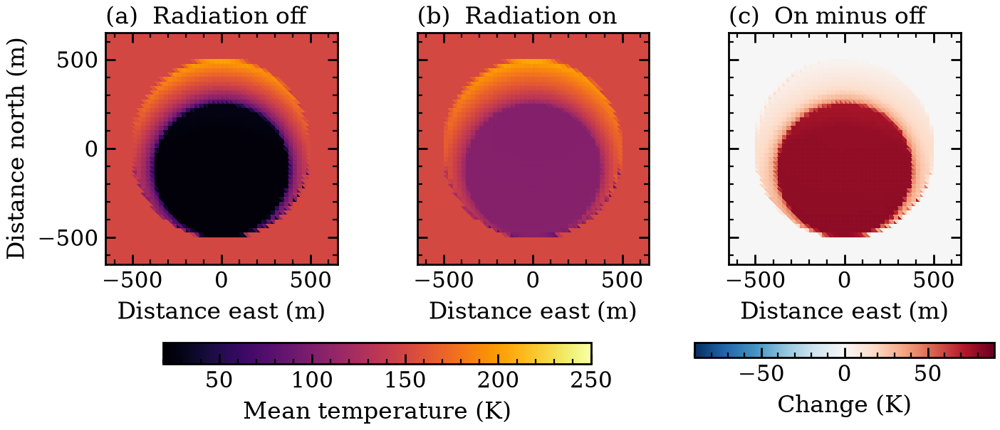
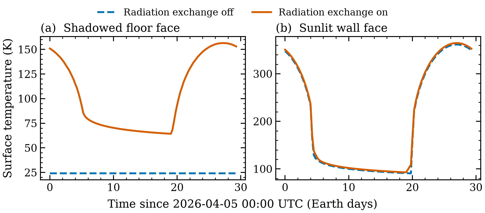

# Tutorial 2: radiation exchange in a polar crater

**Configuration:** [`examples/tutorial04_crater80N_radoff.yaml`](../../examples/tutorial04_crater80N_radoff.yaml)
(radiation exchange off) and
[`examples/tutorial04_crater80N_coupled.yaml`](../../examples/tutorial04_crater80N_coupled.yaml)
(radiation exchange on)
**Data:** `data/meshes/lunar_crater_80N.ply`, a bowl-shaped crater at 80°N with 12,800 faces about
29 m across, included in the repository
**Time:** about 15 seconds and 40 seconds on four cores, under 1 GB of memory

## Indirect heating of a shadowed floor

A crater floor that never sees the Sun still receives energy. Sunlight scattered by the sunlit
walls and thermal infrared emitted by the warm rim reach the floor and warm it. PTM3D computes
this exchange from the view factors between faces, with a radiosity calculation that is coupled
to the thermal model. This tutorial measures the effect by comparing two simulations that differ
only in whether radiation exchange is on.

## Illumination settings

Both configurations begin with an `engine_env:` block.

```yaml
engine_env:
  PTM_ILLUM_TRUE_NORMALS: '1'
  PTM_ILLUM_RISE_EPS: '1'
  PTM_ILLUM_RISE_KEPS: '0.2'
  PTM_ILLUM_RISE_HABS: '0'
  PTM_ILLUM_SEAL_HOLES: '1'
```

These settings improve the shadowing on meshes with fine relief. They use each face's own
normal, and they keep a shadow ray from passing through a small rim close to its starting
face. On this crater, with facets about 29 m across, they change few faces. Use the five
together, and confirm that the log reports each one as `(applied)`. They are described in
[ENVIRONMENT.md](../ENVIRONMENT.md).

## Running the two simulations

```bash
./build/bin/ptm_thermal_sim --config examples/tutorial04_crater80N_radoff.yaml
./build/bin/ptm_thermal_sim --config examples/tutorial04_crater80N_coupled.yaml
```

In the run with radiation exchange, look for these lines.

```
Building H-matrix view factor for 12800 faces...
H-matrix saved to .../output/tutorial04_crater80N.vf (36341754 bytes)
[Radiosity] View-factor row sums Σ_j F_ij: max=0.1, mean=0.0 (0/12800 rows > 1 renormalized for energy conservation)
--- Radiation Iteration 3 ---
  Converged on max-temperature criterion (0.77 K < 2.00 K)
```

The sum of the view factors from one face to all others is well below 1, because a face in this
open crater sees mostly sky. The coupling between radiosity and temperature converges in three
iterations. The view factors are saved in `output/tutorial04_crater80N.vf`, and a second run
loads them (`Loaded view factors from: ...`) instead of computing them again.

In a run with radiation exchange, the spin-up already includes an estimate of the indirect flux
on each face. The log announces this with a line beginning `[eq-seed]`.

Both configurations integrate 8 lunar days of spin-up, and the log prints a warning that the
estimate asks for about 62. On this crater the 8-day spin-up is within a few tenths of a kelvin
of a 40-day spin-up for most faces. Use a longer spin-up for research results.

Radiation exchange uses two bands by default (`radiation.band_separated`), so the coupled run
also writes the scattered sunlight and the infrared emission received from other faces as
`indirect_solar` and `indirect_ir`.

## Comparing the two simulations

```bash
python3 - <<'PY'
import struct, array, statistics as st
def load(p):
    b = open(p, 'rb').read(); n = struct.unpack('<i', b[:4])[0]
    a = array.array('f'); a.frombytes(b[4:4 + 4 * n]); return list(a)
base = 'output/tutorial04_crater80N_%s/statistics/%s.bin'
# Shadowed faces: peak direct solar flux below 50 W/m2 in the run without exchange.
dsm = load(base % ('radoff', 'direct_solar_max'))
shad = [i for i, v in enumerate(dsm) if v < 50.0]
print(f"shadowed faces: {len(shad)} of {len(dsm)}")
for name in ('temperature_min', 'temperature_avg', 'temperature_max'):
    off = load(base % ('radoff', name)); on = load(base % ('coupled', name))
    d = [on[i] - off[i] for i in range(len(off))]
    print(f"{name}: shadowed mean {st.mean(off[i] for i in shad):.1f} K "
          f"-> {st.mean(on[i] for i in shad):.1f} K | largest change {max(d):+.1f} K "
          f"| median over all faces {st.median(d):+.2f} K")
PY
```

The expected output is below.

```
shadowed faces: 1423 of 12800
temperature_min: shadowed mean 24.4 K -> 64.1 K | largest change +40.5 K | median over all faces +0.48 K
temperature_avg: shadowed mean 24.7 K -> 103.4 K | largest change +80.6 K | median over all faces +0.19 K
temperature_max: shadowed mean 26.1 K -> 155.4 K | largest change +132.7 K | median over all faces +0.02 K
```

Without radiation exchange the shadowed faces stay near the geothermal floor of 24 K, the
temperature at which the Moon's internal heat flow balances thermal emission. With exchange
their mean temperature rises by about 80 K, while the median face of the whole mesh, most of it
sunlit, changes by only 0.2 K. A statistic over shadowed faces depends on how they are chosen,
so state the criterion with the number.

## Maps and time series

The next block maps the mean temperature of both runs and their difference on the crater, and
follows the surface temperature of two faces through the lunar day. It needs the `ptm` package
(`python3 -m pip install -e .` from the repository root) and matplotlib. The map coordinates are
distances east and north of the center of the mesh, found by projecting the vertices onto the
plane tangent to the surface there.

```python
import numpy as np
import matplotlib
matplotlib.use("Agg")
import matplotlib.pyplot as plt
from ptm import Results

off = Results("output/tutorial04_crater80N_radoff")
on = Results("output/tutorial04_crater80N_coupled")

# Map coordinates: distance east and north of the crater center, in meters.
v = off.mesh["vertices"]
up = v.mean(axis=0) / np.linalg.norm(v.mean(axis=0))
east = np.cross([0.0, 0.0, 1.0], up)
east /= np.linalg.norm(east)
north = np.cross(up, east)
x, y = (v - v.mean(axis=0)) @ east, (v - v.mean(axis=0)) @ north
tris = off.mesh["faces"]

t_off, t_on = off.stat("temperature", "avg"), on.stat("temperature", "avg")
fig, axes = plt.subplots(1, 3, figsize=(13.0, 4.0), sharey=True, constrained_layout=True)
for ax, T, title in ((axes[0], t_off, "Radiation exchange off"),
                     (axes[1], t_on, "Radiation exchange on")):
    art = ax.tripcolor(x, y, tris, facecolors=T, cmap="inferno", vmin=20, vmax=250)
    ax.set_title(title)
fig.colorbar(art, ax=axes[:2], label="Mean temperature (K)", shrink=0.9)
d = t_on - t_off
art = axes[2].tripcolor(x, y, tris, facecolors=d, cmap="RdBu_r", vmin=-90, vmax=90)
axes[2].set_title("Difference")
fig.colorbar(art, ax=axes[2], label="Change in mean temperature (K)", shrink=0.9)
for ax in axes:
    ax.set_aspect("equal")
    ax.set_xlim(-650, 650)
    ax.set_ylim(-650, 650)
    ax.set_xlabel("Distance east (m)")
axes[0].set_ylabel("Distance north (m)")
fig.savefig("output/tutorial04_crater80N_coupled/mean_temperature_maps.png", dpi=100)

# Temperature through the window on the coldest floor face and on a sunlit face.
floor = int(np.argmin(off.stat("temperature", "max")))
wall = int(np.argmax(off.stat("temperature", "max")))
fig, ax = plt.subplots(figsize=(7.0, 4.2), constrained_layout=True)
for face, color, name in ((floor, "#2a78d6", "shadowed floor"), (wall, "#eb6834", "sunlit wall")):
    for run, style, label in ((off, "--", "exchange off"), (on, "-", "exchange on")):
        hours, T = run.series("temperature", face=face)
        ax.plot(hours / 24, T, style, color=color, lw=1.8, label=f"{name}, {label}")
ax.set_xlabel("Time since 2026-04-05 00:00 UTC (Earth days)")
ax.set_ylabel("Surface temperature (K)")
ax.legend(frameon=False, loc="upper left", bbox_to_anchor=(1.0, 1.0))
fig.savefig("output/tutorial04_crater80N_coupled/floor_and_wall.png", dpi=110, bbox_inches="tight")
print(f"coldest floor face {floor}: mean {t_off[floor]:.1f} K without exchange, "
      f"{t_on[floor]:.1f} K with exchange")
```

```
coldest floor face 4097: mean 24.0 K without exchange, 104.0 K with exchange
```



The permanently shadowed floor is the dark disk in the first panel, held near the geothermal floor.
The sunlit wall is on the north side, which faces the Sun at this latitude. With radiation
exchange the floor warms by about 80 K. The lower walls on the shadowed side warm by tens of
kelvin, and the plains around the crater, which see little of the warm wall, do not change.



The floor face follows the day and night of the wall that heats it. With exchange its temperature
rises when the north wall is lit and falls through the lunar night, while without exchange it
stays at 24 K. The sunlit wall face changes by only a few kelvin, because the energy it receives
from the rest of the crater is small compared with direct sunlight.

## Going further

- Read the two indirect bands ([tutorial 3](03_outputs.md)). Over the shadowed faces the median
  peak of scattered sunlight is 4.5 W m<sup>-2</sup> and of infrared from other faces
  28.7 W m<sup>-2</sup>. The thermal emission of the warm rim, not scattered sunlight, heats this
  crater floor.
- Run the same crater at 85°N, `data/meshes/lunar_crater_85N.ply`, which is colder and more
  shadowed.
- Raise `radiation.max_coupling_iterations` or lower `radiation.coupling_temp_threshold` to
  converge further at higher cost.
