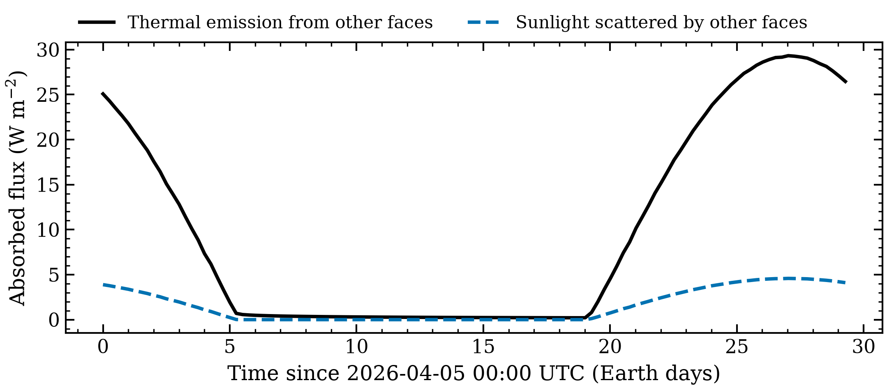

# Tutorial 3: the output files

This tutorial describes every file in a PTM3D output directory and how to read it, using the
simulations of [tutorial 1](01_quickstart.md) and [tutorial 2](02_crater_radiosity.md).

## Directory layout

The coupled crater simulation of tutorial 2 writes the following.

```
output/tutorial04_crater80N_coupled/
├── mesh.ply              the simulated mesh, in the face order of every .bin file
├── metadata.txt          face count, step count and the fields written
├── provenance.txt        which version of the model made the run, and how
├── config_used.yaml      a copy of the configuration file that was read
├── time_steps.txt        the time of each output step
├── body_positions.csv    Sun and primary-body vectors at each output step
├── statistics/           per-face minimum, mean and maximum over the output window
├── temperature/          surface temperature at each output step
├── illumination/         total absorbed flux at each output step
├── direct_solar/         direct sunlight
├── primary_reflected/    sunlight reflected by Earth
├── primary_ir/           thermal emission from Earth
├── indirect_solar/       sunlight scattered by other faces (radiation exchange only)
└── indirect_ir/          thermal emission from other faces (radiation exchange only)
```

Some options add files. `output.locations_file` adds per-site series, `output.map_depths_m`
adds temperature maps at depth in `statistics/`, and `thermal.compute_ice_stability` adds
`statistics/ice_depth.bin`. These are described in the [User Guide](../USER_GUIDE.md).

## The file format

Every `.bin` file, statistics and per-step alike, has the same layout.

| Bytes | Content |
|---|---|
| 0-3 | the number of faces *n*, a 4-byte little-endian integer |
| 4 to 4 + 4*n* | *n* 4-byte floats, one per face, in mesh order |

This reader needs only the Python standard library.

```python
import struct, array

def load_bin(path):
    b = open(path, 'rb').read()
    n = struct.unpack('<i', b[:4])[0]
    a = array.array('f')
    a.frombytes(b[4:4 + 4 * n])
    assert len(a) == n, f"truncated file: {len(a)} of {n} values"
    return a

t = load_bin('output/quickstart_moon_diurnal/statistics/temperature_max.bin')
print(len(t), 'faces, highest maximum', max(t), 'K')
```

Reading the file without skipping the header, for example with a bare
`numpy.fromfile(path, dtype='f4')`, shifts every value by one face. The `ptm` package reads these
files for you (`ptm.Results`), as the notebooks show.

Temperatures are in kelvin. Fluxes are in W m<sup>-2</sup>. The direct, primary-reflected and
primary infrared fluxes are the flux arriving at the face. The two indirect fluxes are the flux
the face absorbs.

## Statistics (maximum, mean and minimum)

For each quantity, `statistics/<quantity>_min.bin`, `_avg.bin` and `_max.bin` hold the minimum,
mean and maximum at each face over the output window. The spin-up is not included.

- `temperature_max` is the temperature at local noon or at the time of peak flux. It responds to
  the illumination of a single step, so a face that sees the Sun through a gap in the terrain
  for one step records it here.
- `temperature_avg` is the time mean. It controls the stability of subsurface ice and the heat
  stored in the ground, and it is the least sensitive to a single step.
- `temperature_min` is the temperature before dawn or in permanent shadow. In a shadowed crater
  without radiation exchange it approaches the geothermal floor, and with radiation exchange it
  is set by the heat received from the surrounding terrain. No layer can be colder than
  (Q<sub>b</sub>/εσ)<sup>1/4</sup>, which is 24.04 K on the Moon and 27.69 K on Europa. A value
  equal to this floor is a bound rather than a converged temperature
  ([KNOWN_LIMITATIONS.md](../KNOWN_LIMITATIONS.md), item 6).

Statistics are written for `temperature`, `illumination`, `direct_solar`, `primary_reflected`,
`primary_ir` and, with radiation exchange, `indirect_solar` and `indirect_ir`.
`effective_albedo.bin` is the albedo each face absorbed sunlight with, averaged over the direct
sunlight it received. It is not defined (NaN) on faces that were never lit.

## The two indirect fluxes

With radiation exchange in two bands (`radiation.band_separated`, the default), the indirect
flux is divided by its origin.

- `indirect_solar` is sunlight scattered by other faces, absorbed with the solar absorptivity
  (1 minus the albedo).
- `indirect_ir` is thermal emission from other faces, absorbed with the emissivity.

The two add up to the indirect flux used in the thermal calculation. Their ratio shows what
heats a face. Scattered sunlight is important near sunlit walls at midday, and thermal infrared
dominates in deep shadow and at night. On the shadowed floor of the tutorial 2 crater the median
peak is 4.5 W m<sup>-2</sup> of scattered sunlight and 28.7 W m<sup>-2</sup> of infrared, so the
warm rim's emission, not scattered sunlight, heats the floor.

## Time steps

`temperature/temperature_000000.bin` through `temperature_000117.bin` are the surface
temperatures at the 118 output steps of the crater simulation, in the same format as the
statistics. The number is the step index, counted from zero, with at least six digits.
`ptm.readers.sorted_frame_files()` lists the files of a field in time order.

`time_steps.txt` gives the time of each step. After three comment lines that begin with `#`, its
first column is ephemeris time in seconds past J2000 (TDB), and its second is UTC. In the crater
simulation, which starts on 2026-04-05, the first step is

```
828619269.185657	2026-04-05T00:00:00.000
```

and consecutive lines are 21,622 s apart, the configured cadence of about 6 hours. Subtract the
first value to get elapsed time, or use the UTC column for dates. `body_positions.csv` gives the
Sun and Earth position vectors, in kilometers in the body-fixed frame, at the same times.

### Reading a time series from the per-step files

A time series at one face is one value read from each per-step file. The next block uses the
reader above to follow the two indirect fluxes on the floor face of the crater that has the
lowest maximum temperature without radiation exchange. Besides the standard library it needs
matplotlib, and the `ptm` package only for the figure style of these tutorials.

```python
import glob, struct, array
import matplotlib
matplotlib.use("Agg")
from ptm import plots

def load_bin(path):
    b = open(path, 'rb').read()
    n = struct.unpack('<i', b[:4])[0]
    a = array.array('f')
    a.frombytes(b[4:4 + 4 * n])
    assert len(a) == n, f"truncated file: {len(a)} of {n} values"
    return a

run = 'output/tutorial04_crater80N_coupled'
# The face with the lowest peak temperature without radiation exchange (tutorial 2).
tmax = load_bin('output/tutorial04_crater80N_radoff/statistics/temperature_max.bin')
face = min(range(len(tmax)), key=tmax.__getitem__)

et = [float(line.split()[0]) for line in open(f'{run}/time_steps.txt') if not line.startswith('#')]
days = [(t - et[0]) / 86400 for t in et]

plt = plots.styled()
fig, ax = plt.subplots(figsize=(plots.DOUBLE_W, 3.2), layout="constrained")
for field, label in (("indirect_ir", "Thermal emission from other faces"),
                     ("indirect_solar", "Sunlight scattered by other faces")):
    files = sorted(glob.glob(f'{run}/{field}/{field}_*.bin'))
    ax.plot(days, [load_bin(f)[face] for f in files], label=label)
ax.set_xlabel("Time since 2026-04-05 00:00 UTC (Earth days)")
ax.set_ylabel(r"Absorbed flux (W m$^{-2}$)")
fig.legend(loc="outside upper center", ncol=2)
plots.save(fig, f'{run}/indirect_flux_floor.png')
print(f"face {face}: {len(files)} steps")
```

```
face 4097: 118 steps
```



Both fluxes follow the illumination of the crater wall. The thermal emission of the wall exceeds
the scattered sunlight by a factor of about six at its peak, and it continues at a low level
through the night as the wall cools.

## Provenance

`provenance.txt` has one `key=value` per line and records which version of the model produced
the directory and how it was run. An excerpt from the crater simulation follows.

```
schema=ptm3d-provenance-1
engine_version=1.2
engine_git_sha=<commit>
engine_binary_md5=<checksum of the executable>
command_line=./build/bin/ptm_thermal_sim --config examples/tutorial04_crater80N_coupled.yaml
body=Moon
mesh_faces=12800
mesh_length_unit=meters
seed_indirect=series
```

`config_used.yaml` beside it is an exact copy of the configuration file. The two complement each
other. The configuration file does not show options given on the command line, such as
`--thermal-inertia`, and `command_line` does. `ptm info <run>` prints a summary of both.

## Converting for visualization

```bash
# ParaView time series (statistics.pvd and one .vtu per step)
python src/python/vtk_converter.py output/tutorial04_crater80N_coupled output/t04_paraview

# NetCDF
python src/python/netcdf_converter.py --input output/t04_paraview/statistics.pvd \
       --output output/t04.nc --format pvd
```

The first needs the `vtk` package and the second `vtk` and `netCDF4`. Each prints the `pip install`
command it needs if a package is missing. The [User Guide](../USER_GUIDE.md) lists the other
conversion scripts.
