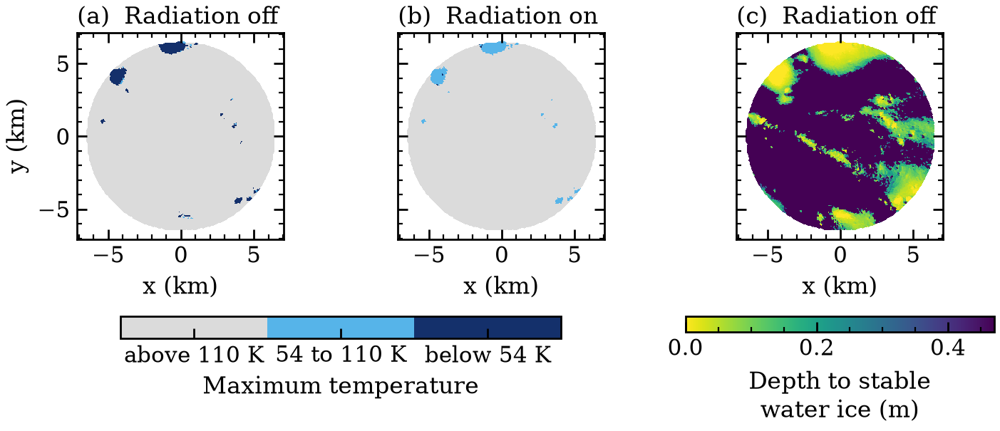
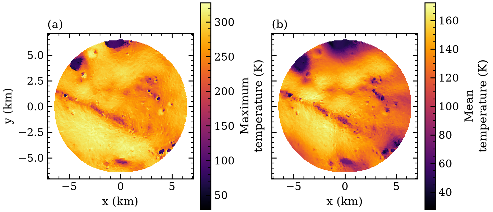
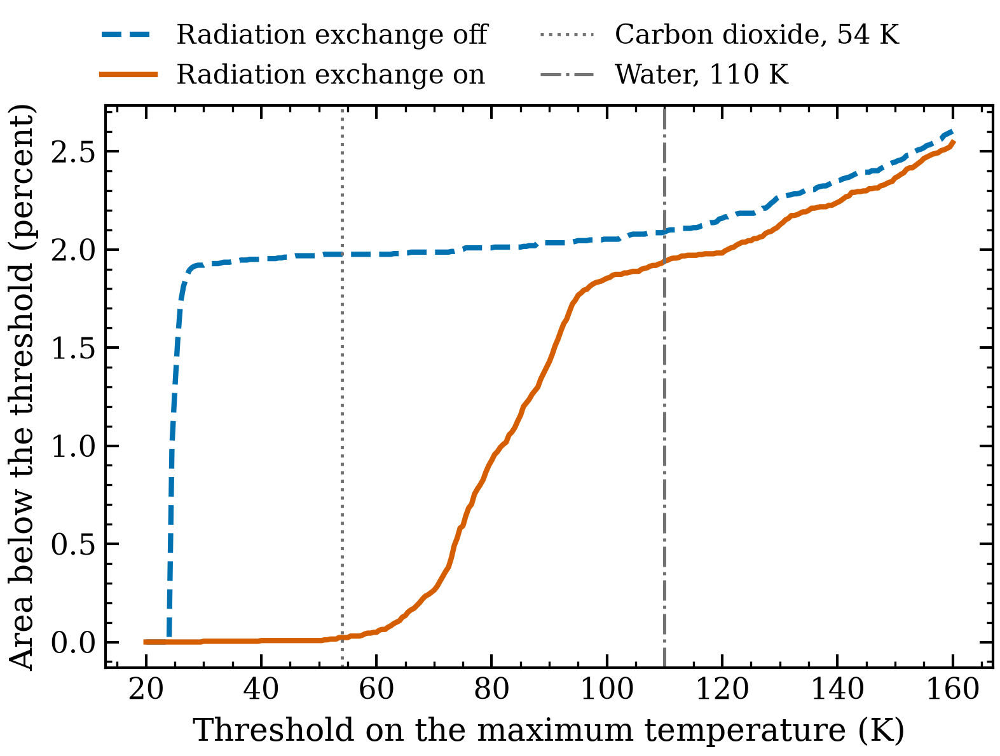

# Tutorial 5: lunar polar ice from a public DEM

**Configuration:** [`examples/lunar_ice_degerlache_radoff.yaml`](../../examples/lunar_ice_degerlache_radoff.yaml)
and [`examples/lunar_ice_degerlache_coupled.yaml`](../../examples/lunar_ice_degerlache_coupled.yaml)
**Data:** a shape-from-shading DEM of the de Gerlache crater rim (1.3 GB download) and a LOLA polar
DEM (115 MB)
**Time:** about 10 minutes of computing on eight cores, CPU only, plus the downloads

## Volatile cold traps near the lunar south pole

Near the lunar south pole the Sun never rises more than a few degrees above the horizon, so
topography decides which surfaces are lit and which are in permanent shadow. A surface whose
maximum temperature stays below about 110 K can hold water ice at the surface over geologic time,
and one below about 54 K can hold carbon dioxide ice. These are the thresholds used by Hayne et
al. (JGR Planets, in revision) for the Moon3D crater. Below the surface, water ice can be stable
even where the surface is too warm, if the regolith above it slows the escape of vapor enough.

This tutorial goes through the whole process for one region on the rim of de Gerlache crater.
It turns a public digital elevation model (DEM) into a mesh, adds the distant terrain that casts
shadows into it, runs one year of temperatures, and maps the depth to stable water ice and the
surface cold traps for water and carbon dioxide.

## Data

The DEM is one of the shape-from-shading products of Bertone et al. (2026, Planetary Science
Journal, [doi:10.3847/PSJ/ae5b70](https://doi.org/10.3847/PSJ/ae5b70)), published on Zenodo at
[doi:10.5281/zenodo.17954508](https://doi.org/10.5281/zenodo.17954508) under CC BY 4.0. Each
region is a separate archive of 5 m/pixel GeoTIFFs in a south polar stereographic projection. The
de Gerlache Rim archive is 1.3 GB. Only the elevation file inside it is needed.

```bash
mkdir -p data/dem/degerlache data/dem/lola
curl -L -o data/dem/degerlache/A3CLR22_9_deGerlache_Rim.zip \
    https://zenodo.org/records/17954508/files/A3CLR22_9_deGerlache_Rim.zip
md5sum data/dem/degerlache/A3CLR22_9_deGerlache_Rim.zip     # macOS: md5
#  -> a34e603e9d2c2c9a2796fc237d24b1b4
unzip data/dem/degerlache/A3CLR22_9_deGerlache_Rim.zip \
    'A3CLR22_9_deGerlache_Rim/A309_GLDELEV_005.tif' 'A3CLR22_9_deGerlache_Rim/README.txt' \
    -d data/dem/degerlache
```

`A309_GLDELEV_005.tif` holds heights in meters above a sphere of radius 1,737,400 m on a
3,200 by 3,200 grid, 16 km on a side. The archive's README gives its bounds.

Terrain beyond the DEM also casts shadows into it. For that the tutorial uses the LOLA polar DEM
of the region from 85°S to the pole at 40 m/pixel, from the PDS Geosciences Node.

```bash
B=https://pds-geosciences.wustl.edu/lro/lro-l-lola-3-rdr-v1/lrolol_1xxx/data/lola_gdr/polar/img
curl -L -o data/dem/lola/LDEM_85S_40M.IMG $B/LDEM_85S_40M.IMG
curl -L -o data/dem/lola/LDEM_85S_40M.LBL $B/LDEM_85S_40M.LBL
```

Files under `data/dem/` are not tracked by git. Keep the zip archive until you have checked the
extracted file, then delete it if you need the space.

## The mesh

The core mesh is the area that is simulated. Here it is a circle 6.5 km in radius around the
center of the region given in the dataset's README (88.675°S, 66.37°W), the largest circle that
fits inside the DEM. It spans the crest of the crater rim and the low ground on either side.
The DEM is sampled every 20 pixels, so the faces are about 100 m across.

The mesh is made by `dtm_to_ply_delaunay`, which can be built only when GDAL is installed
([INSTALL.md](../../INSTALL.md), "DEM / DTM tools"). The build commands in the README make only
the thermal model, so build this tool first.

```bash
cmake --build build --target dtm_to_ply_delaunay -j
```

```bash
./build/bin/dtm_to_ply_delaunay \
    data/dem/degerlache/A3CLR22_9_deGerlache_Rim/A309_GLDELEV_005.tif \
    data/dem/degerlache/degerlache_core.ply \
    --body-radius 1737400 --downsample 20 \
    --roi-center -88.675 -66.37 --roi-radius 6.5
```

```
  Triangle quality: min_angle=18.4°, max_edge=224m
  Vertices: 13267
  Faces: 26253
Success!
```

[dem-to-mesh-workflow.md](../dem-to-mesh-workflow.md) describes the other options of the tool.

## The distant terrain

At grazing sunlight, a massif tens of kilometers away can shadow the site. The second mesh is a
ring of LOLA topography from the edge of the core out to 100 km. It casts shadows but is not
simulated, so it adds little cost
([extended-occluder-architecture.md](../extended-occluder-architecture.md)).

```bash
python3 scripts/build_lola_ring.py --lola data/dem/lola/LDEM_85S_40M.LBL \
    --site-lat -88.675 --site-lon -66.37 --r-core-km 6.5 --r-ext-km 100 \
    --core-ply data/dem/degerlache/degerlache_core.ply \
    --out data/dem/degerlache/degerlache_ring.ply
```

```
wrote data/dem/degerlache/degerlache_ring.ply: 75275 verts, 150245 faces, elev[-4998,2822] dist_km[6.44,100.00]
[ring-registration] GATE PASS: no ring geometry lies inside the core outer boundary.
```

The script opens the LOLA file through its label (`.LBL`), which gives the height units and the
radius of the reference sphere. The script fits the inner edge of the ring to the outer edge of
the core, so that the ring does not cover any of the core. It needs the GDAL Python bindings
(`python3 -m pip install "GDAL==$(gdal-config --version)"`).

## Two simulations

Both configurations simulate one year from 2026-01-01 at a 12-hour output cadence on the core
mesh, with the ring casting shadows. They write only the statistics
(`output.skip_time_series: true`), which keeps each output directory to a few megabytes.

- **Radiation exchange off** (`examples/lunar_ice_degerlache_radoff.yaml`). The spin-up is 70 lunar
  days, and `thermal.compute_ice_stability: true` writes the depth to stable water ice.
- **Radiation exchange on** (`examples/lunar_ice_degerlache_coupled.yaml`). The faces exchange
  scattered sunlight and thermal emission. The spin-up is 8 lunar days.

The two spin-ups differ because the depth to stable ice depends on the temperatures below the
surface, which settle slowly. Between 8 and 70 lunar days of spin-up, the ice depth changes
on about a fifth of the faces, while the maximum surface temperature changes by less than about
1 K. The coupled run is the more expensive one, and the maximum temperature is all it is used
for here, so it uses the shorter spin-up.

```bash
./build/bin/ptm_thermal_sim --config examples/lunar_ice_degerlache_radoff.yaml
./build/bin/ptm_thermal_sim --config examples/lunar_ice_degerlache_coupled.yaml
```

The first takes about 2 minutes and the second about 8 minutes on eight cores. The second
computes the view factors between the faces first, in under a minute, and saves them in
`output/lunar_ice_degerlache.vf` for later runs. Look for these lines.

```
Occluder mesh registered: 75275 verts, 150245 tris (shadow BVH only)
[Ice stability] Wrote output/lunar_ice_degerlache_radoff/statistics/ice_depth.bin  (26253 finite, range 0.0..0.5 m, mean 0.4 m, 533 at surface, 18527 at z_max=0.5 m)
  Converged on max-temperature criterion (0.69 K < 2.00 K)
```

## Cold traps and ice

Save the following as a file and run it with Python from the repository root, in the
environment described in [INSTALL.md](../../INSTALL.md). The maps use south polar stereographic
coordinates x and y, in kilometers from the center of the region, with the 0° meridian along +y.

```python
import numpy as np
import matplotlib
matplotlib.use("Agg")
from matplotlib.colors import ListedColormap
from ptm import Results, plots

off = Results("output/lunar_ice_degerlache_radoff")
on = Results("output/lunar_ice_degerlache_coupled")
area = off.face_areas_m2

def percent(mask):
    return 100 * area[mask].sum() / area.sum()

H2O, CO2 = 110.0, 54.0
for label, run in (("radiation off", off), ("radiation on ", on)):
    tmax = run.stat("temperature", "max")
    print(f"{label}: Tmax < {H2O:.0f} K on {percent(tmax < H2O):.2f}% of the area, "
          f"Tmax < {CO2:.0f} K on {percent(tmax < CO2):.2f}%")

ice = off.stat("ice_depth", None)
print(f"water ice stable within the column on {percent(ice < ice.max()):.1f}% of the area, "
      f"at the surface on {percent(ice == 0):.2f}%")

# South polar stereographic coordinates of the mesh vertices, in km.
R = 1737.4
v = off.mesh["vertices"] / 1000.0
lat = np.arcsin(v[:, 2] / np.linalg.norm(v, axis=1))
lon = np.arctan2(v[:, 1], v[:, 0])
rho = 2 * R * np.tan((np.pi / 2 + lat) / 2)
x, y = rho * np.sin(lon), rho * np.cos(lon)
x, y = x - x.mean(), y - y.mean()
tris = off.mesh["faces"]

plt = plots.styled()
fig, axes = plt.subplots(1, 3, figsize=(plots.DOUBLE_W, 3.0), sharey=True, constrained_layout=True)
classes = ListedColormap(["0.86", plots.SKY_BLUE, "#14306b"])
for ax, run in ((axes[0], off), (axes[1], on)):
    tmax = run.stat("temperature", "max")
    trap = np.where(tmax < CO2, 2, np.where(tmax < H2O, 1, 0))
    art = ax.tripcolor(x, y, tris, facecolors=trap, cmap=classes, vmin=-0.5, vmax=2.5)
cbar = fig.colorbar(art, ax=axes[:2], ticks=[0, 1, 2], location="bottom", shrink=0.7)
cbar.ax.set_xticklabels(["above 110 K", "54 to 110 K", "below 54 K"])
cbar.ax.minorticks_off()
cbar.set_label("Maximum temperature")
art = axes[2].tripcolor(x, y, tris, facecolors=ice, cmap=plots.CMAP_SCALAR + "_r")
plots.colorbar(fig, art, axes[2], label="Depth to stable\nwater ice (m)", location="bottom")
for ax in axes:
    ax.set_aspect("equal")
    ax.set_xlabel("x (km)")
axes[0].set_ylabel("y (km)")
plots.panel_labels(axes, titles=["Radiation off", "Radiation on", "Radiation off"])
plots.save(fig, "output/lunar_ice_degerlache_cold_traps.png", dpi=200)
```

The expected output is below.

```
radiation off: Tmax < 110 K on 2.09% of the area, Tmax < 54 K on 1.98%
radiation on : Tmax < 110 K on 1.94% of the area, Tmax < 54 K on 0.02%
water ice stable within the column on 28.9% of the area, at the surface on 1.98%
```



## Interpretation

Without radiation exchange, nearly every face below 110 K is also below 54 K. Those faces see no
sunlight and receive no heat from their surroundings, so they cool toward the floor set by the
Moon's internal heat flow, about 24 K. With radiation exchange, the same faces receive thermal
emission from the sunlit slopes around them. The area of water-ice cold traps changes little,
but the carbon dioxide cold traps almost disappear, because the infrared from the warm terrain
holds their maximum temperature well above 54 K. Hayne et al. (in revision) find the same
contrast for the Moon3D crater. A carbon dioxide cold trap can only be identified with radiation
exchange included.

Water ice is stable within the top 0.47 m, the depth of the model's soil column, over a much
larger area than the surface cold traps. In the third panel, ice depth 0 marks the surface cold
traps, and the darkest color marks faces where ice is not stable anywhere within the column.

## Temperature maps and other volatiles

The cold-trap maps above reduce each face to a class. The next block maps the maximum and mean
temperature of the run with radiation exchange, and computes the fraction of the area whose
maximum temperature is below a threshold, for every threshold from 20 to 160 K. The second
figure gives the cold-trap area for any volatile whose stability temperature is known.

```python
import numpy as np
import matplotlib
matplotlib.use("Agg")
from ptm import Results, plots

off = Results("output/lunar_ice_degerlache_radoff")
on = Results("output/lunar_ice_degerlache_coupled")
area = off.face_areas_m2

# The same map coordinates as in the previous block.
R = 1737.4
v = off.mesh["vertices"] / 1000.0
lat = np.arcsin(v[:, 2] / np.linalg.norm(v, axis=1))
lon = np.arctan2(v[:, 1], v[:, 0])
rho = 2 * R * np.tan((np.pi / 2 + lat) / 2)
x, y = rho * np.sin(lon), rho * np.cos(lon)
x, y = x - x.mean(), y - y.mean()
tris = off.mesh["faces"]

# Maximum and mean temperature with radiation exchange.
plt = plots.styled()
fig, axes = plt.subplots(1, 2, figsize=(plots.DOUBLE_W, 3.2), sharey=True, constrained_layout=True)
for ax, moment, name in ((axes[0], "max", "Maximum"), (axes[1], "avg", "Mean")):
    art = ax.tripcolor(x, y, tris, facecolors=on.stat("temperature", moment),
                       cmap=plots.CMAP_TEMPERATURE)
    plots.colorbar(fig, art, ax, label=f"{name}\ntemperature (K)")
    ax.set_aspect("equal")
    ax.set_xlabel("x (km)")
axes[0].set_ylabel("y (km)")
plots.panel_labels(axes)
plots.save(fig, "output/lunar_ice_degerlache_temperature_maps.png", dpi=200)

# Fraction of the area whose maximum temperature is below a threshold.
threshold = np.linspace(20, 160, 281)
fig, ax = plt.subplots(figsize=(plots.COLUMN_W * 1.5, 4.0), layout="constrained")
for run, kind, label in ((off, "radiation_off", "Radiation exchange off"),
                         (on, "radiation_on", "Radiation exchange on")):
    tmax = run.stat("temperature", "max")
    frac = [100 * area[tmax < t].sum() / area.sum() for t in threshold]
    ax.plot(threshold, frac, **plots.STYLES[kind], label=label)
for t, style, name in ((54.0, ":", "Carbon dioxide, 54 K"), (110.0, "-.", "Water, 110 K")):
    ax.axvline(t, color="0.45", lw=1.2, ls=style, label=name)
ax.set_xlabel("Threshold on the maximum temperature (K)")
ax.set_ylabel("Area below the threshold (percent)")
fig.legend(loc="outside upper center", ncol=2)
plots.save(fig, "output/lunar_ice_degerlache_area_below_threshold.png")
```



The maximum temperature follows the topography. At this latitude the Sun circles the horizon once
a lunar day, never more than a few degrees high, so the faces that it strikes nearly face-on at
some time of the year exceed 300 K. The floors of small craters and the shadowed parts of the rim
stay below 100 K. The mean temperature shows the same pattern over about half the range, because
each face is lit for only part of the time.



Without radiation exchange the curve rises abruptly near 24 K, the temperature at which the
Moon's internal heat flow balances thermal emission, because the permanently shadowed faces have
no other source of heat. With radiation exchange the same faces are spread between about 50 and
100 K by the infrared emission of the terrain around them. A threshold anywhere in that range,
such as the 54 K of carbon dioxide, therefore gives a very different area in the two runs, while
the area below 110 K is nearly the same. The same curve, read at another temperature, gives the
cold-trap area of another volatile. This is a calculation on the output and needs no new run.

## Sensitivity to the model setup

The areas above are for this region at a 100 m grid, a 6.5 km crop, one year starting in
January 2026, and distant terrain to 100 km. Each of these choices affects them.

- **Resolution.** A 100 m face averages over the small craters and slopes that create many cold
  traps, so finer grids generally find more and smaller ones. Use `--downsample 10` for a 50 m
  grid (about four times as many faces) or `--downsample 4` for 20 m (about 25 times). The
  radiation-off run grows roughly in proportion to the number of faces, and the view factors and
  the coupled run grow faster. At 20 m, plan for a workstation and hours rather than minutes.
- **Cadence.** At a 12-hour cadence a short burst of sunlight through a gap in the horizon can
  be missed, which makes the cold-trap area slightly too large. A 6-hour cadence gives areas
  within 0.05 percentage points of these at this resolution. Finer meshes need a finer cadence.
- **Distant terrain.** The ring to 100 km includes the large massifs near the pole. Without it,
  the same region receives about 16% more direct sunlight over the year.
- **Depth of the column.** The ice depth cannot exceed the bottom of the column, 0.47 m here.
  With `thermal.thermal_b: 32` the column reaches 1.0 m at almost no extra cost, and the area
  with stable ice within 0.47 m rises from 28.9% to 31.5%. A deeper column also needs a longer
  spin-up, and the spin-up estimate in the log gives the required length.
- **Window.** One year includes the lunar seasons. A shorter window can only make the cold-trap
  area larger.

## Going further

- Use a different region from the same Zenodo record, and center the crop with the bounds in
  that region's README.
- Increase the resolution of the core as described above, or the outer radius of the ring.
- Map other thresholds by changing `H2O` and `CO2` in the script, for example to compare with
  published stability temperatures of other volatiles.
