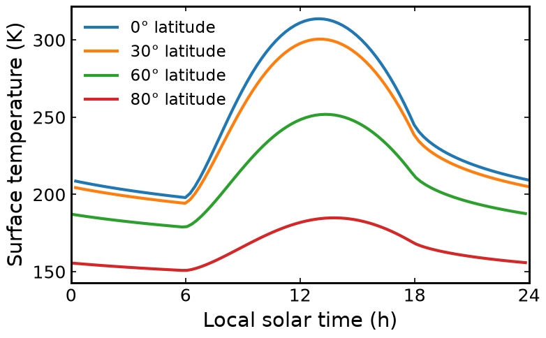
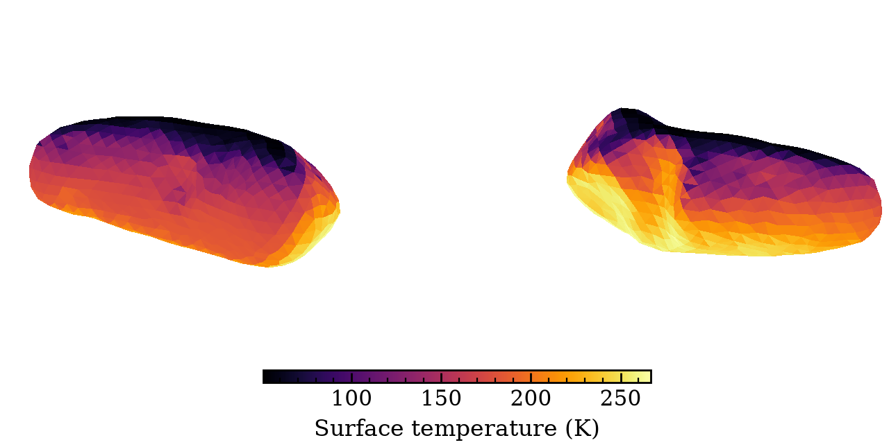
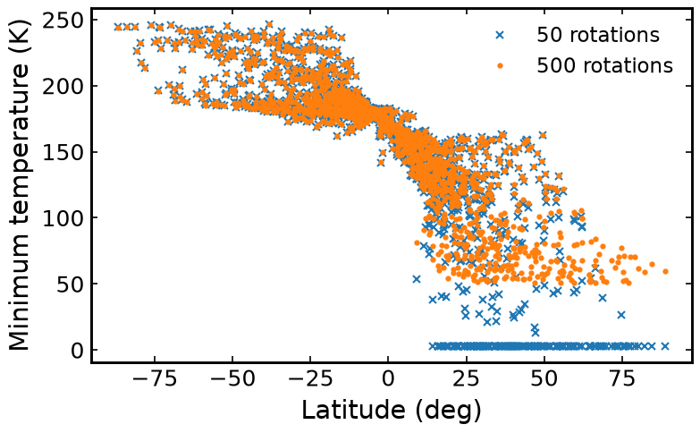
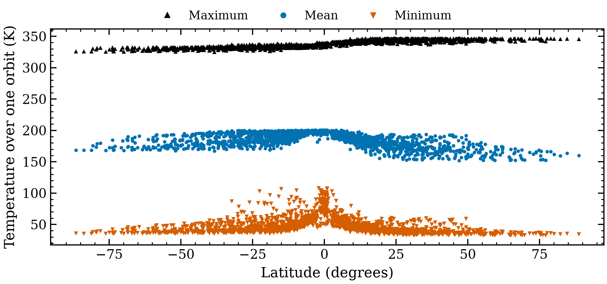
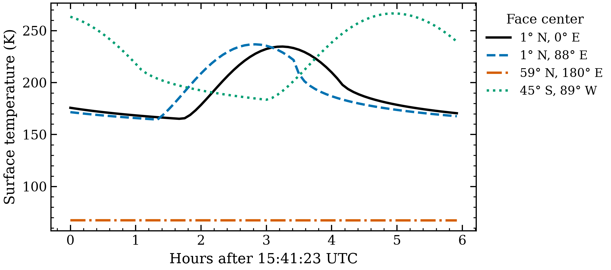
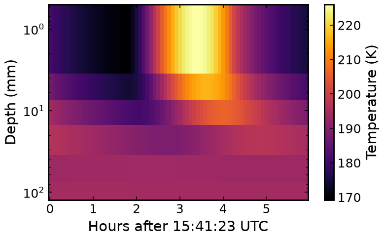
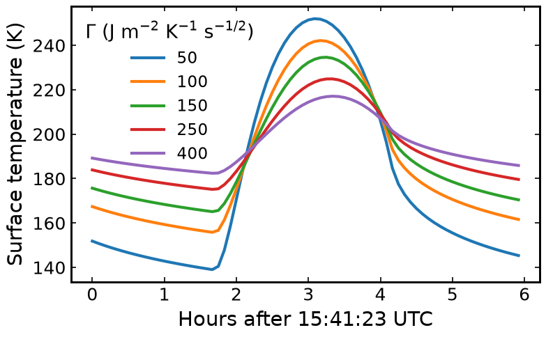

# Tutorial 6: surface temperatures of an asteroid

**Configurations:** [`asteroid_sphere.yaml`](../../examples/asteroid_sphere.yaml),
[`asteroid_ellipsoid.yaml`](../../examples/asteroid_ellipsoid.yaml),
[`asteroid_eros_sphere.yaml`](../../examples/asteroid_eros_sphere.yaml),
[`quickstart_asteroid_bennu.yaml`](../../examples/quickstart_asteroid_bennu.yaml),
[`asteroid_bennu_sphere.yaml`](../../examples/asteroid_bennu_sphere.yaml) and
[`asteroid_eros.yaml`](../../examples/asteroid_eros.yaml)
**Data:** the Moon SPICE kernels (44 MB), the Bennu ephemeris (81 MB), and for Eros 0.3 MB from JPL
Horizons and DAMIT
**Time:** about 40 minutes of computing on four cores for all the runs, 10 of them for the full orbit,
CPU only

## The question

The infrared light from an asteroid depends on the temperature of its surface, and that
temperature depends on the distance from the Sun, the albedo, the shape, the spin, and the thermal
inertia of the regolith. Radiometric studies run the argument backward. They fit a model to
thermal infrared observations to find the thermal inertia, which tells how fine-grained or
rock-covered the surface is (Delbo et al.,
[2015](https://doi.org/10.2458/azu_uapress_9780816532131-ch006)). The model has to give the
temperature of each part of the surface at the time of the observation.

PTM3D solves heat conduction in a column of regolith beneath every face of a body, as in
[tutorial 1](01_quickstart.md). For an asteroid the body is a sphere, an ellipsoid or a shape
model, and the sunlight comes from a Keplerian orbit or from a JPL ephemeris. This tutorial runs
each of these. It then covers the choices that decide whether the temperatures are right for a
particular date. These are the output time that falls on the time of interest, the length of the
spin-up, and the rotational phase of the shape model on that date. It ends with extracting
temperatures for comparison with observations and with a small study of thermal inertia.

## The simplest asteroid

`examples/asteroid_sphere.yaml` describes a sphere 1 km across on a circular orbit at 1.3 AU. It
spins once in six hours about an axis perpendicular to the orbit. The body is defined in the
`generic_body` block, which is the same for every body other than the Moon, Mercury and Europa.

```yaml
generic_body:
  name: Sphere Asteroid
  ephemeris_source: keplerian
  shape:
    type: spherical
    radius_km: 0.5
  orbit:
    semi_major_axis_au: 1.3
    eccentricity: 0.0
    inclination_deg: 0.0
    lon_ascending_node_deg: 0.0
    arg_perihelion_deg: 0.0
    mean_anomaly_deg: 0.0
    epoch: '2026-01-01T00:00:00'
  spin:
    period_hours: 6.0
    pole_ra_deg: 270.0
    pole_dec_deg: 66.5607
    prime_meridian_deg: 0.0
  surface:
    albedo: 0.10
    emissivity: 0.95
    ks: 0.0333333
    kd: 0.0333333
    rhos: 1500.0
    rhod: 1500.0
    H: 0.05
    cp0: 800.0
    Qb: 0.0
    chi: 0.0
```

The orbit is a circle in the ecliptic, so the body is always 1.3 AU from the Sun and every day
receives the same sunlight. The spin pole is given in equatorial coordinates (right ascension and
declination of J2000). The values above are the north pole of the ecliptic, which puts the
obliquity at zero and keeps the Sun over the equator. A pole published in ecliptic coordinates
must be converted first. The function `ecliptic_pole_to_equatorial` in `horizons.horizons_client`
does it.

`albedo` is the Bond albedo, the fraction of the incident sunlight that the surface scatters in
all directions. Catalogs usually list the geometric albedo *p*<sub>V</sub>, which is different.
The Bond albedo is *p*<sub>V</sub> *q*, where the phase integral is *q* = 0.290 + 0.684 *G* and *G*
is the slope parameter that the Small-Body Database lists with the albedo.

The thermal inertia Γ = (*k* ρ *c*<sub>p</sub>)<sup>1/2</sup> follows from the surface properties.
Here the column is uniform and its properties do not change with temperature (`chi: 0` removes the
radiative term in the conductivity), so Γ = 200 J m<sup>-2</sup> K<sup>-1</sup> s<sup>-1/2</sup>
everywhere. A loose layer over denser material has `ks` smaller than `kd` and `rhos` smaller
than `rhod`, over the depth `H`. `Qb` is the heat flow into the base of the column, in
W m<sup>-2</sup>. It is zero here, and [a later section](#the-spin-up-and-the-basal-heat-flow)
explains what that does to a face that stays dark.

A sphere does not see itself, so radiation exchange is off (`radiation.enabled: false`). The window
is one rotation (`duration_days: 0.25`) in 96 outputs, preceded by 50 rotations of spin-up.

### Run it

```bash
python3 scripts/fetch_kernels.py --bodies moon
./build/bin/ptm_thermal_sim --config examples/asteroid_sphere.yaml
```

The first command is needed only for the leap-seconds kernel. The run takes about a minute. Look
for these lines in the log.

```
Using generic body: Sphere Asteroid
  Solar constant: 805.325 W/m^2
Mesh created with 2562 vertices and 5120 faces
[mesh-units] inferred KILOMETERS: median |face_center| = 0.4995454718 (range 0.4994310584 .. 0.4995503772), 5120 faces, R_body = 0.5 km
Equilibration (integrated): 50.00 day/night cycles = 1 pass(es) x 50.00-cycle forcing block  [default]
Simulation completed in 50.876 seconds (50876 ms)
```

The `mesh-units` line is the check that the size of the mesh and the body radius agree. The log
adds a warning to it when they do not.

### Temperatures against local time

Save the following as a file and run it from the repository root, in the environment described in
[INSTALL.md](../../INSTALL.md).

```python
import numpy as np
from ptm import Results

run = Results("output/asteroid_sphere", body_radius_km=0.5)
tmax = run.stat("temperature", "max")
tmin = run.stat("temperature", "min")
equator = run.faces_in_band(-6, 6)
print(f"{run.n_faces} faces, {len(run.times().et)} output steps")
print(f"equator: T_max {tmax[equator].mean():.1f} K, T_min {tmin[equator].mean():.1f} K")

sigma, eps, albedo, S = 5.670374e-8, 0.95, 0.10, 1361.0 / 1.3**2
T_ss = ((1 - albedo) * S / (eps * sigma)) ** 0.25
theta = 200.0 * np.sqrt(2 * np.pi / (6 * 3600)) / (eps * sigma * T_ss**3)
print(f"sub-solar equilibrium temperature {T_ss:.1f} K, thermal parameter {theta:.2f}")
```

```
5120 faces, 96 output steps
equator: T_max 313.6 K, T_min 198.1 K
sub-solar equilibrium temperature 340.6 K, thermal parameter 1.60
```

A body with no thermal inertia would reach 340.6 K at the sub-solar point at noon and fall to
the cold sky at night. This one reaches 313.6 K and holds 198.1 K before dawn, because the regolith
stores the heat of the day. The thermal parameter of Spencer et al.
([1989](https://doi.org/10.1016/0019-1035(89)90182-6)) measures this buffering. It is
Θ = Γ ω<sup>1/2</sup> / (ε σ *T*<sub>ss</sub><sup>3</sup>), where Γ is the thermal inertia, ω the
angular rate of the spin, ε the emissivity, σ the Stefan-Boltzmann constant and
*T*<sub>ss</sub> the sub-solar temperature of the body without thermal inertia (340.6 K here).
The block above prints Θ = 1.60 for this body.

For the local solar time of a face, take its longitude relative to the sub-solar longitude at each
output step. The local time is 12 hours plus that angle divided by 15° per hour.

```python
import numpy as np
from ptm import Results, plots

plt = plots.styled()
run = Results("output/asteroid_sphere", body_radius_km=0.5)
sun_lon = np.array([run.subsolar_latlon(i)[1] for i in range(len(run.times().et))])

fig, ax = plt.subplots(figsize=(5.5, 3.5))
for lat in (0, 30, 60, 80):
    face = run.face_at(lat, 0.0)
    _, T = run.series("temperature", face=face)
    local_time = (12.0 + (run.lon[face] - sun_lon) / 15.0) % 24.0
    order = np.argsort(local_time)
    ax.plot(local_time[order], T[order], label=f"{lat}° latitude")
ax.set_xlabel("Local solar time (h)")
ax.set_ylabel("Surface temperature (K)")
ax.set_xlim(0, 24)
ax.set_xticks(range(0, 25, 6))
ax.legend()
fig.tight_layout()
fig.savefig("output/asteroid_sphere/diurnal_curves.png", dpi=150)
```



The temperature peaks about an hour after local noon and is lowest shortly before sunrise at 6 h.
The kinks at 6 h and 18 h are sunrise and sunset. The sphere has the same diurnal curve on every
day of the run, because the obliquity is zero.

### A temperature map

This map shows every face at the output step at which the sub-solar point crosses longitude 0.
The star marks the sub-solar point.

```python
import numpy as np
from ptm import Results, plots

plt = plots.styled()
run = Results("output/asteroid_sphere", body_radius_km=0.5)
lons = np.array([run.subsolar_latlon(i)[1] for i in range(len(run.times().et))])
step = int(np.argmin(np.abs(lons)))
T = run.field("temperature", step=step)
sun_lat, sun_lon = run.subsolar_latlon(step)

fig, ax = plt.subplots(figsize=(6.0, 3.3))
dots = plots.scatter_map(ax, run.lat, run.lon, T, size=14)
ax.plot(sun_lon, sun_lat, marker="*", color="white", markeredgecolor="black",
        markersize=12, linestyle="none")
plots.colorbar(fig, dots, ax, "Surface temperature (K)")
fig.tight_layout()
fig.savefig("output/asteroid_sphere/map.png", dpi=120)
```


The warmest ground is a little east of the sub-solar point, where the local time is early
afternoon. The coldest is 90° to the west, where the Sun is about to rise.

### An ellipsoid

`examples/asteroid_ellipsoid.yaml` differs from the sphere in two lines.

```yaml
  shape:
    type: ellipsoidal
    semi_axes_km: [0.6, 0.4, 0.3]
```

The semi-axes are along the body's x, y and z axes, and the spin axis is z, so the body rotates
about its shortest axis. Each face of the mesh is a flat facet of the ellipsoid, with its own
normal. The sunlight absorbed by a face depends on the angle between its normal and the Sun, not
on the angle between the radial direction and the Sun. On a sphere these are the same.

```bash
./build/bin/ptm_thermal_sim --config examples/asteroid_ellipsoid.yaml
```

The figure compares the maximum temperature of every face on the two bodies against its latitude.
Latitude is planetocentric, from the direction of the face center.

```python
from ptm import Results, plots

plt = plots.styled()
sphere = Results("output/asteroid_sphere", body_radius_km=0.5)
ellipsoid = Results("output/asteroid_ellipsoid", body_radius_km=0.416)

fig, ax = plt.subplots(figsize=(5.5, 3.5))
for run, label in ((sphere, "Sphere"), (ellipsoid, "Ellipsoid")):
    ax.plot(run.lat, run.stat("temperature", "max"), ".", ms=2, label=label)
    band = run.faces_in_band(24, 36)
    print(f"{label}: mean T_max at 24 to 36 degrees latitude "
          f"{run.stat('temperature', 'max')[band].mean():.1f} K")
ax.set_xlabel("Planetocentric latitude (deg)")
ax.set_ylabel("Maximum temperature (K)")
ax.legend(markerscale=4)
fig.tight_layout()
fig.savefig("output/asteroid_ellipsoid/tmax_by_latitude.png", dpi=150)
```

```
Sphere: mean T_max at 24 to 36 degrees latitude 300.5 K
Ellipsoid: mean T_max at 24 to 36 degrees latitude 262.3 K
```


At the equator the two bodies agree to about 1 K. At 30° latitude the ellipsoid is 38 K cooler,
because on a flattened body the surface there faces more toward the pole than the radial
direction does, and the noon Sun strikes it at a larger angle. Thermal inertia, albedo, spin
period and the distance from the Sun set the temperatures of a convex body. Its size does not,
and a sphere of 5 km radius gives the same temperatures as this one. Its shape decides how the
sunlight is distributed over its surface.

### A real orbit from JPL Horizons

The script `examples/python/fetch_asteroid.py` asks JPL Horizons for the osculating orbital
elements at the epoch you give, for the diameter, pole and period it lists, and for an SPK file
over the dates you give. It writes a `generic_body` block to paste into a configuration. Eros is a
good example, because its orbit is eccentric.

```bash
python3 examples/python/fetch_asteroid.py 433 --shape sphere --start 1993-01-01 --stop 1999-01-01 \
    --epoch 1998-12-23T15:41:23 --outdir data/asteroids/eros_sphere
```

The script prints what it found and writes `ephemeris.bsp` (178 kB), `metakernel.tm` and
`generic_body.yaml` in `data/asteroids/eros_sphere`. The configuration
`examples/asteroid_eros_sphere.yaml` uses the elements in that block with
`ephemeris_source: keplerian`. Osculating elements describe a two-body orbit that matches the
real one at the epoch. Set `ephemeris_source: spice`
to follow the SPK file instead. For this window and its 110 days of spin-up, the two orbits give
temperatures that differ by 0.4 K at the median and 2.3 K at most. The two drift apart with time from the epoch as
the planets perturb the orbit, so use the SPK file for a window of months or more.

```bash
./build/bin/ptm_thermal_sim --config examples/asteroid_eros_sphere.yaml
```

The run takes about 3 minutes, almost all of it the spin-up of 500 rotations (110 days) that the
Eros section explains.

```python
import numpy as np
from ptm import Results

run = Results("output/asteroid_eros_sphere", body_radius_km=8.42)
row = run.body_positions()[0]
distance = np.linalg.norm([row["sun_x"], row["sun_y"], row["sun_z"]]) / 1.495978707e8
sun_lat, _ = run.subsolar_latlon(0)
tmax = run.stat("temperature", "max")
print(f"distance from the Sun {distance:.2f} AU, sub-solar latitude {sun_lat:.1f} degrees")
print(f"T_max {tmax.max():.1f} K at the hottest face, "
      f"T_min {run.stat('temperature', 'min').min():.1f} K at the coldest")
```

```
distance from the Sun 1.76 AU, sub-solar latitude -34.6 degrees
T_max 268.5 K at the hottest face, T_min 52.0 K at the coldest
```

Over one orbit of Eros both the distance from the Sun and the sub-solar latitude change a great
deal, so the temperatures of a face depend on the date for both reasons.

## A shape model from the repository: Bennu

`examples/quickstart_asteroid_bennu.yaml` simulates (101955) Bennu with the global shape model
from the OSIRIS-REx laser altimeter and the JPL ephemeris of the mission. The shape model is in
the repository. The ephemeris is a kernel of 81 MB.

```bash
python3 scripts/fetch_kernels.py --bodies bennu
```

These keys differ from the sphere.

```yaml
generic_body:
  ephemeris_source: spice
  spice_metakernel: bennu.tm
  naif_id: '2101955'
  shape:
    type: custom_mesh
    radius_km: 0.2437
    mesh_file: data/horizons_cache/bodies/101955_Bennu_(1999_RQ36)/g_06370mm_alt_obj_0000n00000_v021.obj
  spin:
    period_hours: 4.29746
    pole_ra_deg: 86.639
    pole_dec_deg: -65.109
    prime_meridian_deg: 0.0
```

The shape has 49,152 triangular facets about 6 m across, with vertices in kilometers.
`radius_km` is the mean radius of the shape. The model uses it to check the length unit of the
mesh. The orbit comes from the SPICE kernel that `bennu.tm` lists. The Keplerian elements in the
`orbit` block of the example are used only at times outside the coverage of the kernel, and
`naif_id` is the number of the body in the kernel. The pole of Bennu is close to the opposite of
its orbit normal, so Bennu spins backward and the Sun stays near its equator. The sub-solar
latitude is 3.6° in this window. The example does not set the rotational phase of Bennu
(`prime_meridian_deg: 0.0`), so a longitude on the model is not a longitude on Bennu. It is
suited to the diurnal behavior of the shape and not to the temperature of a named boulder.

The sunlight on each facet includes the shadows that other parts of the shape cast, which the
model finds by tracing rays. Radiation exchange is off, so a facet receives no scattered sunlight
or thermal emission from its neighbors. The Eros section shows what that changes.

```bash
./build/bin/ptm_thermal_sim --config examples/quickstart_asteroid_bennu.yaml
```

The run takes about 4 minutes on four cores. Look for these lines.

```
Successfully loaded 25350 vertices and 49152 faces from OBJ file
[mesh-units] inferred KILOMETERS: median |face_center| = 0.239777204 (range 0.2145068748 .. 0.2887708304), 49152 faces, R_body = 0.2437 km
[ephemeris] SPK coverage for 2101955 (NAIF 2101955, 1 kernel(s), 1 interval(s)): 1899-12-31T23:59:19 .. 2135-09-30T23:58:51 -- contains the run window 2019-01-02T20:01:53 .. 2019-01-10T08:33:01.
[ephemeris] Keplerian fallback: 0 of 2113 Sun-position epochs (SPK served the whole run).
```

The window in the third line includes the spin-up. The last line counts the times at which the
kernel did not cover the run, and the model used the Keplerian elements instead. It should read
zero.

### What the shape changes

`examples/asteroid_bennu_sphere.yaml` runs the same simulation on a sphere with Bennu's mean
radius, with the same ephemeris, spin and surface. It takes about 2 minutes. The next block
compares the maximum temperatures of the two runs facet by facet, using for each facet of the
shape the sphere face in the same direction.

```python
import numpy as np
from matplotlib.colors import TwoSlopeNorm
from ptm import Results, plots

plt = plots.styled()
shape = Results("output/quickstart_asteroid_bennu", body_radius_km=0.2437)
sphere = Results("output/asteroid_bennu_sphere", body_radius_km=0.2437)

# For each facet of the shape model, the face of the sphere in the same direction.
u_shape, u_sphere = shape.face_unit_vectors, sphere.face_unit_vectors
nearest = np.concatenate([np.argmax(u_shape[i:i + 4000] @ u_sphere.T, axis=1)
                          for i in range(0, len(u_shape), 4000)])
t_shape = shape.stat("temperature", "max")
difference = t_shape - sphere.stat("temperature", "max")[nearest]

tilt = np.degrees(np.arccos(np.sum(shape.mesh["face_normals"] * u_shape, axis=1)))
print(f"median angle between a facet normal and the radial direction: {np.median(tilt):.1f} degrees")
low = np.abs(shape.lat) <= 30
high = np.abs(shape.lat) >= 60
rms = lambda x: np.sqrt(np.mean(x**2))
print(f"rms difference in T_max: {rms(difference[low]):.1f} K within 30 degrees of the equator, "
      f"{rms(difference[high]):.1f} K within 30 degrees of the poles")
print(f"mean temperature over the faces: {shape.stat('temperature', 'avg').mean():.1f} K for the shape, "
      f"{sphere.stat('temperature', 'avg').mean():.1f} K for the sphere")

mesh = shape.mesh
fig = plt.figure(figsize=(7.0, 3.4))
panels = ((t_shape, "Maximum temperature (K)", None, "inferno"),
          (difference, "Shape minus sphere (K)", TwoSlopeNorm(0.0, -60.0, 60.0), "RdBu_r"))
for k, (values, label, norm, cmap) in enumerate(panels):
    ax = fig.add_subplot(1, 2, k + 1, projection="3d")
    art = plots.shape(ax, mesh["vertices"], mesh["faces"], values, cmap=cmap, norm=norm,
                      elev=25, azim=40, axis_labels=None)
    ax.set_axis_off()
    plots.colorbar(fig, art, ax, label, values=values, norm=norm, shrink=0.65, pad=0.0)
fig.subplots_adjust(left=0.0, right=0.98, wspace=0.15)
fig.savefig("output/quickstart_asteroid_bennu/shape_effect.png", dpi=150)
```

```
median angle between a facet normal and the radial direction: 15.5 degrees
rms difference in T_max: 20.2 K within 30 degrees of the equator, 48.6 K within 30 degrees of the poles
mean temperature over the faces: 280.3 K for the shape, 282.2 K for the sphere
```


The shape changes the temperature of a facet by tens of kelvin and the mean temperature of the
body by about 2 K. Most facets tilt away from the radial direction, by 15° at the median. A
facet that tilts toward the Sun at noon is warmer than the sphere in the same place, and one that
tilts away is cooler. Near the poles the Sun is close to the horizon of a sphere, so a facet that
tilts toward the Sun is much warmer than the sphere, and the shape model is the warmer of the two
there. Eight faces of the shape and twelve of the sphere never see the Sun in this window, and most of
them are at the south pole, which the Sun does not reach at this season. The log warns about
them. [The section on spin-up](#the-spin-up-and-the-basal-heat-flow) explains the warning.

## A shape model from DAMIT: Eros

The Database of Asteroid Models from Inversion Techniques (DAMIT, Ďurech et al.,
[2010](https://doi.org/10.1051/0004-6361/200912693)) lists shape models and spin states derived
from the brightness variations of asteroids. A DAMIT model is the usual starting point for an
asteroid that no spacecraft has mapped. This section uses the model of (433) Eros as the example,
and the date of the NEAR Shoemaker flyby of Eros. NASA's mission catalog gives the time of
closest approach as 18:41:23 UT on 23 December 1998
([NSSDCA, 1996-008A](https://nssdc.gsfc.nasa.gov/nmc/spacecraft/display.action?id=1996-008A)).

### Fetching the shape, the spin state and the orbit

```bash
python3 examples/python/fetch_asteroid.py 433 --damit-id 1714 --start 1993-01-01 \
    --stop 1999-01-01 --epoch 1998-12-23T15:41:23 --outdir data/asteroids/eros
```

The script needs network access to `ssd.jpl.nasa.gov` (Horizons), `ssd-api.jpl.nasa.gov` (the
Small-Body Database) and `damit.cuni.cz`. It downloads about 0.3 MB in total. The `--damit-id` is
the number at the end of the address of the model's page on the DAMIT site. Without it the script
searches DAMIT by asteroid number, which takes several requests and stops with an error if the
site does not answer. The SPK file covers 1993 to 1999, which reaches back far enough for the
spin-up in the next section. The script prints what it found.

```
Horizons: 433 Eros (A898 PA), diameter 16.84 km, period 5.27 h, geometric albedo 0.25, pole RA 11.37 Dec 17.22
SPK: 178 kB
DAMIT model 1714: 856 vertices, 1708 faces, equal-volume radius 8.410 in the units of the file, signed volume 2491.6
spin: lambda 17, beta 11, P 5.27025528 h, JD0 2451545.0, phi0 32.64
pole RA 11.2906, Dec 16.8116; W0 305.9786 at JD 2451545.000000
wrote data/asteroids/eros/generic_body.yaml
```

It writes `ephemeris.bsp`, `metakernel.tm`, `shape.obj` and `generic_body.yaml` to
`data/asteroids/eros`. The block in `generic_body.yaml` is the `generic_body` block of
`examples/asteroid_eros.yaml` without the surface properties.

### What to check

- **The length unit.** The Eros model is in kilometers. A DAMIT model can be in other units. The
  script prints the radius of a sphere of equal volume, in the units of the file, and the run
  log has a `mesh-units` line that compares the size of the mesh with `shape.radius_km`. If the
  radius is not in kilometers, give `--radius-km` with the true value and the script rescales the
  shape. A mesh that is much smaller or larger than `radius_km` produces a warning in the log and
  not an error, and the run proceeds with a body of the wrong size. Leave `shape.mesh_scale` at
  1, because it rescales the vertices and not the faces.
- **The orientation of the faces.** The script prints the signed volume of the mesh, which is
  positive when the faces point outward. If they point inward, the log reports
  `Flipped 1708 face normals to point outward` and the run corrects them.
- **The number of faces.** The log reports `Successfully loaded 856 vertices and 1708 faces`. Each
  face is a column of regolith, so the cost of a run grows with the number of faces.
- **The pole.** DAMIT gives the pole in ecliptic coordinates, and the script converts it. It
  differs from the pole in the Small-Body Database by 0.4° for Eros. Use the pole of the model
  together with the phase of the model, as the script does.
- **The body-fixed frame.** The body-fixed axes are the axes of the DAMIT file, with z along the
  pole. PTM3D takes the shape as given in those axes and finds the direction of the Sun in them
  from the pole, the period and the rotational phase.

### The configuration

`examples/asteroid_eros.yaml` has the block above, with the surface properties added.

```yaml
generic_body:
  name: 433 Eros (A898 PA)
  ephemeris_source: spice
  spice_metakernel: data/asteroids/eros/metakernel.tm
  naif_id: '20000433'
  shape:
    type: custom_mesh
    mesh_file: data/asteroids/eros/shape.obj
    radius_km: 8.410
  spin:
    period_hours: 5.27025528
    pole_ra_deg: 11.290620
    pole_dec_deg: 16.811616
    prime_meridian_deg: 305.978632
    epoch: 'JD 2451545.000000'
  surface:
    albedo: 0.151
    emissivity: 0.95
    ks: 0.01875                  # with rho and cp this gives a thermal inertia of 150
    kd: 0.01875
    rhos: 1500.0
    rhod: 1500.0
    H: 0.05
    cp0: 800.0
    Qb: 0.0
    chi: 0.0
```

The albedo is the Bond albedo computed from the geometric albedo of 0.25 and the slope
parameter of 0.46 that the Small-Body Database lists, which give a phase integral of 0.60. The
thermal inertia of 150 is chosen for the example. Fit it to your own data. The window is six
hours starting at 15:41:23 in 72 outputs, and the spin-up is 500 rotations. [The next section](#choosing-the-window-and-the-spin-up) explains both.

### Run it

```bash
./build/bin/ptm_thermal_sim --config examples/asteroid_eros.yaml
```

The run takes about 3 minutes on four cores, almost all of it the spin-up. Look for these
lines.

```
Successfully loaded 856 vertices and 1708 faces from OBJ file
[mesh-units] inferred KILOMETERS: median |face_center| = 9.425513868 (range 3.346628156 .. 17.58198531), 1708 faces, R_body = 8.41 km
[mesh-units]   confirmed by R_body: |face_center| / R_body = 1.12 assuming KILOMETERS
  Spin epoch:  JD 2451545 TDB  (prime meridian W0 = 305.978632 deg at this epoch)
Total equilibration period: 109.86 Earth days
[ephemeris] SPK coverage for 20000433 (NAIF 20000433, 1 kernel(s), 1 interval(s)): 1992-12-31T23:59:01 .. 1998-12-31T23:58:57 -- contains the run window 1998-09-04T18:58:37 .. 1998-12-23T21:36:23.
[ephemeris] Keplerian fallback: 0 of 25384 Sun-position epochs (SPK served the whole run).
Simulation completed in 195.085 seconds (195085 ms)
```

The `[ephemeris]` line confirms that the SPK file covers the spin-up as well as the window. The
temperatures at the time of the flyby are in the output step at 18:41:23.

```python
import numpy as np
from ptm import Results, plots

plt = plots.styled()
run = Results("output/asteroid_eros", body_radius_km=8.41)
utc = list(run.times().utc)
step = utc.index("1998-12-23T18:41:23.000")
T = run.field("temperature", step=step)
sun_lat, sun_lon = run.subsolar_latlon(step)
print(f"{run.n_faces} faces, output {step} is at {utc[step]} UTC")
print(f"sub-solar point at latitude {sun_lat:.1f}, longitude {sun_lon:.1f} degrees")
print(f"surface temperature {T.min():.1f} to {T.max():.1f} K, "
      f"area-weighted mean {np.average(T, weights=run.face_areas_m2):.1f} K")

mesh = run.mesh
fig = plt.figure(figsize=(7.0, 3.3))
for k, azim in enumerate((-60, 120)):
    ax = fig.add_subplot(1, 2, k + 1, projection="3d")
    art = plots.shape(ax, mesh["vertices"], mesh["faces"], T, elev=15, azim=azim, axis_labels=None)
    ax.set_axis_off()
    ax.set_box_aspect((1, 1, 1), zoom=1.7)
plots.colorbar(fig, art, fig.axes, "Surface temperature (K)", orientation="horizontal",
               shrink=0.5, pad=0.0, aspect=30)
fig.subplots_adjust(left=0.0, right=1.0, top=1.0, bottom=0.2, wspace=0.0)
fig.savefig("output/asteroid_eros/shape_temperature.png", dpi=150)
```

```
1708 faces, output 36 is at 1998-12-23T18:41:23.000 UTC
sub-solar point at latitude -34.5, longitude 14.5 degrees
surface temperature 50.7 to 268.3 K, area-weighted mean 178.9 K
```



The figure shows the shape in two views. The side facing the Sun is warm, the terminator is
sharp, and the cold dark region at the top is in its polar night. The temperature of every face
at this time is in the array `T`.

### Self-heating

Faces in a concave region see each other. With `radiation.enabled: true`, each face also receives
the sunlight scattered by the other faces and their thermal emission, as in
[tutorial 2](02_crater_radiosity.md) for a crater. The option is also on the command line.

```bash
./build/bin/ptm_thermal_sim --config examples/asteroid_eros.yaml --radiation-exchange \
    --output output/asteroid_eros_rad
```

The run takes about 7 minutes. The model computes the view factors between the 1,708 faces in
under a second. It then solves for the temperatures again and again until they change by less
than 0.5 K, and repeats the spin-up with the indirect flux included. The next block compares the
two runs.

```python
import numpy as np
from ptm import Results

off = Results("output/asteroid_eros", body_radius_km=8.41)
on = Results("output/asteroid_eros_rad", body_radius_km=8.41)
for moment in ("max", "min"):
    d = on.stat("temperature", moment) - off.stat("temperature", moment)
    worst = np.argmax(np.abs(d))
    print(f"T_{moment}: median change {np.median(d):+.2f} K, 95th percentile of the change "
          f"{np.percentile(np.abs(d), 95):.1f} K, largest {d[worst]:+.1f} K "
          f"at latitude {off.lat[worst]:.0f}, longitude {off.lon[worst]:.0f}")
```

```
T_max: median change +0.07 K, 95th percentile of the change 2.0 K, largest +13.2 K at latitude 11, longitude -92
T_min: median change +0.06 K, 95th percentile of the change 1.9 K, largest +10.9 K at latitude 11, longitude -92
```

Self-heating changes most faces of Eros by less than 2 K and raises a few by more than 10 K. A
face is warmed most where a large part of its sky is filled by other parts of the body. On a
convex body no face sees another, and the option changes nothing.

## Choosing the window and the spin-up

### An output on the time of interest

The outputs are at `start_time + i × duration_days / timesteps` for *i* = 0 to `timesteps` − 1. The
Eros example has 72 outputs in 0.25 days, 300 s apart. To put an output on closest approach at
18:41:23, `start_time` is a whole number of steps earlier. With 36 steps it is 15:41:23, and the
first block above confirmed that output 36 is at 18:41:23. A window can be as short as the event.
For the minutes around a flyby, set `duration_days: 0.02` and `timesteps: 72`. The length of the
window does not change the spin-up.

The log prints a cadence advisory for this run, `COARSE` for a 5 minute step. It concerns the
minimum and maximum temperatures of faces that terrain shadows, where a brief flash of sunlight
can fall between two outputs. It does not affect the temperature of a face at an output time.

### The spin-up and the basal heat flow

Before the first output the model integrates `equilibration_orbits` rotations with the real
positions of the Sun and the real spin. The surface follows the Sun within a few rotations. The
regolith below responds more slowly, and a surface that has been dark for months is colder than
one that has been dark for a day. A body with an eccentric orbit or a large obliquity needs a
spin-up that reaches back through the season before the window. Eros has an obliquity near 90°.
The next block finds from the SPK file how long the northern hemisphere has been dark.

```python
import numpy as np
import spiceypy as spice

spice.furnsh("data/asteroids/eros/metakernel.tm")
ra, dec = np.radians([11.2906, 16.8116])               # the pole in the configuration
pole = np.array([np.cos(dec) * np.cos(ra), np.cos(dec) * np.sin(ra), np.sin(dec)])
start = spice.str2et("1998-12-23T15:41:23")

def subsolar_latitude(days_before):
    sun, _ = spice.spkpos("SUN", start - days_before * 86400.0, "J2000", "LT+S", "20000433")
    return np.degrees(np.arcsin(pole @ sun / np.linalg.norm(sun)))

days = np.arange(0, 330)
latitude = np.array([subsolar_latitude(d) for d in days])
print(f"sub-solar latitude {latitude[0]:.1f} degrees at the start of the window")
print(f"the Sun was last over the northern hemisphere {days[latitude > 0].min()} days earlier")
```

```
sub-solar latitude -34.5 degrees at the start of the window
the Sun was last over the northern hemisphere 94 days earlier
```

The 50 rotations of the quickstart span 11 days and do not reach the last sunlight. The 500 of the
example span 110 days and do. The practical test of a spin-up is to repeat the run with a longer
one and compare the quantity you need. Run the example with 50 rotations, which is too short, and
with 1000, which is twice the example.

```bash
./build/bin/ptm_thermal_sim --config examples/asteroid_eros.yaml --equilibration-orbits 50 \
    --output output/asteroid_eros_eq50
./build/bin/ptm_thermal_sim --config examples/asteroid_eros.yaml --equilibration-orbits 1000 \
    --output output/asteroid_eros_eq1000
./build/bin/ptm_thermal_sim --config examples/asteroid_eros.yaml --equilibration-orbits 50 \
    --geothermal-heat-flow 0.001 --output output/asteroid_eros_eq50_qb
```

The run with 50 rotations prints two warnings, one that the spin-up is shorter than its own
estimate and one that some faces start at the temperature floor of the model.

```
this run integrates 50.0 equilibration cycles, BELOW the p95 requirement of 152.5 cycles
WARNING: 154 of 1708 faces seeded at the 2.7 K CMB floor -- they have Qb <= 0 AND zero mean absorbed flux, so the steady-state balance has no positive root. cp(T) is not defined below that.
```

```python
import numpy as np
from ptm import Results, plots

plt = plots.styled()
runs = (("50 rotations", "output/asteroid_eros_eq50"),
        ("50 rotations, Qb 0.001", "output/asteroid_eros_eq50_qb"),
        ("500 rotations", "output/asteroid_eros"),
        ("1000 rotations", "output/asteroid_eros_eq1000"))
runs = {name: Results(path, body_radius_km=8.41) for name, path in runs}
tmin = {name: run.stat("temperature", "min") for name, run in runs.items()}
reference = tmin["1000 rotations"]

print(f"{'spin-up':25s} {'faces below 15 K':>16s} {'coldest (K)':>12s} {'change from 1000: median, largest (K)':>38s}")
for name, t in tmin.items():
    d = np.abs(t - reference)
    print(f"{name:25s} {np.sum(t < 15):16d} {t.min():12.1f} {np.median(d):22.2f} {d.max():9.1f}")

lat = runs["500 rotations"].lat
fig, ax = plt.subplots(figsize=(5.5, 3.5))
ax.plot(lat, tmin["50 rotations"], "x", ms=4, label="50 rotations")
ax.plot(lat, tmin["500 rotations"], ".", ms=4, label="500 rotations")
ax.set_xlabel("Latitude (deg)")
ax.set_ylabel("Minimum temperature (K)")
ax.legend()
fig.tight_layout()
fig.savefig("output/asteroid_eros/spinup_tmin.png", dpi=150)
```

```
spin-up                   faces below 15 K  coldest (K)  change from 1000: median, largest (K)
50 rotations                           155          2.7                   0.15      79.0
50 rotations, Qb 0.001                 155         11.7                   0.15      70.0
500 rotations                            0         50.7                   0.00       0.8
1000 rotations                           0         51.5                   0.00       0.0
```



A body defined in `generic_body` has `Qb: 0` unless you set it. A face that has no sunlight and no
heat from below has nothing to balance its radiation, and the model stops it at 2.7 K, the
temperature of the cosmic background. The spin-up starts such a face at that floor when it
receives no sunlight during the spin-up, and with 50 rotations 154 faces start there. A small heat
flow does not warm them. Setting `Qb` to 0.001 W m<sup>-2</sup> raises their floor to 11.7 K and
changes the faces above 20 K by less than 0.5 K. The remedy is a spin-up through the dark season.
With 500 rotations the coldest face is at 50.7 K, and doubling the spin-up again changes no face
by more than a kelvin. The warmth of those faces is stored in the regolith from before the
polar night, and only a longer spin-up can supply it. Set `Qb` for a body with a real source of
internal heat, and read the warning in the log for every other body.

### The rotational phase

A DAMIT model gives the pole, the sidereal period *P*, a reference epoch JD<sub>0</sub> and the
phase φ<sub>0</sub> at that epoch. PTM3D needs the prime meridian *W*<sub>0</sub> at `spin.epoch`.
With `spin.epoch` set to JD<sub>0</sub>, the two are related by

*W*<sub>0</sub> = φ<sub>0</sub> + δ.

The constant δ depends only on the pole. It is the angle about the pole between the direction from
which DAMIT measures φ and the direction from which PTM3D measures *W*, which is the J2000 vernal
equinox projected onto the equator of the body. The `damit` module of PTM3D reads JD<sub>0</sub>
and φ<sub>0</sub> with the model and writes `spin.epoch` and `prime_meridian_deg` from them. The
same values reach `generic_body.yaml` from `fetch_asteroid.py`, from the body writer in
`horizons.body_config_writer`, and from the "DAMIT shape model…" button of the GUI. For Eros δ is
−86.7°, so *W*<sub>0</sub> is 306.0° at JD 2451545. To confirm the result, `check_damit_phase.py`
finds the Sun direction from the SPK file, rotates it into the body frame with the DAMIT rotation
matrix, and compares the sub-solar point with the one in `body_positions.csv`.

```bash
python3 examples/python/check_damit_phase.py output/asteroid_eros \
    --metakernel data/asteroids/eros/metakernel.tm --naif 20000433 \
    --spin 17 11 5.27025528 2451545.0 32.64
```

```
step    0  1998-12-23T15:41:23.000  sub-solar point: DAMIT  -34.47,  -140.61  run  -34.47,  -140.61  separation 0.0001 deg
step   35  1998-12-23T18:36:23.000  sub-solar point: DAMIT  -34.51,    20.16  run  -34.51,    20.16  separation 0.0001 deg
step   71  1998-12-23T21:36:23.000  sub-solar point: DAMIT  -34.56,   175.24  run  -34.56,   175.24  separation 0.0000 deg
largest separation 0.0001 deg
```

A configuration that leaves `prime_meridian_deg: 0.0` with no epoch gives this instead.

```
step    0  1998-12-23T15:41:23.000  sub-solar point: DAMIT  -34.47,  -140.61  run  -34.47,   165.37  separation 43.9771 deg
step   35  1998-12-23T18:36:23.000  sub-solar point: DAMIT  -34.51,    20.16  run  -34.51,   -33.86  separation 43.9517 deg
step   71  1998-12-23T21:36:23.000  sub-solar point: DAMIT  -34.56,   175.24  run  -34.56,   121.22  separation 43.9256 deg
largest separation 43.9771 deg
```

DAMIT does not state the time scale of JD<sub>0</sub>, and PTM3D reads `spin.epoch` as TDB. If
JD<sub>0</sub> is in UTC, the phase is off by the angle the body turns through in about one
minute, 1.2° for Eros.

Three further uncertainties remain. The phase error from the period is
360° *N* σ<sub>P</sub> / *P*, with *N* the number of rotations since JD<sub>0</sub> and
σ<sub>P</sub> the uncertainty of the period. It is negligible for the 1,700 rotations of Eros, and a period uncertain by
10<sup>-5</sup> h on a 5 h rotator gives about 25° after 20 years. The pole is uncertain by a few
degrees, which moves the sub-solar latitude by as much. The shape from brightness variations has
no concavities. A phase error shifts every face in local time, 15° to the hour. The next block
finds the effect of an error of two output steps.

```python
import numpy as np
from ptm import Results

run = Results("output/asteroid_eros", body_radius_km=8.41)
period_s = 5.27025528 * 3600.0
shift = 2 * 300.0 / period_s * 360.0
d = np.abs(run.field("temperature", step=38) - run.field("temperature", step=36))
print(f"two outputs are {shift:.1f} degrees of rotation. The temperature of a face changes by "
      f"{np.median(d):.1f} K at the median and by {d.max():.0f} K at most")
```

```
two outputs are 11.4 degrees of rotation. The temperature of a face changes by 1.7 K at the median and by 20 K at most
```

If you have an observation of the rotational phase, such as the time of a lightcurve maximum,
adjust `prime_meridian_deg` until the model agrees with it.

## A long integration

A question about the seasons, such as the hottest and coldest a face gets in one orbit, needs a
window of a whole orbit. `examples/asteroid_eros_orbit.yaml` simulates one orbit of Eros, 643 days,
ending on the day of the flyby. It writes the statistics and the temperature at the four sites in
`examples/asteroid_sites.csv` at every step, and no per-step maps (`output.skip_time_series: true`).
Maps at every step of this window would need 1.6 GB.

```bash
./build/bin/ptm_thermal_sim --config examples/asteroid_eros_orbit.yaml
```

The run takes about 10 minutes on four cores. The output cadence is significant, because the
minimum and maximum are taken over the output times and not over every step of the solution. The
example has 16 outputs per rotation. In a test on a 5-day window of Eros, the statistics from 24 outputs per
rotation differ from those at 96 per rotation by 0.2 K at the median and 2 K at most, and those
from 6 per rotation by 3 K at the median and 9 K at most. Use at least 16.

```python
import numpy as np
from ptm import Results, plots

plt = plots.styled()
run = Results("output/asteroid_eros_orbit", body_radius_km=8.41)
tmax, tmin, tavg = (run.stat("temperature", m) for m in ("max", "min", "avg"))
hot, cold = np.argmax(tmax), np.argmin(tmin)
print(f"hottest face {tmax[hot]:.1f} K at latitude {run.lat[hot]:.0f}, "
      f"coldest face {tmin[cold]:.1f} K at latitude {run.lat[cold]:.0f}")
print(f"orbit-mean temperature {np.average(tavg, weights=run.face_areas_m2):.1f} K (area-weighted), "
      f"{np.sum(tmin < 15)} faces below 15 K")

fig, ax = plt.subplots(figsize=(5.5, 3.5))
for values, label in ((tmax, "Maximum"), (tavg, "Mean"), (tmin, "Minimum")):
    ax.plot(run.lat, values, ".", ms=3, label=label)
ax.set_xlabel("Latitude (deg)")
ax.set_ylabel("Temperature over one orbit (K)")
ax.set_ylim(top=400)
ax.legend(loc="upper center", ncol=3)
fig.tight_layout()
fig.savefig("output/asteroid_eros_orbit/orbit_statistics.png", dpi=150)
```

```
hottest face 345.9 K at latitude 19, coldest face 33.1 K at latitude 47
orbit-mean temperature 184.2 K (area-weighted), 0 faces below 15 K
```



The statistics are the seasonal extremes of each face. The maximum is nearly the same at every
latitude, because the pole of Eros lies near its orbital plane and every latitude faces the Sun
at some time. The minimum is lowest at high latitude, where a face spends months in darkness. The
site series give the dates of the extremes.

```python
import numpy as np

table = np.genfromtxt("output/asteroid_eros_orbit/orbit_sites.csv", delimiter=",",
                      names=True, dtype=None, encoding="utf-8")
orbit = table[table["Time"] >= "1997-03-20T11:00:00"]          # drop the spin-up
for site in ("equator_0", "north_60", "south_45"):
    T = orbit[f"{site}_Ts"]
    hot, cold = np.argmax(T), np.argmin(T)
    print(f"{site:10s} T_max {T[hot]:6.1f} K on {orbit['Time'][hot][:10]}, "
          f"T_min {T[cold]:6.1f} K on {orbit['Time'][cold][:10]}")
```

```
equator_0  T_max  338.6 K on 1997-12-12, T_min   66.0 K on 1997-08-12
north_60   T_max  345.9 K on 1998-02-01, T_min   36.2 K on 1997-10-30
south_45   T_max  332.5 K on 1997-11-02, T_min   51.3 K on 1998-05-07
```

For a mesh too large for the memory of the machine, `scripts/run_chunked_simulation.py` divides
the window into segments ([User Guide](../USER_GUIDE.md#long-simulations)).

## Temperatures for comparison with observations

This section reads temperatures back in the three forms that a comparison with observations needs,
from a run of `examples/asteroid_eros.yaml` that also writes the series at four named sites and
the temperature below each.

```bash
./build/bin/ptm_thermal_sim --config examples/asteroid_eros.yaml \
    --locations examples/asteroid_sites.csv --depths examples/asteroid_depths.txt \
    --series-output sites_series.csv --output output/asteroid_eros_sites
```

The sites are listed in `examples/asteroid_sites.csv` by name, latitude and longitude, and the
depths in `examples/asteroid_depths.txt` in meters, from 2 mm to 10 cm. The column is 15 cm deep
here, and a request for a deeper point stops the run with an error that gives the deepest depth.

### Every face at one time

The output at 18:41:23 is the temperature map for the time of the flyby. A comparison with a
measurement at a point uses the face nearest to it. `face_at_verbose` also gives the angular
distance to the face center.

```python
from ptm import Results

run = Results("output/asteroid_eros_sites", body_radius_km=8.41)
step = list(run.times().utc).index("1998-12-23T18:41:23.000")
T = run.field("temperature", step=step)
sites = {"equator_0": (0.0, 0.0), "equator_90": (0.0, 90.0),
         "north_60": (60.0, 180.0), "south_45": (-45.0, 270.0)}
for name, (lat, lon) in sites.items():
    face, distance = run.face_at_verbose(lat, lon)
    print(f"{name:10s} face {face:4d} at latitude {run.lat[face]:6.1f}, longitude {run.lon[face]:7.1f} "
          f"({distance:.1f} deg from the site), {T[face]:6.1f} K")
```

```
equator_0  face  986 at latitude    0.8, longitude    -0.4 (0.9 deg from the site),  232.3 K
equator_90 face 1486 at latitude    0.8, longitude    87.7 (2.4 deg from the site),  235.4 K
north_60   face 1157 at latitude   59.3, longitude   179.8 (0.7 deg from the site),   67.4 K
south_45   face  247 at latitude  -44.8, longitude   -88.8 (0.9 deg from the site),  183.5 K
```

### A series at one site

The file `sites_series.csv` has one row for every step of the simulation, beginning with the
spin-up, and the columns for each site hold its temperature and fluxes. Select the rows from the
start of the output window.

```python
import numpy as np
from ptm import Results, plots

plt = plots.styled()
run = Results("output/asteroid_eros_sites", body_radius_km=8.41)
table = np.genfromtxt("output/asteroid_eros_sites/sites_series.csv", delimiter=",",
                      names=True, dtype=None, encoding="utf-8")
window = table[table["Time"] >= "1998-12-23T15:41:23"]
print(f"{len(table)} rows in the file, {len(window)} in the output window")

fig, ax = plt.subplots(figsize=(5.5, 3.5))
for site in ("equator_0", "equator_90", "north_60", "south_45"):
    ax.plot(run.elapsed_hours, window[f"{site}_Ts"], label=site)
    print(f"{site:10s} T_max {window[f'{site}_Ts'].max():6.1f} K  T_min {window[f'{site}_Ts'].min():6.1f} K")
ax.set_xlabel("Hours after 15:41:23 UTC")
ax.set_ylabel("Surface temperature (K)")
ax.legend()
fig.tight_layout()
fig.savefig("output/asteroid_eros_sites/sites.png", dpi=150)
```

```
25384 rows in the file, 72 in the output window
equator_0  T_max  234.6 K  T_min  165.1 K
equator_90 T_max  236.8 K  T_min  164.4 K
north_60   T_max   67.5 K  T_min   67.3 K
south_45   T_max  266.5 K  T_min  183.5 K
```



### Temperature with depth

The `depth_series` method returns the profile at a site for the output window only. The deeper
layers follow the surface with a delay and a smaller amplitude, which is what a measurement at a
longer wavelength sees.

```python
import numpy as np
from ptm import Results, plots

plt = plots.styled()
run = Results("output/asteroid_eros_sites", body_radius_km=8.41)
profile = run.depth_series("equator_0")                  # output window only
depths_mm = 1000.0 * np.asarray(profile.depths_m)
T = np.asarray(profile.temperature)                      # (step, depth)
print(f"{T.shape[0]} steps, depths {depths_mm.min():.0f} to {depths_mm.max():.0f} mm")
for k, depth in enumerate(depths_mm):
    print(f"{depth:6.0f} mm: T_max {T[:, k].max():6.1f} K, T_min {T[:, k].min():6.1f} K")

fig, ax = plt.subplots(figsize=(5.5, 3.5))
art = ax.pcolormesh(run.elapsed_hours, depths_mm, T.T, shading="nearest", cmap=plots.CMAP_FIELD)
ax.set_yscale("log")
ax.invert_yaxis()
ax.set_xlabel("Hours after 15:41:23 UTC")
ax.set_ylabel("Depth (mm)")
plots.colorbar(fig, art, ax, "Temperature (K)")
fig.tight_layout()
fig.savefig("output/asteroid_eros_sites/depth.png", dpi=150)
```

```
72 steps, depths 2 to 100 mm
     2 mm: T_max  226.0 K, T_min  169.2 K
     5 mm: T_max  216.3 K, T_min  174.4 K
    10 mm: T_max  206.1 K, T_min  181.1 K
    20 mm: T_max  197.0 K, T_min  188.5 K
    50 mm: T_max  193.6 K, T_min  193.3 K
   100 mm: T_max  194.1 K, T_min  194.0 K
```



### Brightness temperature and flux

A spacecraft instrument or a telescope does not see the surface temperature. It sees thermal
emission from the visible part of the body, which depends on the emissivity, the observer's
position and the wavelength. The tool `ptm observe` computes the disk-integrated flux density and
the brightness temperature for an observer at a given position. See the
[User Guide](../USER_GUIDE.md#brightness-temperature) for its options.

An unresolved asteroid is observed as a flux density. A generic body has no SPICE rotation frame,
so give the geometry directly as a sub-observer latitude, longitude and distance. This block
observes the 5 km sphere of the quickstart (`examples/quickstart_asteroid_diurnal.yaml`, run it
first) at 12 μm from 1.7 AU, first from the direction of the Sun and then 60° further east.

```python
from ptm import Results, observe

run = Results("output/quickstart_asteroid_diurnal", body_radius_km=5.0)
step = run.steps("temperature")[-1]
sun = observe.explicit_geometry(0.0, 0.0, 2.54e8, run=run, step=step)
print(f"step {step}: sub-solar latitude {sun.sub_solar_lat:.1f}, longitude {sun.sub_solar_lon:.1f}")
for dlon in (0.0, 60.0):
    geom = observe.explicit_geometry(sun.sub_solar_lat, sun.sub_solar_lon + dlon, 2.54e8,
                                     run=run, step=step)
    em = observe.disk_emission(run, observe.temperature_at(run, geom), geom,
                               wavelength_um=12.0, emissivity=0.9)
    print(f"phase {geom.phase_angle_deg:5.1f} deg: {1000 * em.flux_density_jy:.1f} mJy, "
          f"T_b {em.tb_planck_k:.1f} K")
```

```
step 191: sub-solar latitude -23.0, longitude -170.7
phase   0.0 deg: 56.5 mJy, T_b 193.2 K
phase  54.8 deg: 51.6 mJy, T_b 190.4 K
```

At the larger phase angle the observer sees part of the cooler terminator and night side, so the
flux is lower. Thermal-infrared emission comes from the surface, so the surface mode with a band
emissivity is appropriate. The mesh must be convex, so the shape models of Eros and Bennu in this
tutorial cannot be used with `observe`. See [Observing a simulated body](../observing.md).

## A small parameter study

A comparison with observations usually fits a parameter. The thermal inertia is the first one to
vary. `ptm sweep` runs the same configuration for a list of values and keeps the results of every
point in its own directory.

```bash
ptm sweep examples/asteroid_eros.yaml --vary constant_thermal_inertia=50,100,150,250,400 \
    --vary thermal.equilibration_orbits=100 --outdir output/asteroid_eros_ti
```

The `constant_thermal_inertia` setting makes the column uniform and the thermal inertia the same
at every depth and temperature, which is the quantity that most radiometric studies report. The
`thermal_inertia` setting scales the conductivity of the column of the configuration and keeps
its depth structure, so it gives different curves for the same number. State which you used. The
second `--vary` fixes the spin-up at 100 rotations to shorten each run. That is enough at this
site, as the block below shows.

```python
import numpy as np
from ptm import Results, plots
from ptm.sweep import load_sweep

plt = plots.styled()
sweep = load_sweep("output/asteroid_eros_ti", results_kwargs={"body_radius_km": 8.41})
site = {"lat": 0.0, "lon": 0.0}
curves = sweep.curves(label=lambda p: f"{p['constant_thermal_inertia']:.0f}", **site)

fig, ax = plt.subplots(figsize=(5.5, 3.5))
for curve in curves:
    ax.plot(curve.x, curve.y, label=curve.label)
    print(f"thermal inertia {curve.label:>3s}: T_max {curve.y.max():.1f} K, T_min {curve.y.min():.1f} K")
ax.set_xlabel("Hours after 15:41:23 UTC")
ax.set_ylabel("Surface temperature (K)")
ax.legend(title=r"$\Gamma$ (J m$^{-2}$ K$^{-1}$ s$^{-1/2}$)")
fig.tight_layout()
fig.savefig("output/asteroid_eros_ti/curves.png", dpi=150)

# The same face in the run with 500 rotations of spin-up and a thermal inertia of 150.
run = Results("output/asteroid_eros", body_radius_km=8.41)
_, long_spinup = run.series("temperature", **site)
short_spinup = next(c.y for c in curves if c.label == "150")
print(f"100 against 500 rotations of spin-up: largest difference {np.abs(short_spinup - long_spinup).max():.2f} K")
```

```
thermal inertia  50: T_max 252.0 K, T_min 139.0 K
thermal inertia 100: T_max 242.1 K, T_min 155.8 K
thermal inertia 150: T_max 234.6 K, T_min 165.1 K
thermal inertia 250: T_max 224.9 K, T_min 175.2 K
thermal inertia 400: T_max 217.1 K, T_min 182.4 K
100 against 500 rotations of spin-up: largest difference 0.03 K
```



A higher thermal inertia lowers the daytime maximum, raises the nighttime minimum and moves the
peak slightly later. These curves are what you compare with a temperature observed at this
face and time. The thermal inertia that fits is the one where the model curve passes through the
measurements, and you can interpolate between the points of the sweep or refine the grid around
the best value. The shorter spin-up is adequate at this site, and the check of the previous section
decides it for the faces your data cover.

## What the results mean, and their limits

The temperature of each face is the surface temperature of a column of regolith under the sunlight
that face receives. When a model does not match an observation, examine four things first. The
thermal inertia sets the amplitude of the diurnal curve and the time of its peak. The date sets the
distance from the Sun and the sub-solar latitude. The rotational phase sets the local time of every
face. The spin-up sets the temperature of a face that has been dark for a season.

The limits follow from what the model solves.

- A face is as large as the mesh makes it, 1.25 km on the Eros model. Boulders and craters smaller
  than a face are not in the model, and they change the temperatures an observer sees. The
  `radiation.beaming` setting adds the directional emission of unresolved roughness
  ([User Guide](../USER_GUIDE.md#self-heating-radiation)).
- Heat flows only into and out of the column below each face. This holds when the faces are much
  larger than the distance heat conducts in a rotation, and the log reports the ratio near its
  start. It is 72,000 for Eros.
- The regolith is the same on every face in these examples. A real surface has rocks and fines,
  and a fit to observations usually has to allow for that.

## Going further

- Run the sphere at `mesh.resolution: 5` for 20,480 faces.
- Fetch another asteroid. Give `fetch_asteroid.py` its number, its DAMIT model number and a date,
  check the items listed under "What to check", and run `check_damit_phase.py`.
- Add a loose layer over denser regolith with `ks` smaller than `kd`, `rhos` smaller than `rhod`
  and `H` of a few centimeters, and compare the diurnal curves with the uniform column.
- Turn on radiation exchange for the run of the orbit of Eros.
