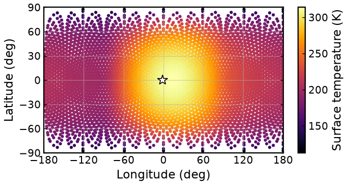
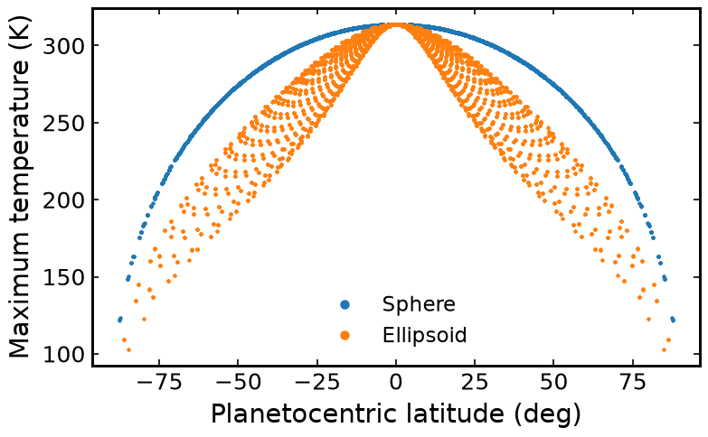
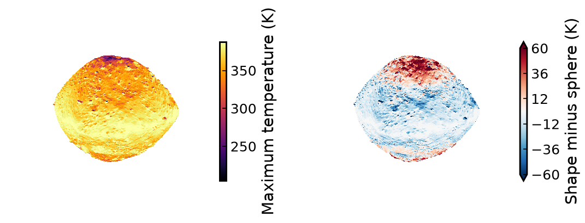

# Tutorial 6: surface temperatures of an asteroid

**Configurations:** [`asteroid_sphere.yaml`](../../examples/asteroid_sphere.yaml),
[`asteroid_ellipsoid.yaml`](../../examples/asteroid_ellipsoid.yaml),
[`asteroid_eros_sphere.yaml`](../../examples/asteroid_eros_sphere.yaml),
[`quickstart_asteroid_bennu.yaml`](../../examples/quickstart_asteroid_bennu.yaml),
[`asteroid_bennu_sphere.yaml`](../../examples/asteroid_bennu_sphere.yaml) and
[`asteroid_eros.yaml`](../../examples/asteroid_eros.yaml)
**Data:** the Moon SPICE kernels (44 MB), the Bennu ephemeris (81 MB), and for Eros 0.3 MB from JPL
Horizons and DAMIT
**Time:** about 20 minutes of computing on four cores for the runs below, CPU only

## The question

The infrared light from an asteroid depends on the temperature of its surface, and that
temperature depends on the distance from the Sun, the albedo, the shape, the spin, and the thermal
inertia of the regolith. Radiometric studies run the argument backward. They fit a model to
thermal infrared observations to find the thermal inertia, which tells how fine-grained or
rock-covered the surface is (Delbo et al.,
[2015](https://doi.org/10.2458/azu_uapress_9780816532131-ch006)). The model has to give the
temperature of each part of the surface at the time of the observation.

PTM3D solves heat conduction in a column of regolith beneath every face of a body, as in
[tutorial 1](01_quickstart.md). For an asteroid the body is a sphere, an ellipsoid or a shape
model, and the sunlight comes from a Keplerian orbit or from a JPL ephemeris. This tutorial runs
each of these. It then covers the choices that decide whether the temperatures are right for a
particular date. These are the output time that falls on the time of interest, the length of the
spin-up, and the rotational phase of the shape model on that date. It ends with extracting temperatures for
comparison with observations and with a small study of thermal inertia.

## The simplest asteroid

`examples/asteroid_sphere.yaml` describes a sphere 1 km across on a circular orbit at 1.3 AU. It
spins once in six hours about an axis perpendicular to the orbit. The body is defined in the
`generic_body` block, which is the same for every body other than the Moon, Mercury and Europa.

```yaml
generic_body:
  name: Sphere Asteroid
  ephemeris_source: keplerian
  shape:
    type: spherical
    radius_km: 0.5
  orbit:
    semi_major_axis_au: 1.3
    eccentricity: 0.0
    inclination_deg: 0.0
    lon_ascending_node_deg: 0.0
    arg_perihelion_deg: 0.0
    mean_anomaly_deg: 0.0
    epoch: '2026-01-01T00:00:00'
  spin:
    period_hours: 6.0
    pole_ra_deg: 270.0
    pole_dec_deg: 66.5607
    prime_meridian_deg: 0.0
  surface:
    albedo: 0.10
    emissivity: 0.95
    ks: 0.0333333
    kd: 0.0333333
    rhos: 1500.0
    rhod: 1500.0
    H: 0.05
    cp0: 800.0
    Qb: 0.0
    chi: 0.0
```

The orbit is a circle in the ecliptic, so the body is always 1.3 AU from the Sun and every day
receives the same sunlight. The spin pole is given in equatorial coordinates (right ascension and
declination of J2000). The values above are the north pole of the ecliptic, which puts the
obliquity at zero and keeps the Sun over the equator. A pole published in ecliptic coordinates
must be converted first. The function `ecliptic_pole_to_equatorial` in `horizons.horizons_client`
does it.

`albedo` is the Bond albedo, the fraction of the incident sunlight that the surface scatters in
all directions. Catalogs usually list the geometric albedo *p*<sub>V</sub>, which is different.
The Bond albedo is *p*<sub>V</sub> *q*, where the phase integral is *q* = 0.290 + 0.684 *G* and *G*
is the slope parameter that the Small-Body Database lists with the albedo.

The thermal inertia Γ = (*k* ρ *c*<sub>p</sub>)<sup>1/2</sup> follows from the surface properties.
Here the column is uniform and its properties do not change with temperature (`chi: 0` removes the
radiative term in the conductivity), so Γ = 200 J m<sup>-2</sup> K<sup>-1</sup> s<sup>-1/2</sup>
everywhere. A column with a loose layer over denser material has `ks` smaller than `kd` and `rhos`
smaller than `rhod`, with `H` the depth over which one changes into the other. `Qb` is the heat
flow into the base of the column, in W m<sup>-2</sup>. It is zero here, and [a later
section](#the-spin-up-and-the-basal-heat-flow) explains what that does to a face that stays dark.

A sphere does not see itself, so radiation exchange is off (`radiation.enabled: false`). The window
is one rotation (`duration_days: 0.25`) in 96 outputs, preceded by 50 rotations of spin-up.

### Run it

```bash
python3 scripts/fetch_kernels.py --bodies moon
./build/bin/ptm_thermal_sim --config examples/asteroid_sphere.yaml
```

The first command is needed only for the leap-seconds kernel. The run takes about a minute. Look
for these lines in the log.

```
Using generic body: Sphere Asteroid
  Solar constant: 805.325 W/m^2
Mesh created with 2562 vertices and 5120 faces
[mesh-units] inferred KILOMETERS: median |face_center| = 0.4995454718 (range 0.4994310584 .. 0.4995503772), 5120 faces, R_body = 0.5 km
Equilibration (integrated): 50.00 day/night cycles = 1 pass(es) x 50.00-cycle forcing block  [default]
Simulation completed in 50.876 seconds (50876 ms)
```

The `mesh-units` line is the check that the size of the mesh and the body radius agree. The log
adds a warning to it when they do not.

### Temperatures against local time

Save the following as a file and run it from the repository root, in the environment described in
[INSTALL.md](../../INSTALL.md).

```python
import numpy as np
from ptm import Results

run = Results("output/asteroid_sphere", body_radius_km=0.5)
tmax = run.stat("temperature", "max")
tmin = run.stat("temperature", "min")
equator = run.faces_in_band(-6, 6)
print(f"{run.n_faces} faces, {len(run.times().et)} output steps")
print(f"equator: T_max {tmax[equator].mean():.1f} K, T_min {tmin[equator].mean():.1f} K")

sigma, eps, albedo, S = 5.670374e-8, 0.95, 0.10, 1361.0 / 1.3**2
T_ss = ((1 - albedo) * S / (eps * sigma)) ** 0.25
theta = 200.0 * np.sqrt(2 * np.pi / (6 * 3600)) / (eps * sigma * T_ss**3)
print(f"sub-solar equilibrium temperature {T_ss:.1f} K, thermal parameter {theta:.2f}")
```

```
5120 faces, 96 output steps
equator: T_max 313.6 K, T_min 198.1 K
sub-solar equilibrium temperature 340.6 K, thermal parameter 1.60
```

A body with no thermal inertia would reach 340.6 K at the sub-solar point at noon and fall to
the cold sky at night. This one reaches 313.6 K and holds 198.1 K before dawn, because the regolith
stores the heat of the day. The thermal parameter Θ = Γ ω<sup>1/2</sup> / (ε σ
*T*<sub>ss</sub><sup>3</sup>) of Spencer et al.
([1989](https://doi.org/10.1016/0019-1035(89)90182-6)) measures the buffering, with ω the angular
spin rate. It is 1.6 here.

To plot the temperature of a face against local solar time, take the longitude of the face
relative to the longitude of the sub-solar point at each output step. Local solar time is 12 hours
plus that angle divided by 15° per hour.

```python
import numpy as np
from ptm import Results, plots

plt = plots.styled()
run = Results("output/asteroid_sphere", body_radius_km=0.5)
sun_lon = np.array([run.subsolar_latlon(i)[1] for i in range(len(run.times().et))])

fig, ax = plt.subplots(figsize=(5.5, 3.5))
for lat in (0, 30, 60, 80):
    face = run.face_at(lat, 0.0)
    _, T = run.series("temperature", face=face)
    local_time = (12.0 + (run.lon[face] - sun_lon) / 15.0) % 24.0
    order = np.argsort(local_time)
    ax.plot(local_time[order], T[order], label=f"{lat}° latitude")
ax.set_xlabel("Local solar time (h)")
ax.set_ylabel("Surface temperature (K)")
ax.set_xlim(0, 24)
ax.set_xticks(range(0, 25, 6))
ax.legend()
fig.tight_layout()
fig.savefig("output/asteroid_sphere/diurnal_curves.png", dpi=150)
```


The temperature peaks about an hour after local noon and is lowest shortly before sunrise at 6 h.
The kinks at 6 h and 18 h are sunrise and sunset. The sphere has the same diurnal curve on every
day of the run, because the obliquity is zero.

### A temperature map

A map shows the temperature of every face at one output time. The next block places the
sub-solar point at the center by choosing the output step at which it crosses longitude 0.

```python
import numpy as np
from ptm import Results, plots

plt = plots.styled()
run = Results("output/asteroid_sphere", body_radius_km=0.5)
lons = np.array([run.subsolar_latlon(i)[1] for i in range(len(run.times().et))])
step = int(np.argmin(np.abs(lons)))
T = run.field("temperature", step=step)
sun_lat, sun_lon = run.subsolar_latlon(step)

fig, ax = plt.subplots(figsize=(6.0, 3.3))
dots = plots.scatter_map(ax, run.lat, run.lon, T, size=14)
ax.plot(sun_lon, sun_lat, marker="*", color="white", markeredgecolor="black",
        markersize=12, linestyle="none", label="Sub-solar point")
ax.legend(loc="lower left", framealpha=1.0)
plots.colorbar(fig, dots, ax, "Surface temperature (K)")
fig.tight_layout()
fig.savefig("output/asteroid_sphere/map.png", dpi=120)
```



The warmest ground is a little east of the sub-solar point, where the local time is early
afternoon. The coldest is 90° to the west, where the Sun is about to rise.

### An ellipsoid

`examples/asteroid_ellipsoid.yaml` differs from the sphere in two lines.

```yaml
  shape:
    type: ellipsoidal
    semi_axes_km: [0.6, 0.4, 0.3]
```

The semi-axes are along the body's x, y and z axes, and the spin axis is z, so the body rotates
about its shortest axis. Each face of the mesh is a flat facet of the ellipsoid, with its own
normal. The sunlight absorbed by a face depends on the angle between its normal and the Sun, not
on the angle between the radial direction and the Sun. On a sphere these are the same.

```bash
./build/bin/ptm_thermal_sim --config examples/asteroid_ellipsoid.yaml
```

The figure compares the maximum temperature of every face on the two bodies against its latitude.
Latitude is planetocentric, from the direction of the face center.

```python
from ptm import Results, plots

plt = plots.styled()
sphere = Results("output/asteroid_sphere", body_radius_km=0.5)
ellipsoid = Results("output/asteroid_ellipsoid", body_radius_km=0.416)

fig, ax = plt.subplots(figsize=(5.5, 3.5))
for run, label in ((sphere, "Sphere"), (ellipsoid, "Ellipsoid")):
    ax.plot(run.lat, run.stat("temperature", "max"), ".", ms=2, label=label)
    band = run.faces_in_band(24, 36)
    print(f"{label}: mean T_max at 24 to 36 degrees latitude "
          f"{run.stat('temperature', 'max')[band].mean():.1f} K")
ax.set_xlabel("Planetocentric latitude (deg)")
ax.set_ylabel("Maximum temperature (K)")
ax.legend(markerscale=4)
fig.tight_layout()
fig.savefig("output/asteroid_ellipsoid/tmax_by_latitude.png", dpi=150)
```

```
Sphere: mean T_max at 24 to 36 degrees latitude 300.5 K
Ellipsoid: mean T_max at 24 to 36 degrees latitude 262.3 K
```



At the equator the two bodies agree to about 1 K. At 30° latitude the ellipsoid is 38 K cooler,
because on a flattened body the surface there faces more toward the pole than the radial
direction does, and the noon Sun strikes it at a larger angle. Thermal inertia, albedo, spin
period and the distance from the Sun set the temperatures of a convex body. Its size does not,
and a sphere of 5 km radius gives the same temperatures as this one. Its shape decides how the
sunlight is distributed over its surface.

### A real orbit from JPL Horizons

For a real asteroid, the orbit comes from JPL Horizons. The script `examples/python/fetch_asteroid.py`
asks Horizons for the osculating orbital elements at the epoch you give, for the diameter, pole
and period it lists, and for an SPK file with the ephemeris over the dates you give. It writes a
`generic_body` block to paste into a configuration. Eros is a good example, because its orbit is
eccentric.

```bash
python3 examples/python/fetch_asteroid.py 433 --shape sphere --start 1993-01-01 --stop 1999-01-01 \
    --epoch 1998-12-23T15:41:23 --outdir data/asteroids/eros_sphere
```

The script prints what it found and writes `ephemeris.bsp` (178 kB), `metakernel.tm` and
`generic_body.yaml` in `data/asteroids/eros_sphere`. The configuration
`examples/asteroid_eros_sphere.yaml` uses the elements in that block with
`ephemeris_source: keplerian`. Osculating elements describe a two-body orbit that matches the
real one at the epoch and drifts from it as the planets perturb it. Set `ephemeris_source: spice`
to follow the SPK file instead. For this window and its 110 days of spin-up, the two orbits give
temperatures that differ by 0.4 K at the median and 2.3 K at most. The difference grows with the
time from the epoch as the planets perturb the orbit, so use the SPK file for a window of months
or more.

```bash
./build/bin/ptm_thermal_sim --config examples/asteroid_eros_sphere.yaml
```

The run takes about 3 minutes, almost all of it the spin-up of 500 rotations (110 days), which
the Eros example below explains. This block reads the result.

```python
import numpy as np
from ptm import Results

run = Results("output/asteroid_eros_sphere", body_radius_km=8.42)
row = run.body_positions()[0]
distance = np.linalg.norm([row["sun_x"], row["sun_y"], row["sun_z"]]) / 1.495978707e8
sun_lat, _ = run.subsolar_latlon(0)
tmax = run.stat("temperature", "max")
print(f"distance from the Sun {distance:.2f} AU, sub-solar latitude {sun_lat:.1f} degrees")
print(f"T_max {tmax.max():.1f} K at the hottest face, "
      f"T_min {run.stat('temperature', 'min').min():.1f} K at the coldest")
```

```
distance from the Sun 1.76 AU, sub-solar latitude -34.6 degrees
T_max 268.5 K at the hottest face, T_min 52.0 K at the coldest
```

Eros has an eccentric orbit and a pole close to its orbital plane, so over one orbit both the
distance from the Sun and the sub-solar latitude change a great deal. The temperatures of a given
face depend on the date for both reasons. The next two sections replace the sphere with a shape
model.

## A shape model from the repository: Bennu

`examples/quickstart_asteroid_bennu.yaml` simulates (101955) Bennu with the global shape model
from the OSIRIS-REx laser altimeter and the JPL ephemeris of the mission. The shape model is in
the repository. The ephemeris is a kernel of 81 MB.

```bash
python3 scripts/fetch_kernels.py --bodies bennu
```

These keys differ from the sphere.

```yaml
generic_body:
  ephemeris_source: spice
  spice_metakernel: bennu.tm
  naif_id: '2101955'
  shape:
    type: custom_mesh
    radius_km: 0.2437
    mesh_file: data/horizons_cache/bodies/101955_Bennu_(1999_RQ36)/g_06370mm_alt_obj_0000n00000_v021.obj
  spin:
    period_hours: 4.29746
    pole_ra_deg: 86.639
    pole_dec_deg: -65.109
    prime_meridian_deg: 0.0
```

The shape has 49,152 triangular facets about 6 m across, with vertices in kilometers.
`radius_km` is the mean radius of the shape. The model uses it to check the length unit of the
mesh. The orbit comes from the SPICE kernel that `bennu.tm` lists. The Keplerian elements in the
`orbit` block of the example are used only at times outside the coverage of the kernel, and
`naif_id` is the number of the body in the kernel. The pole of Bennu is close to the opposite of
its orbit normal, so Bennu spins backward and the Sun stays near its equator. The sub-solar
latitude is 3.6° in this window. The example does not set the rotational phase of Bennu
(`prime_meridian_deg: 0.0`), so a longitude on the model is not a longitude on Bennu. It is
suited to the diurnal behavior of the shape and not to the temperature of a named boulder.

The temperature of each facet follows from the sunlight it receives and the conduction in its own
column. The sunlight includes the shadows that other parts of the shape cast, which the model
finds by tracing rays. Radiation exchange is off, so a facet receives no scattered sunlight or
thermal emission from its neighbors. The Eros run later in this tutorial shows how much that
changes the temperatures.

```bash
./build/bin/ptm_thermal_sim --config examples/quickstart_asteroid_bennu.yaml
```

The run takes about 4 minutes on four cores. Look for these lines.

```
Successfully loaded 25350 vertices and 49152 faces from OBJ file
[mesh-units] inferred KILOMETERS: median |face_center| = 0.239777204 (range 0.2145068748 .. 0.2887708304), 49152 faces, R_body = 0.2437 km
[ephemeris] SPK coverage for 2101955 (NAIF 2101955, 1 kernel(s), 1 interval(s)): 1899-12-31T23:59:19 .. 2135-09-30T23:58:51 -- contains the run window 2019-01-02T20:01:53 .. 2019-01-10T08:33:01.
[ephemeris] Keplerian fallback: 0 of 2113 Sun-position epochs (SPK served the whole run).
```

The window in the third line includes the spin-up before the output window. The last line counts
the times at which the kernel did not cover the run and the model used the Keplerian elements
instead. It should read zero.

### What the shape changes

`examples/asteroid_bennu_sphere.yaml` runs the same simulation on a sphere with Bennu's mean
radius, with the same ephemeris, spin and surface. It takes about 2 minutes. The next block
compares the maximum temperatures of the two runs facet by facet, using for each facet of the
shape the sphere face in the same direction.

```python
import numpy as np
from matplotlib.colors import TwoSlopeNorm
from ptm import Results, plots

plt = plots.styled()
shape = Results("output/quickstart_asteroid_bennu", body_radius_km=0.2437)
sphere = Results("output/asteroid_bennu_sphere", body_radius_km=0.2437)

# For each facet of the shape model, the face of the sphere in the same direction.
u_shape, u_sphere = shape.face_unit_vectors, sphere.face_unit_vectors
nearest = np.concatenate([np.argmax(u_shape[i:i + 4000] @ u_sphere.T, axis=1)
                          for i in range(0, len(u_shape), 4000)])
t_shape = shape.stat("temperature", "max")
difference = t_shape - sphere.stat("temperature", "max")[nearest]

tilt = np.degrees(np.arccos(np.sum(shape.mesh["face_normals"] * u_shape, axis=1)))
print(f"median angle between a facet normal and the radial direction: {np.median(tilt):.1f} degrees")
low = np.abs(shape.lat) <= 30
high = np.abs(shape.lat) >= 60
rms = lambda x: np.sqrt(np.mean(x**2))
print(f"rms difference in T_max: {rms(difference[low]):.1f} K within 30 degrees of the equator, "
      f"{rms(difference[high]):.1f} K within 30 degrees of the poles")
print(f"mean temperature over the faces: {shape.stat('temperature', 'avg').mean():.1f} K for the shape, "
      f"{sphere.stat('temperature', 'avg').mean():.1f} K for the sphere")

mesh = shape.mesh
fig = plt.figure(figsize=(7.0, 3.4))
panels = ((t_shape, "Maximum temperature (K)", None, "inferno"),
          (difference, "Shape minus sphere (K)", TwoSlopeNorm(0.0, -60.0, 60.0), "RdBu_r"))
for k, (values, label, norm, cmap) in enumerate(panels):
    ax = fig.add_subplot(1, 2, k + 1, projection="3d")
    art = plots.shape(ax, mesh["vertices"], mesh["faces"], values, cmap=cmap, norm=norm,
                      elev=25, azim=40, axis_labels=None)
    ax.set_axis_off()
    plots.colorbar(fig, art, ax, label, values=values, norm=norm, shrink=0.65, pad=0.0)
fig.subplots_adjust(left=0.0, right=0.98, wspace=0.15)
fig.savefig("output/quickstart_asteroid_bennu/shape_effect.png", dpi=150)
```

```
median angle between a facet normal and the radial direction: 15.5 degrees
rms difference in T_max: 20.2 K within 30 degrees of the equator, 48.6 K within 30 degrees of the poles
mean temperature over the faces: 280.3 K for the shape, 282.2 K for the sphere
```



The shape changes the temperature of a facet by tens of kelvin and the mean temperature of the
body by about 2 K. Most facets tilt away from the radial direction, by 15° at the median. A
facet that tilts toward the Sun at noon is warmer than the sphere in the same place, and one that
tilts away is cooler. Near the poles the Sun is close to the horizon of a sphere, so a facet that
tilts toward the Sun is much warmer than the sphere, and the shape model is the warmer of the two
there. Eight faces of the shape and twelve of the sphere never see the Sun in this window, and most of
them are at the south pole, which the Sun does not reach at this season. The log warns about
them. [The section on spin-up](#the-spin-up-and-the-basal-heat-flow) explains the warning.

## A shape model from DAMIT: Eros

The Database of Asteroid Models from Inversion Techniques (DAMIT, Ďurech et al.,
[2010](https://doi.org/10.1051/0004-6361/200912693)) lists shape models and spin states derived
from the brightness variations of asteroids. A DAMIT model is the usual starting point for an
asteroid that no spacecraft has mapped. This section uses the model of (433) Eros as the example,
and the date of the NEAR Shoemaker flyby of Eros. NEAR passed at 18:41:23 UTC on 23 December
1998.

### Fetching the shape, the spin state and the orbit

```bash
python3 examples/python/fetch_asteroid.py 433 --damit-id 1714 --start 1993-01-01 \
    --stop 1999-01-01 --epoch 1998-12-23T15:41:23 --outdir data/asteroids/eros
```

The script needs network access to `ssd.jpl.nasa.gov` (Horizons), `ssd-api.jpl.nasa.gov` (the
Small-Body Database) and `damit.cuni.cz`. It downloads about 0.3 MB in total. The `--damit-id` is the number at the end of the
address of the model's page on the DAMIT site. Without it the script searches DAMIT by asteroid
number, which fails when the site is slow. The SPK file covers 1993 to 1999, which
reaches back far enough for the spin-up in the next section. The script prints what it found.

```
Horizons: 433 Eros (A898 PA), diameter 16.84 km, period 5.27 h, geometric albedo 0.25, pole RA 11.37 Dec 17.22
SPK: 178 kB
DAMIT model 1714: 856 vertices, 1708 faces, equal-volume radius 8.410 in the units of the file, signed volume 2491.6
spin: lambda 17.0, beta 11.0, P 5.27025528 h, JD0 2451545.0, phi0 32.64
pole RA 11.2906, Dec 16.8116; delta -86.661; W at JD 2451171.154470 = 147.625
wrote data/asteroids/eros/generic_body.yaml
```

It writes `ephemeris.bsp`, `metakernel.tm`, `shape.obj` and `generic_body.yaml` to
`data/asteroids/eros`. The block in `generic_body.yaml` is the `generic_body` block of
`examples/asteroid_eros.yaml` without the surface properties.

### What to check

- **The length unit.** The Eros model is in kilometers. A DAMIT model can be in other units. The
  script prints the radius of a sphere of equal volume, in the units of the file, and the run
  log has a `mesh-units` line that compares the size of the mesh with `shape.radius_km`. If the
  radius is not in kilometers, give `--radius-km` with the true value and the script rescales the
  shape. A mesh that is much smaller or larger than `radius_km` produces a warning in the log and
  not an error, and the run proceeds with a body of the wrong size. Leave `shape.mesh_scale` at
  1, because it rescales the vertices and not the faces.
- **The orientation of the faces.** The script prints the signed volume of the mesh, which is
  positive when the faces point outward. If they point inward, the log reports
  `Flipped 1708 face normals to point outward` and the run corrects them.
- **The number of faces.** The log reports `Successfully loaded 856 vertices and 1708 faces`. Each
  face is a column of regolith, so the cost of a run grows with the number of faces.
- **The pole.** DAMIT gives the pole in ecliptic coordinates, and the script converts it. It
  differs from the pole in the Small-Body Database by 0.4° for Eros. Use the pole of the model
  together with the phase of the model, as the script does.
- **The body-fixed frame.** The body-fixed axes are the axes of the DAMIT file, with z along the
  pole. PTM3D takes the shape as given in those axes and finds the direction of the Sun in them
  from the pole, the period and the rotational phase.

### The configuration

`examples/asteroid_eros.yaml` has the block above, with the surface properties added.

```yaml
generic_body:
  name: 433 Eros (A898 PA)
  ephemeris_source: spice
  spice_metakernel: data/asteroids/eros/metakernel.tm
  naif_id: '20000433'
  shape:
    type: custom_mesh
    mesh_file: data/asteroids/eros/shape.obj
    radius_km: 8.410
  spin:
    period_hours: 5.27025528
    pole_ra_deg: 11.2906
    pole_dec_deg: 16.8116
    prime_meridian_deg: 147.625
    epoch: 'JD 2451171.154470'
  surface:
    albedo: 0.151
    emissivity: 0.95
    ks: 0.01875                  # with rho and cp this gives a thermal inertia of 150
    kd: 0.01875
    rhos: 1500.0
    rhod: 1500.0
    H: 0.05
    cp0: 800.0
    Qb: 0.0
    chi: 0.0
```

The albedo is the Bond albedo computed from the geometric albedo of 0.25 and the slope
parameter of 0.46 that the Small-Body Database lists, which give a phase integral of 0.60. The
thermal inertia of 150 is chosen for the example. Fit it to your own data. The window is six hours starting at 15:41:23 in 72 outputs, and the spin-up is 500
rotations. [The next section](#choosing-the-window-and-the-spin-up) explains both.

### Run it

```bash
./build/bin/ptm_thermal_sim --config examples/asteroid_eros.yaml
```

The run takes about 3 minutes on four cores, almost all of it the spin-up. Look for these
lines.

```
Successfully loaded 856 vertices and 1708 faces from OBJ file
[mesh-units] inferred KILOMETERS: median |face_center| = 9.425513868 (range 3.346628156 .. 17.58198531), 1708 faces, R_body = 8.41 km
[mesh-units]   confirmed by R_body: |face_center| / R_body = 1.12 assuming KILOMETERS
  Spin epoch:  JD 2451171.154 TDB  (prime meridian W0 = 147.625 deg at this epoch)
Total equilibration period: 109.86 Earth days
[ephemeris] SPK coverage for 20000433 (NAIF 20000433, 1 kernel(s), 1 interval(s)): 1992-12-31T23:59:01 .. 1998-12-31T23:58:57 -- contains the run window 1998-09-04T18:58:37 .. 1998-12-23T21:36:23.
[ephemeris] Keplerian fallback: 0 of 25384 Sun-position epochs (SPK served the whole run).
Simulation completed in 195.085 seconds (195085 ms)
```

The `[ephemeris]` line confirms that the SPK file covers the spin-up as well as the window. The
temperatures at the time of the flyby are in the output step at 18:41:23.

```python
import numpy as np
from ptm import Results, plots

plt = plots.styled()
run = Results("output/asteroid_eros", body_radius_km=8.41)
utc = list(run.times().utc)
step = utc.index("1998-12-23T18:41:23.000")
T = run.field("temperature", step=step)
sun_lat, sun_lon = run.subsolar_latlon(step)
print(f"{run.n_faces} faces, output {step} is at {utc[step]} UTC")
print(f"sub-solar point at latitude {sun_lat:.1f}, longitude {sun_lon:.1f} degrees")
print(f"surface temperature {T.min():.1f} to {T.max():.1f} K, "
      f"area-weighted mean {np.average(T, weights=run.face_areas_m2):.1f} K")

mesh = run.mesh
fig = plt.figure(figsize=(7.0, 3.3))
for k, azim in enumerate((-60, 120)):
    ax = fig.add_subplot(1, 2, k + 1, projection="3d")
    art = plots.shape(ax, mesh["vertices"], mesh["faces"], T, elev=15, azim=azim, axis_labels=None)
    ax.set_axis_off()
    ax.set_box_aspect((1, 1, 1), zoom=1.7)
plots.colorbar(fig, art, fig.axes, "Surface temperature (K)", orientation="horizontal",
               shrink=0.5, pad=0.0, aspect=30)
fig.subplots_adjust(left=0.0, right=1.0, top=1.0, bottom=0.2, wspace=0.0)
fig.savefig("output/asteroid_eros/shape_temperature.png", dpi=150)
```

```
1708 faces, output 36 is at 1998-12-23T18:41:23.000 UTC
sub-solar point at latitude -34.5, longitude 14.5 degrees
surface temperature 50.7 to 268.3 K, area-weighted mean 178.9 K
```


The figure shows the shape in two views. The side facing the Sun is warm, the terminator is
sharp, and the cold dark region at the top is in its polar night. The temperature of every face
at this time is in the array `T`.

### Self-heating

Faces in a concave region see each other. With `radiation.enabled: true`, each face also receives
the sunlight scattered by the other faces and their thermal emission, as in
[tutorial 2](02_crater_radiosity.md) for a crater. The option is also on the command line.

```bash
./build/bin/ptm_thermal_sim --config examples/asteroid_eros.yaml --radiation-exchange \
    --output output/asteroid_eros_rad
```

The run takes about 7 minutes. The model computes the view factors between the 1,708 faces in
under a second. It then solves for the temperatures again and again until they change by less
than 0.5 K, and repeats the spin-up with the indirect flux included. The next block compares the
two runs.

```python
import numpy as np
from ptm import Results

off = Results("output/asteroid_eros", body_radius_km=8.41)
on = Results("output/asteroid_eros_rad", body_radius_km=8.41)
for moment in ("max", "min"):
    d = on.stat("temperature", moment) - off.stat("temperature", moment)
    worst = np.argmax(np.abs(d))
    print(f"T_{moment}: median change {np.median(d):+.2f} K, 95th percentile of the change "
          f"{np.percentile(np.abs(d), 95):.1f} K, largest {d[worst]:+.1f} K "
          f"at latitude {off.lat[worst]:.0f}, longitude {off.lon[worst]:.0f}")
```

```
T_max: median change +0.07 K, 95th percentile of the change 2.0 K, largest +13.2 K at latitude 11, longitude -92
T_min: median change +0.06 K, 95th percentile of the change 1.9 K, largest +10.9 K at latitude 11, longitude -92
```

Self-heating changes the temperature of most faces of Eros by less than 2 K and raises the
temperature of a few faces by more than 10 K. A face is warmed most where a large part of its sky
is filled by other parts of the body. On a smooth convex body, as in the first part of this
tutorial, no face sees another and the option changes nothing.
