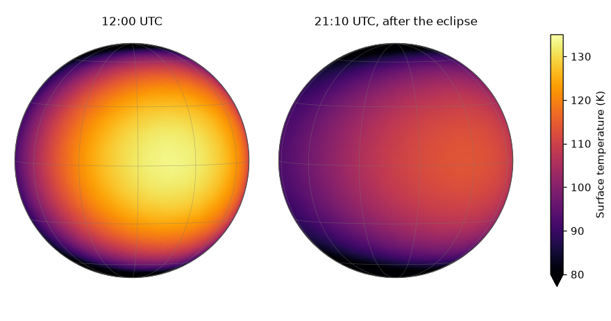
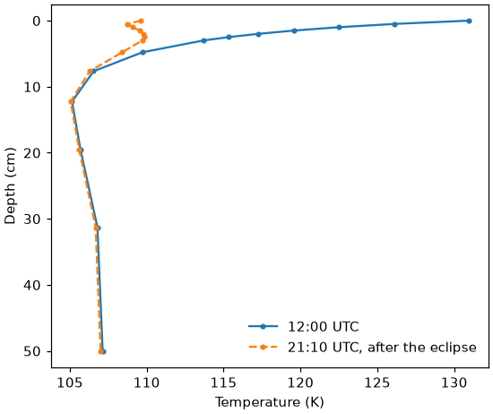
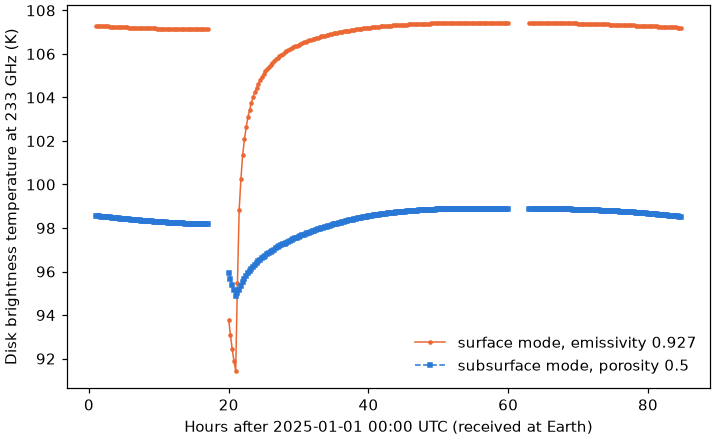
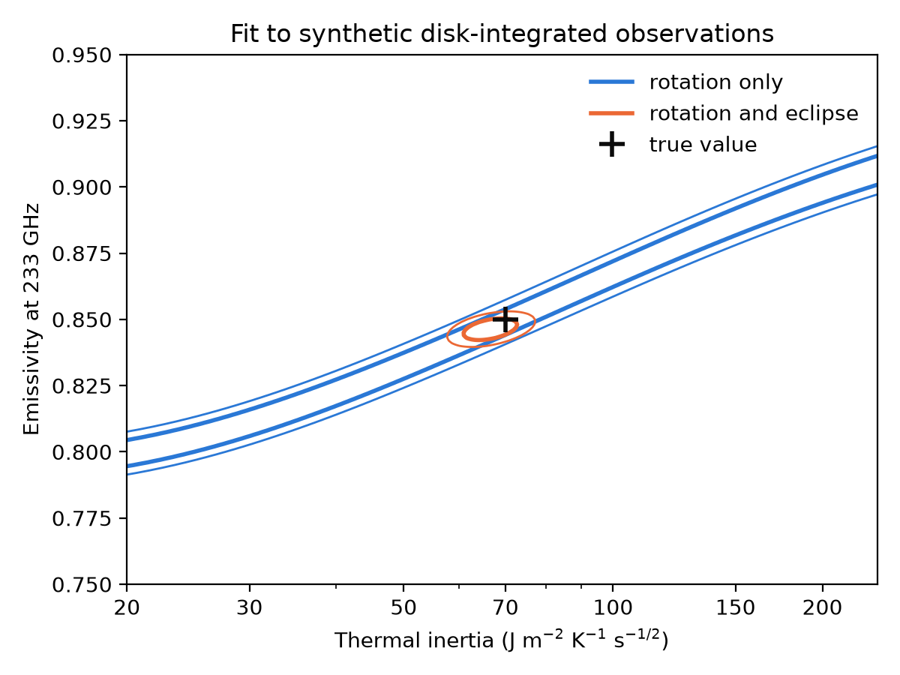
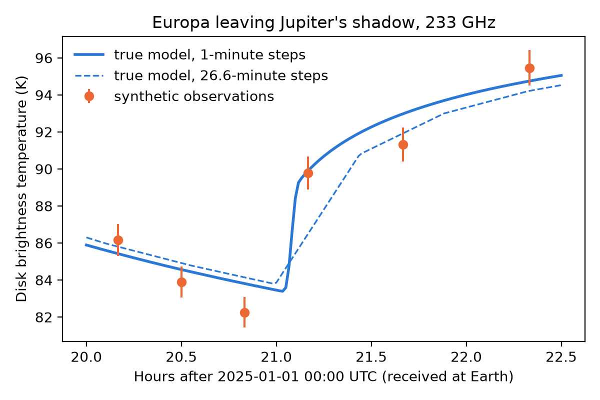
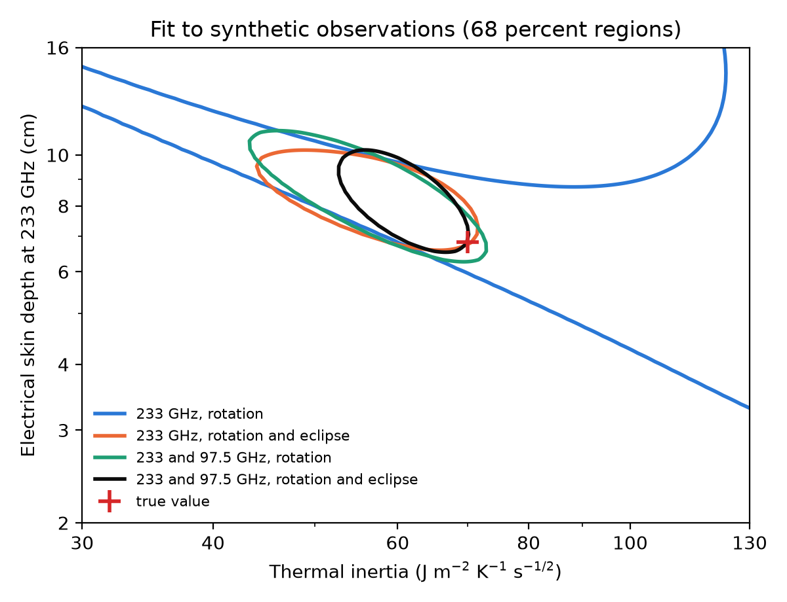
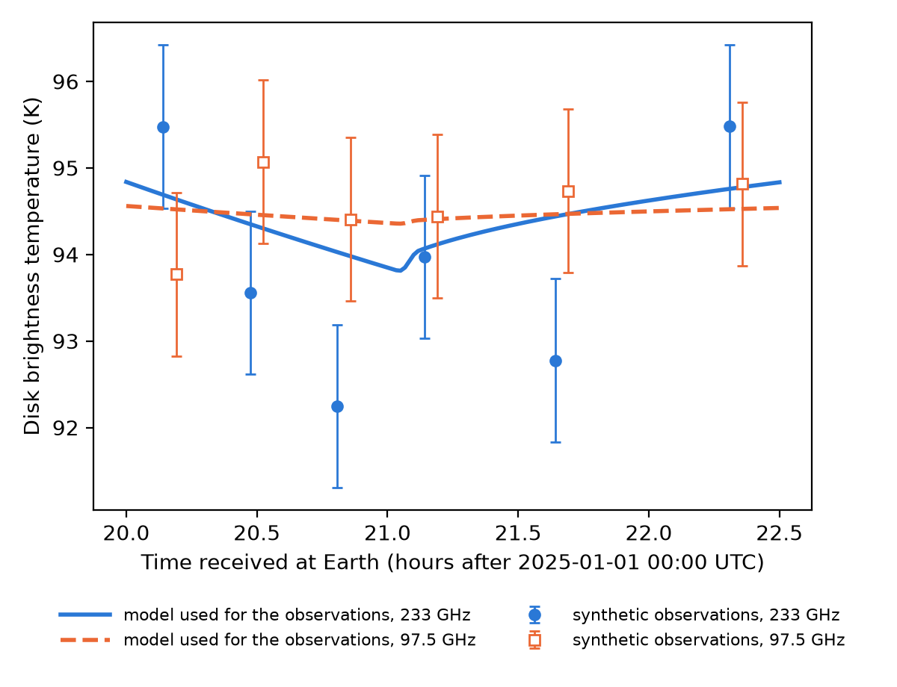

# Tutorial 7: Europa's thermal emission seen from Earth

**Configuration:** [`examples/quickstart_europa_observing.yaml`](../../examples/quickstart_europa_observing.yaml)
**Data:** the Europa SPICE kernels (1.1 GB)
**Time:** about 15 seconds for the simulation and under a minute for the figures on eight cores.
The two fitting examples take about 4 and 7 minutes.

## Thermal emission of Europa's disk

Millimeter telescopes such as ALMA measure the thermal emission of Europa's whole disk. To
compare such a measurement with a thermal model, the model temperatures must be taken at the
moment the light left Europa, seen from where Earth was, and integrated over the visible disk at
the observing frequency. At millimeter wavelengths water ice is partly transparent, so the
emission comes from the upper several centimeters of the ice rather than from its surface.

This tutorial runs Europa through one orbit, computes the disk brightness temperature seen from
Earth at a chosen time, follows it through a Jupiter eclipse, and fits thermal inertia to
synthetic observations. The physics of the calculation is described in
[docs/observing.md](../observing.md).

## Data

```bash
python3 scripts/fetch_kernels.py --bodies europa
```

This downloads the core kernels and the Galilean satellite ephemeris (`jup365.bsp`, 1.1 GB)
into `data/kernels`. The Python steps and the `ptm observe` command need the `ptm` package,
installed from the repository root with `python3 -m pip install -e .`.

## The configuration

The configuration is the Europa quickstart of the notebook tutorials with one addition. Besides
the surface temperature, the run writes the temperature at 13 depths for every face at every
output step.

```yaml
output:
  directory: output/quickstart_europa_observing
  map_depths_m: [0.0, 0.005, 0.01, 0.015, 0.02, 0.025, 0.03, 0.0479, 0.0766,
                 0.1225, 0.1957, 0.3128, 0.5]
  map_depth_snap_to_node: false
  map_depths_per_step: true
```

The model represents Europa as a sphere of 5,120 faces with the built-in porous-ice properties,
and follows one orbit of 3.55 days from 2025-01-01 at 26.6-minute output steps. Europa passes
through Jupiter's shadow on the first day.

The depths are chosen for emission at 233 GHz. The first ones are 5 mm apart, which resolves
both the diurnal temperature wave and the absorption length of the ice. The last is 0.5 m,
deeper than seven electrical skin depths. `map_depth_snap_to_node: false` interpolates the
model's temperatures to these depths, and `map_depths_per_step: true` writes them at every
output step rather than only as statistics.

## Running the simulation

```bash
./build/bin/ptm_thermal_sim --config examples/quickstart_europa_observing.yaml
```

Look for these lines in the log.

```
Mesh created with 2562 vertices and 5120 faces
  per-step frames: every output step in the window, 49 MiB (output.map_depths_per_step)
[depth-map] Per-step frames written: 13 depth(s) x 192 step(s), in output/quickstart_europa_observing/<field>/
Simulation completed in 12.330 seconds (12330 ms)
```

The log also warns that 20 orbits of spin-up are fewer than its estimate of 35. With 40 orbits
the disk brightness temperatures below change by less than 0.1 K, so the warning can be set
aside here.

## Europa at the time of an observation

Choose the time at which the light reaches Earth. The model then finds where Europa was and how
it was oriented when the light left it, and interpolates its temperatures to that moment.

```python
import numpy as np
from ptm import Results, observe

run = Results("output/quickstart_europa_observing")
geom = observe.observer_geometry(run, "2025-01-01T12:00:00", observer="EARTH")
print(f"light left Europa at {geom.utc_emission} UTC, {geom.light_time_s:.0f} s earlier")
print(f"sub-Earth point {geom.sub_observer_lat:.2f} N {geom.sub_observer_lon:.2f} E, "
      f"phase angle {geom.phase_angle_deg:.2f} deg, {geom.occultation}")

T_surface = observe.temperature_at(run, geom)          # K, one value per face
depths, T = observe.depth_temperatures_at(run, geom)   # K, (faces, depths)

mesh = observe.disk_mesh(run)
facing = mesh.normals @ (geom.observer_km / np.linalg.norm(geom.observer_km))
center = int(np.argmax(facing))                        # face at the disk center
print(f"disk center: surface {T_surface[center]:.1f} K")
for z, t in zip(depths, T[center]):
    if z in (0.01, 0.03, 0.0766, 0.1957, 0.5):
        print(f"  {100 * z:5.1f} cm  {t:.1f} K")
```

```
light left Europa at 2025-01-01T11:25:04.865 UTC, 2095 s earlier
sub-Earth point 2.75 N 26.94 E, phase angle 5.23 deg, visible
disk center: surface 131.0 K
    1.0 cm  122.5 K
    3.0 cm  113.7 K
    7.7 cm  106.5 K
   19.6 cm  105.7 K
   50.0 cm  107.1 K
```

`T_surface` and `T` are snapshots of the whole body at the moment the light left it. Near noon at
the disk center the surface is about 25 K warmer than the ice 20 cm below it. Below the diurnal
wave the temperature rises again with depth, carried by the internal heat flow.

### The visible disk at two observation times

The next block draws the surface temperature of the hemisphere that faces Earth at 12:00 UTC and
at 21:10 UTC, a few minutes after Europa leaves Jupiter's shadow, each centered on the sub-Earth
point with north up. It then plots the temperature against depth at the center of the disk at
the same two times.

```python
import numpy as np
import matplotlib
matplotlib.use("Agg")
import matplotlib.pyplot as plt
from ptm import Results, observe, plots

run = Results("output/quickstart_europa_observing")
mesh = run.mesh
times = {"2025-01-01T12:00:00": "12:00 UTC", "2025-01-01T21:10:00": "21:10 UTC, after the eclipse"}

fig, axes = plt.subplots(1, 2, figsize=(8.0, 4.2), constrained_layout=True)
profiles = {}
for ax, (utc, title) in zip(axes, times.items()):
    geom = observe.observer_geometry(run, utc, observer="EARTH")
    T = observe.temperature_at(run, geom)
    tv = plots.vertex_values_from_faces(mesh["faces"], T, mesh["n_vertices"])
    art = plots.globe(ax, mesh["vertices"], mesh["faces"], tv, geom.sub_observer_lat,
                      geom.sub_observer_lon, norm=plt.Normalize(80, 135), title=title)
    depths, Tz = observe.depth_temperatures_at(run, geom)
    facing = observe.disk_mesh(run).normals @ (geom.observer_km / np.linalg.norm(geom.observer_km))
    profiles[title] = Tz[int(np.argmax(facing))]
fig.colorbar(art, ax=axes, shrink=0.8, extend="min", label="Surface temperature (K)")
fig.savefig("output/quickstart_europa_observing/disk_snapshots.png", dpi=110)

fig, ax = plt.subplots(figsize=(5.0, 4.2), constrained_layout=True)
for (title, Tz), style in zip(profiles.items(), ("-", "--")):
    ax.plot(Tz, 100 * depths, style, marker="o", ms=3, label=title)
ax.invert_yaxis()
ax.set_xlabel("Temperature (K)")
ax.set_ylabel("Depth (cm)")
ax.legend(frameon=False, loc="lower right")
fig.savefig("output/quickstart_europa_observing/disk_center_profiles.png", dpi=110)
```



The color scale stops at 80 K. The faces near the poles are colder, down to about 28 K, and
contribute little to the emission. At 12:00 UTC the warmest surface is near the disk center,
because Earth and the Sun are within a few degrees of each other as seen from Europa. At 21:10 UTC
the surface has recovered only part of the cooling it suffered in Jupiter's shadow.



The eclipse cools the upper few centimeters of the ice. Below about 8 cm the two profiles
agree, and the diurnal wave is largely damped. Emission at 233 GHz, with an electrical skin depth
of about 7 cm, comes from both parts of the profile, which is why the subsurface mode below
responds to the eclipse much less than the surface mode.

## The disk brightness temperature

`ptm observe` integrates the emission over the visible disk. In the surface mode each face emits
with a band emissivity that you choose.

```bash
ptm observe output/quickstart_europa_observing \
    --time 2025-01-01T12:00:00 --time 2025-01-01T21:10:00 --freq-ghz 233 --emissivity 0.9
```

```
quickstart_europa_observing: surface mode, 233.000 GHz, band emissivity 0.9, radius 1560.8 km
observer EARTH, times corrected for light time (CN+S), temperatures interpolated linearly in time between the output steps shown
brightness temperatures use the solid angle pi R^2/D^2
observed UTC  emitted UTC (at body)  steps  shift deg  obs lat  obs lon  phase deg  dist km  F_nu Jy  Tb Planck K  Tb RJ K  view
2025-01-01T12:00:00.000  2025-01-01T11:25:04.865  25-26  -  2.752  26.944  5.23  6.2811e+08  3.1934  104.185  98.694  visible
2025-01-01T21:10:00.000  2025-01-01T20:35:03.127  46-47  -  2.751  -11.774  5.30  6.2863e+08  2.7801  91.540  86.062  visible
```

In the subsurface mode the emission is integrated through the temperature profile of every
face, along the ray refracted into the ice at that face's emission angle. The electrical skin
depth and the Fresnel transmissivity of the surface come from the porous-ice dielectric model.

```bash
ptm observe output/quickstart_europa_observing \
    --time 2025-01-01T12:00:00 --time 2025-01-01T21:10:00 --freq-ghz 233 --porosity 0.5
```

```
quickstart_europa_observing: subsurface mode, 233.000 GHz, electrical skin depth 6.84 cm, refractive index 1.374, radius 1560.8 km
beta = L_e / thermal skin depth = 1.93. Much less than 1, the surface mode would serve. Near 1 or more, the emission samples the diurnal temperature wave.
observer EARTH, times corrected for light time (CN+S), temperatures interpolated linearly in time between the output steps shown
brightness temperatures use the solid angle pi R^2/D^2
observed UTC  emitted UTC (at body)  steps  shift deg  obs lat  obs lon  phase deg  dist km  F_nu Jy  Tb Planck K  Tb RJ K  view
2025-01-01T12:00:00.000  2025-01-01T11:25:04.865  25-26  -  2.752  26.944  5.23  6.2811e+08  3.0011  98.236  92.751  visible
2025-01-01T21:10:00.000  2025-01-01T20:35:03.127  46-47  -  2.751  -11.774  5.30  6.2863e+08  2.8909  94.974  89.493  visible
```

The second time is a few minutes after Europa leaves Jupiter's shadow. Between the two times the
brightness temperature falls by about 13 K in the surface mode but only about 3 K in the
subsurface mode, because the ice a few centimeters down has barely cooled.

## The disk brightness temperature through one orbit

This block follows the disk brightness temperature through the orbit in both modes. For the
surface mode it uses an emissivity of 0.927, the disk average of the Fresnel transmissivity, so
the two curves differ only in where the emission comes from. Times when Jupiter hides Europa or
Europa is in front of Jupiter are left as gaps in the curves.

```python
import warnings
import numpy as np
import matplotlib
matplotlib.use("Agg")
import matplotlib.pyplot as plt
from ptm import Results, observe

run = Results("output/quickstart_europa_observing")
sub = observe.Subsurface(porosity=0.5)
hours, tb_surf, tb_sub = [], [], []
for h in np.arange(1.0, 85.0, 0.25):
    utc = str(np.datetime64("2025-01-01T00:00:00") + np.timedelta64(int(h * 3600), "s"))
    with warnings.catch_warnings():
        warnings.simplefilter("ignore")
        geom = observe.observer_geometry(run, utc, observer="EARTH")
    hours.append(h)
    if geom.occultation != "visible":            # break the curves while Jupiter hides Europa
        tb_surf.append(np.nan)
        tb_sub.append(np.nan)
        continue
    surface = observe.disk_emission(run, observe.temperature_at(run, geom), geom,
                                    frequency_ghz=233.0, emissivity=0.927)
    depths, T = observe.depth_temperatures_at(run, geom)
    subsurface = observe.disk_emission(run, T, geom, frequency_ghz=233.0,
                                       subsurface=sub, depths_m=depths)
    tb_surf.append(surface.tb_planck_k)
    tb_sub.append(subsurface.tb_planck_k)

tb_surf, tb_sub = np.array(tb_surf), np.array(tb_sub)
print(f"surface mode:    {np.nanmin(tb_surf):.1f} to {np.nanmax(tb_surf):.1f} K")
print(f"subsurface mode: {np.nanmin(tb_sub):.1f} to {np.nanmax(tb_sub):.1f} K")

fig, ax = plt.subplots(figsize=(6.5, 4.0), constrained_layout=True)
ax.plot(hours, tb_surf, "o-", ms=2, lw=1, color="#eb6834", label="surface mode, emissivity 0.927")
ax.plot(hours, tb_sub, "s--", ms=2, lw=1, color="#2a78d6", label="subsurface mode, porosity 0.5")
ax.set_xlabel("Hours after 2025-01-01 00:00 UTC (received at Earth)")
ax.set_ylabel("Disk brightness temperature at 233 GHz (K)")
ax.legend(frameon=False, loc="lower right")
fig.savefig("output/quickstart_europa_observing/disk_tb_233ghz.png", dpi=110)
```

```
surface mode:    91.4 to 107.4 K
subsurface mode: 94.9 to 98.9 K
```



From Earth, Europa is always seen near full phase, so its rotation changes the disk brightness
temperature very little on this uniform-albedo model. The eclipse is the strongest signal. The
subsurface brightness temperature is lower than the surface one at the same emissivity, because
the emitting layer lies below the warm daytime surface. Its eclipse dip is a fifth as deep.

## Fitting thermal inertia to disk observations

Two example scripts fit model parameters to synthetic observations. Each makes the observations
from one simulation with known parameters and 1 percent noise, and fits them with a grid of
simulations at other thermal inertias. Half of the observation times follow Europa's rotation,
and half follow it out of Jupiter's shadow on 2025-01-01.

The first uses the surface mode and fits thermal inertia and a band emissivity.

```bash
python3 examples/python/fit_europa_disk_tb.py
```

```
SYNTHETIC observations: true thermal inertia 70, true emissivity 0.85, 1 percent noise

rotation only          (6 times): thermal inertia   24.1  [20.0, 240.0]   emissivity 0.804  [0.797, 0.909]   min chi-square 0.8
rotation and eclipse   (12 times): thermal inertia   66.5  [62.9, 70.4]   emissivity 0.846  [0.844, 0.848]   min chi-square 8.9
```

The rotation alone leaves thermal inertia undetermined, because the disk is always seen near
noon and its brightness depends mostly on the emissivity. The eclipse cools the surface on a
time scale of an hour, and how fast it cools and recovers fixes the thermal inertia.

The script writes the synthetic observations to `output/europa_disk_fit/synthetic_observations.csv`
and draws two figures in the same directory. The first, `chi2_surface.png`, shows the regions of
68 and 95 percent confidence for the two parameters, as the thick and thin contours.



With the rotation alone, the confidence region is a band in which a higher thermal inertia is
offset by a higher emissivity. The eclipse observations close the band into a small ellipse
around the true values.

The second, `eclipse_tb.png`, compares the synthetic observations after the eclipse with the
model that made them, at one-minute output steps and at the 26.6-minute steps of the one-orbit
run.



The second uses the subsurface mode at 233 and 97.5 GHz. It fits thermal inertia and the
electrical skin depth at 233 GHz. The refractive index and the skin depth at 97.5 GHz follow
from the dielectric model, which gives a skin depth more than five times longer at the lower
frequency.

```bash
python3 examples/python/fit_europa_disk_tb_subsurface.py
```

```
Fit with noise:
  233 GHz, rotation                        ( 6 obs): thermal inertia  130.0 [30.0, 130.0]   L_e(233)  4.88 cm [3.76, 13.29]   min chi-square 0.7
  233 GHz, rotation and eclipse            (12 obs): thermal inertia   55.7 [47.6, 65.1]   L_e(233)  8.20 cm [7.34, 9.51]   min chi-square 8.7
  233 and 97.5 GHz, rotation               (12 obs): thermal inertia   55.4 [47.1, 66.1]   L_e(233)  8.51 cm [7.07, 9.87]   min chi-square 6.1
  233 and 97.5 GHz, rotation and eclipse   (24 obs): thermal inertia   60.5 [55.4, 66.4]   L_e(233)  8.20 cm [7.07, 9.17]   min chi-square 16.4

Fit without noise (expected widths):
  233 GHz, rotation                        ( 6 obs): thermal inertia   70.4 [30.0, 130.0]   L_e(233)  6.81 cm [3.49, 13.79]   min chi-square 0.0
  233 GHz, rotation and eclipse            (12 obs): thermal inertia   70.1 [59.0, 84.8]   L_e(233)  6.81 cm [5.87, 7.90]   min chi-square 0.0
  233 and 97.5 GHz, rotation               (12 obs): thermal inertia   70.1 [58.7, 85.7]   L_e(233)  6.81 cm [5.45, 8.20]   min chi-square 0.0
  233 and 97.5 GHz, rotation and eclipse   (24 obs): thermal inertia   70.1 [63.5, 77.7]   L_e(233)  6.81 cm [5.87, 7.90]   min chi-square 0.0

With all observations and 40 other noise draws, the interval contains the true thermal inertia 29 times and the true skin depth 23 times (about 68 percent expected).
```

The true values are a thermal inertia of 70 and a skin depth of 6.84 cm. At one frequency and
without the eclipse, a higher thermal inertia and a longer skin depth both reduce the variation
of the brightness temperature, and the fit finds a long valley through the whole range searched.
The eclipse and the second frequency each cut across the valley. With both, the expected
interval in thermal inertia is about ±10 percent.

This particular noise draw places the best fit about 1.5 standard errors from the true values
along the valley. The fit without noise returns the true values, and over many draws the
intervals contain the true values about as often as they should. The script draws the
confidence regions as `valley.png` and the eclipse at both frequencies as `eclipse_tb.png`, in
`output/europa_disk_fit_subsurface`.





At 97.5 GHz the emission comes from tens of centimeters below the surface, and the eclipse is
barely visible in the disk brightness temperature. The two frequencies are observed at the same
times, and their points are drawn 1.5 minutes apart so that both error bars can be seen. At 233 GHz the dip is about 1 K, comparable
to the 1 percent noise of these synthetic observations, which is why the eclipse narrows the
fit only when it is sampled at several times.

The subsurface example needs temperatures to 4 m at every output step, because the skin depth at
97.5 GHz is about 40 cm. Its runs take about 2.3 GB of disk.

## Output cadence for eclipse data

Linear interpolation between output steps is adequate for Europa's slow rotation but not for an
eclipse. As Europa leaves the shadow, the disk brightness temperature in the surface mode rises
by about 2 K per minute. A model used to fit eclipse observations needs output steps of 1 minute
or less within 10 minutes of the shadow contacts, and 5 minutes or less through the rest of the
eclipse.

The fitting examples therefore add, for each thermal inertia, a five-hour run with one-minute
steps around the eclipse. It starts before Europa enters the shadow, so the cooling is
integrated from its beginning. Its spin-up is sampled 192 times per orbit, as in the one-orbit
run, with `thermal.equilibration_samples_per_diurnal_cycle: 192`. Without that key the spin-up
would also take one-minute steps and the run would take about thirty times longer. With the
26.6-minute steps of the one-orbit run, the disk brightness temperature at egress is more than
3 K off.

## What a fit can and cannot determine

The surface mode is the right description in the thermal infrared, where the emission comes
from a thin surface layer. At millimeter wavelengths the emission comes from the upper
centimeters of the ice, and the subsurface mode is needed. An emissivity fitted with the surface
mode should never be used in the subsurface calculation.

A single disk brightness temperature cannot separate thermal inertia, emissivity and electrical
skin depth, because each of them changes the brightness in a similar way. Observations that
follow the temperature in time, such as an eclipse sampled every minute near the shadow
contacts, or observations at several frequencies, separate them.

Fits to synthetic observations test the method and the sampling of the observations. They carry
no information about Europa's actual properties.

## Going further

- Add `--csv table.csv` to `ptm observe` to write every geometric and radiometric quantity.
- Replace the uniform albedo with the observed albedo map (`illumination.use_albedo_map: true`,
  see notebook 02) and follow the disk brightness temperature as Europa rotates.
- Observe from a spacecraft by adding its trajectory with `--kernel` and naming it with
  `--observer`.
- Try 97.5 GHz with this run. The command then warns that the depths do not reach seven
  electrical skin depths. Extend `map_depths_m` and raise `thermal.thermal_b` until the warning
  stops.
