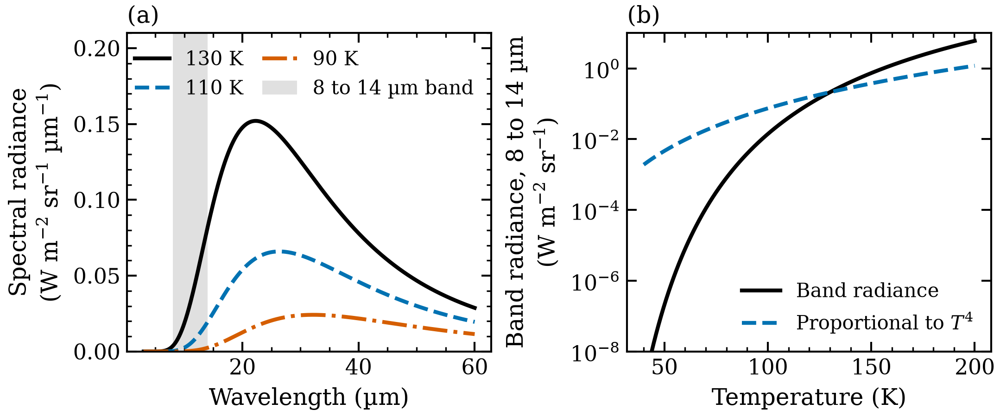
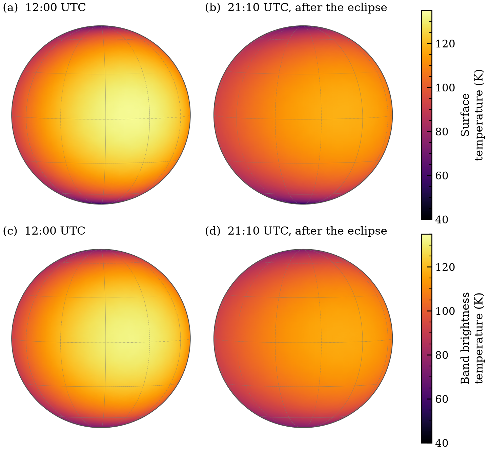
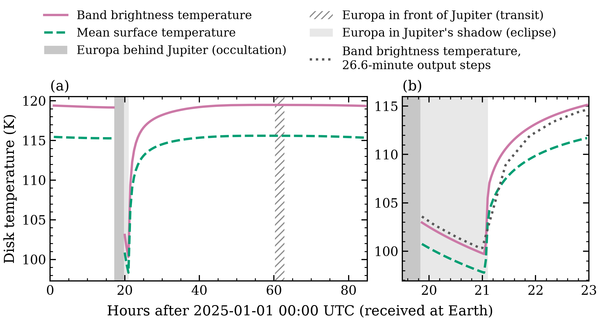
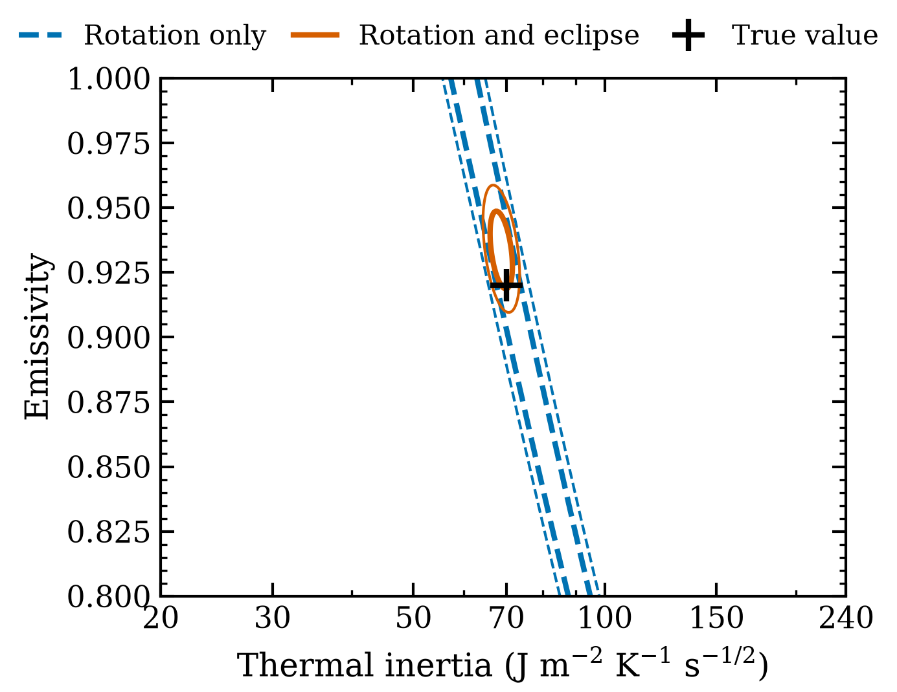
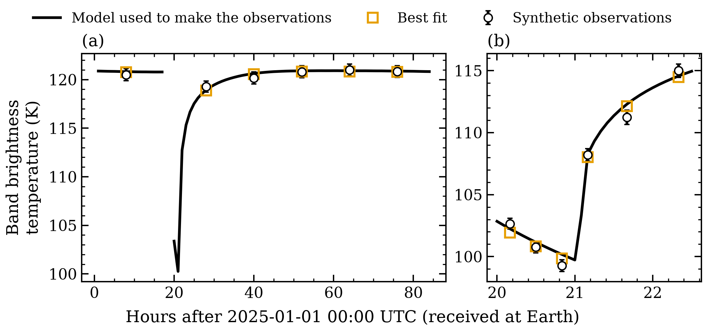

# Tutorial 7: Europa seen from Earth in the thermal infrared

**Configuration:** [`examples/quickstart_europa_diurnal.yaml`](../../examples/quickstart_europa_diurnal.yaml)
and [`examples/quickstart_europa_eclipse.yaml`](../../examples/quickstart_europa_eclipse.yaml)
**Data:** the Europa SPICE kernels (1.1 GB)
**Time:** about 12 seconds for each simulation and under two minutes for the figures on eight
cores. The fitting example takes about 18 minutes.

## Thermal emission of Europa's disk

A telescope on Earth with a mid-infrared camera sees Europa as a disk a few pixels across, or
measures the flux of the whole disk in a band such as 8 to 14 μm. To compare such a measurement
with a thermal model, the model temperatures must be taken at the moment the light left Europa,
seen from where Earth was, converted to radiance in the band, and integrated over the visible
disk. In the thermal infrared the ice is opaque, so the emission comes from the surface
temperature of each face.

Europa's dayside is at 100 to 130 K, and at these temperatures the band from 8 to 14 μm lies on
the short-wavelength side of the Planck function, far from its peak. This tutorial shows what
that means for an observation. It runs Europa through one orbit and through a Jupiter eclipse,
maps the surface temperature and the band brightness temperature on the disk seen from Earth,
follows the disk brightness temperature through the orbit and the eclipse, and fits thermal
inertia and emissivity to synthetic observations. The physics of the calculation is described
in [docs/observing.md](../observing.md).

## Data

```bash
python3 scripts/fetch_kernels.py --bodies europa
```

This downloads the core kernels and the Galilean satellite ephemeris (`jup365.bsp`, 1.1 GB)
into `data/kernels`. The Python steps and the `ptm observe` command need the `ptm` package,
installed from the repository root with `python3 -m pip install -e .`, and the fitting example
needs scipy.

## The simulations

Two simulations of the same model are used. The Europa quickstart follows one orbit of
3.55 days from 2025-01-01 on a sphere of 5,120 faces at 26.6-minute output steps, with the
built-in properties of porous ice (Bond albedo 0.5, emissivity 0.9). Europa passes through
Jupiter's shadow on the first day, from about 18:06 to 20:33 UTC at Europa. The second
simulation covers five hours around that eclipse at one-minute output steps, because the
surface cools and warms within minutes of the shadow contacts.

```bash
export OMP_NUM_THREADS=8
./build/bin/ptm_thermal_sim --config examples/quickstart_europa_diurnal.yaml
./build/bin/ptm_thermal_sim --config examples/quickstart_europa_eclipse.yaml
```

Each takes about 12 seconds on eight cores and writes 23 MB and 36 MB. The log of each warns
that 20 orbits of spin-up are fewer than its estimate of 30 to 35. With 40 orbits the disk
brightness temperatures computed below change by less than 0.05 K, and the coldest sunlit faces
near the poles by less than 1 K.

## Europa at the time of an observation

Choose the time at which the light reaches Earth. The model then finds where Europa was and how
it was oriented when the light left it, and interpolates its temperatures to that moment.

```python
from ptm import Results, observe

run = Results("output/quickstart_europa_diurnal")
geom = observe.observer_geometry(run, "2025-01-01T12:00:00", observer="EARTH")
print(f"light left Europa at {geom.utc_emission} UTC, {geom.light_time_s:.0f} s earlier")
print(f"sub-Earth point {geom.sub_observer_lat:.2f} N {geom.sub_observer_lon:.2f} E, "
      f"sub-solar point {geom.sub_solar_lat:.2f} N {geom.sub_solar_lon:.2f} E")
print(f"phase angle {geom.phase_angle_deg:.2f} deg, {geom.occultation}")
```

```
light left Europa at 2025-01-01T11:25:04.865 UTC, 2095 s earlier
sub-Earth point 2.75 N 26.94 E, sub-solar point 2.58 N 32.18 E
phase angle 5.23 deg, visible
```

From Earth, Europa is always seen within about 12° of full phase, so the warm dayside fills
most of the disk.

## Band radiance and temperature

The band radiance of a blackbody is the integral of the Planck function over the band. This
block evaluates it at three temperatures and compares it with the fourth power of temperature,
which describes the emission integrated over all wavelengths.

```python
import numpy as np
import matplotlib
matplotlib.use("Agg")
from ptm import observe, plots

band = observe.Band.top_hat(8.0, 14.0)
for T in (90.0, 110.0, 130.0):
    n = np.log(band.radiance(1.01 * T) / band.radiance(T / 1.01)) / (2 * np.log(1.01))
    print(f"{T:.0f} K: Planck peak at {2897.77 / T:.1f} um, band radiance "
          f"{band.radiance(T):.3e} W m-2 sr-1, d ln L / d ln T = {n:.1f}")
print(f"fraction of a 5772 K blackbody Sun in the band: {band.solar_fraction():.3e}")

plt = plots.styled()
fig, (ax1, ax2) = plt.subplots(1, 2, figsize=(plots.DOUBLE_W, 3.0), constrained_layout=True)
lam = np.linspace(3.0, 60.0, 600)
for T in (130.0, 110.0, 90.0):
    ax1.plot(lam, 1e-6 * observe.planck_lambda(T, lam * 1e-6), label=f"{T:.0f} K")
ax1.axvspan(8.0, 14.0, color="0.88", lw=0, zorder=0, label="8 to 14 µm band")
ax1.set_xlabel("Wavelength (µm)")
ax1.set_ylabel("Spectral radiance\n(W m$^{-2}$ sr$^{-1}$ µm$^{-1}$)")
ax1.set_ylim(0, 0.21)
ax1.legend(loc="upper right", ncol=2, columnspacing=1.0, handlelength=1.8)
T = np.linspace(40.0, 200.0, 400)
ax2.semilogy(T, band.radiance(T), label="Band radiance")
ax2.semilogy(T, band.radiance(130.0) * (T / 130.0) ** 4, label="Proportional to $T^4$")
ax2.set_ylim(1e-8, 10)
ax2.set_xlabel("Temperature (K)")
ax2.set_ylabel("Band radiance, 8 to 14 µm\n(W m$^{-2}$ sr$^{-1}$)")
ax2.legend(loc="lower right")
plots.panel_labels([ax1, ax2])
plots.save(fig, "output/europa_tir_band_radiance.png")
```

```
90 K: Planck peak at 32.2 um, band radiance 3.912e-03 W m-2 sr-1, d ln L / d ln T = 12.7
110 K: Planck peak at 26.3 um, band radiance 4.045e-02 W m-2 sr-1, d ln L / d ln T = 10.7
130 K: Planck peak at 22.3 um, band radiance 2.126e-01 W m-2 sr-1, d ln L / d ln T = 9.2
fraction of a 5772 K blackbody Sun in the band: 1.108e-03
```



At 90 to 130 K the Planck function peaks at 22 to 32 μm, and the band samples its steep short-
wavelength side. There the band radiance grows about as the tenth power of temperature, compared
with the fourth power for the emission at all wavelengths. A face at 130 K is 54 times brighter
in the band than a face at 90 K. The same steepness means that a 1 percent error in temperature
is a 10 percent error in band radiance.

## The disk seen from Earth

`ptm observe` with `--band-um` integrates the band radiance over the visible disk. The
emissivity is gray, so the surface also reflects the fraction 1 − ε of the sunlight it receives
in the band, and this reflected light is included.

```bash
ptm observe output/quickstart_europa_diurnal --time 2025-01-01T12:00:00 --band-um 8 14 --emissivity 0.9
ptm observe output/quickstart_europa_eclipse --time 2025-01-01T21:10:00 --band-um 8 14 --emissivity 0.9
```

```
quickstart_europa_diurnal: band 8-14 um, gray emissivity 0.9, reflected sunlight included, radius 1560.8 km
fraction of a 5772 K blackbody Sun in the band: 1.1080e-03
observer EARTH, times corrected for light time (CN+S), temperatures interpolated linearly in time between the output steps shown
band brightness temperatures use the solid angle of the visible faces. refl/therm: reflected over thermal flux of the disk. max face: the largest ratio on any visible face
observed UTC  emitted UTC (at body)  steps  shift deg  obs lat  obs lon  phase deg  dist km  F W/m2  Tb K  Tb thermal K  mean T K  refl/therm  max face  view
2025-01-01T12:00:00.000  2025-01-01T11:25:04.865  25-26  -  2.752  26.944  5.23  6.2811e+08  1.7935e-12  119.206  119.046  115.287  0.0135  20315.3599  visible
quickstart_europa_eclipse: band 8-14 um, gray emissivity 0.9, reflected sunlight included, radius 1560.8 km
fraction of a 5772 K blackbody Sun in the band: 1.1080e-03
observer EARTH, times corrected for light time (CN+S), temperatures interpolated linearly in time between the output steps shown
band brightness temperatures use the solid angle of the visible faces. refl/therm: reflected over thermal flux of the disk. max face: the largest ratio on any visible face
observed UTC  emitted UTC (at body)  steps  shift deg  obs lat  obs lon  phase deg  dist km  F W/m2  Tb K  Tb thermal K  mean T K  refl/therm  max face  view
2025-01-01T21:10:00.000  2025-01-01T20:35:03.127  170-171  -  2.751  -11.774  5.30  6.2863e+08  6.2249e-13  107.686  107.300  104.799  0.0398  21201.2909  visible
```

At 12:00 UTC the disk brightness temperature is 119.2 K, about 4 K above the mean surface
temperature of the visible disk weighted by projected area. A few minutes after Europa leaves
Jupiter's shadow it is 107.7 K, and the flux is about a third of its value at 12:00 UTC.

The next block draws the hemisphere that faces Earth at the same two times, centered on the
sub-Earth point with north up, first as surface temperature and then as band brightness
temperature, which is what an imager records.

```python
import numpy as np
import matplotlib
matplotlib.use("Agg")
from ptm import Results, observe, plots

plt = plots.styled()
band = observe.Band.top_hat(8.0, 14.0)
views = [(Results("output/quickstart_europa_diurnal"), "2025-01-01T12:00:00", "12:00 UTC"),
         (Results("output/quickstart_europa_eclipse"), "2025-01-01T21:10:00",
          "21:10 UTC, after the eclipse")]

def vertex_values(mesh, face_values):
    """Average face values onto vertices, ignoring faces turned away (NaN)."""
    ok = np.isfinite(face_values)
    total = plots.vertex_values_from_faces(mesh["faces"], np.where(ok, face_values, 0.0),
                                           mesh["n_vertices"])
    count = plots.vertex_values_from_faces(mesh["faces"], ok.astype(float), mesh["n_vertices"])
    return np.where(count > 0, total / np.maximum(count, 1e-12), np.nan)

fig, axes = plt.subplots(2, 2, figsize=(plots.DOUBLE_W, 6.6), constrained_layout=True)
for col, (run, utc, title) in enumerate(views):
    geom = observe.observer_geometry(run, utc, observer="EARTH")
    T = observe.temperature_at(run, geom)
    em = observe.band_emission(run, T, geom, band=band, emissivity=0.9,
                               direct_solar=observe.temperature_at(run, geom, "direct_solar"))
    mesh = run.mesh
    visible = em.face_mu > 0
    center = int(np.argmax(em.face_mu))
    print(f"{title}: disk center {T[center]:.1f} K surface, {em.face_tb_k[center]:.1f} K band; "
          f"visible faces {T[visible].min():.1f} to {T[visible].max():.1f} K surface, "
          f"{np.nanmin(em.face_tb_k):.1f} to {np.nanmax(em.face_tb_k):.1f} K band")
    hot = visible & (T > T[visible].max() - 10.0)
    flux = em.face_radiance * em.face_solid_angle_sr
    print(f"   faces within 10 K of the warmest: "
          f"{100 * em.face_solid_angle_sr[hot].sum() / em.omega_projected_sr:.0f} percent of "
          f"the disk, {100 * flux[hot].sum() / flux.sum():.0f} percent of the flux")
    art_t = plots.globe(axes[0, col], mesh["vertices"], mesh["faces"],
                        plots.vertex_values_from_faces(mesh["faces"], T, mesh["n_vertices"]),
                        geom.sub_observer_lat, geom.sub_observer_lon,
                        norm=plt.Normalize(40, 135))
    art_b = plots.globe(axes[1, col], mesh["vertices"], mesh["faces"],
                        vertex_values(mesh, em.face_tb_k),
                        geom.sub_observer_lat, geom.sub_observer_lon,
                        norm=plt.Normalize(40, 135))
plots.colorbar(fig, art_t, axes[0, :], label="Surface\ntemperature (K)")
plots.colorbar(fig, art_b, axes[1, :], label="Band brightness\ntemperature (K)")
plots.panel_labels(axes, titles=[title for _, _, title in views] * 2)
plots.save(fig, "output/europa_tir_disk_maps.png", dpi=200)
```

```
12:00 UTC: disk center 131.0 K surface, 129.6 K band; visible faces 41.9 to 133.2 K surface, 61.1 to 131.8 K band
   faces within 10 K of the warmest: 36 percent of the disk, 69 percent of the flux
21:10 UTC, after the eclipse: disk center 115.5 K surface, 114.7 K band; visible faces 40.8 to 118.2 K surface, 54.9 to 117.3 K band
   faces within 10 K of the warmest: 46 percent of the disk, 77 percent of the flux
```



At 12:00 UTC the band brightness temperature over most of the disk is 1 to 1.4 K below the
surface temperature, the effect of an emissivity of 0.9 at these temperatures. After the eclipse
the difference is about half as large, because the reflected sunlight is a larger part of the
band radiance. Near the poles the order reverses. The coldest faces are at about 41 K, but no face
appears colder than 55 to 61 K in the band, because the sunlight the cold faces reflect in the
band is far brighter than their own thermal emission. The warm center of the disk dominates its
flux. The faces within 10 K of the warmest cover 36 percent of the disk at 12:00 UTC and give
69 percent of its flux.

## Reflected sunlight

The block below measures how much the reflected sunlight contributes, for the disk as a whole
and face by face.

```python
import numpy as np
from ptm import Results, observe

band = observe.Band.top_hat(8.0, 14.0)
for run, utc in ((Results("output/quickstart_europa_diurnal"), "2025-01-01T12:00:00"),
                 (Results("output/quickstart_europa_eclipse"), "2025-01-01T21:10:00")):
    geom = observe.observer_geometry(run, utc, observer="EARTH")
    em = observe.band_emission(run, observe.temperature_at(run, geom), geom, band=band,
                               emissivity=0.9,
                               direct_solar=observe.temperature_at(run, geom, "direct_solar"))
    vis = em.face_mu > 0
    ratio = em.face_radiance_reflected[vis] / em.face_radiance_thermal[vis]
    share = em.face_solid_angle_sr[vis] / em.omega_projected_sr
    print(f"{utc[11:16]} UTC: reflected/thermal flux of the disk {em.reflected_fraction_disk:.4f}, "
          f"T_b {em.tb_thermal_k:.2f} K -> {em.tb_k:.2f} K")
    print(f"   reflected above 1 percent of thermal on {100 * share[ratio > 0.01].sum():.0f} "
          f"percent of the disk, above thermal on {100 * share[ratio > 1].sum():.1f} percent, "
          f"largest ratio {ratio.max():.1e}")
```

```
12:00 UTC: reflected/thermal flux of the disk 0.0135, T_b 119.05 K -> 119.21 K
   reflected above 1 percent of thermal on 74 percent of the disk, above thermal on 0.8 percent, largest ratio 2.0e+04
21:10 UTC: reflected/thermal flux of the disk 0.0398, T_b 107.30 K -> 107.69 K
   reflected above 1 percent of thermal on 100 percent of the disk, above thermal on 1.7 percent, largest ratio 2.1e+04
```

Only 0.11 percent of the Sun's light falls between 8 and 14 μm, and a gray surface with an
emissivity of 0.9 reflects 10 percent of it. Even so, the reflected light adds 1.4 percent to the
flux of the disk at 12:00 UTC and 4 percent shortly after the eclipse, when the surface is cold
but sunlit again. A 1 percent change in flux corresponds to only about 0.1 K in brightness
temperature, so the effect on the disk brightness temperature is 0.2 to 0.4 K. `ptm observe`
includes it unless `--no-reflected` is given.

The coldest sunlit faces lie near 85° S, on the hemisphere away from the subsolar point, where
the Sun is about 2° above the horizon. In this configuration the albedo increases toward grazing
incidence (`incidence_angle_albedo: true`) and is about 0.74 there, and these faces are at 41 to
43 K. Their reflected sunlight exceeds their thermal emission by a factor of up to
2 × 10<sup>4</sup>. With an albedo that does not depend on the angle of incidence they are 6 to
7 K warmer, and the factor is below 10<sup>3</sup>. Either way they add almost nothing to the flux
of the disk.

## The disk brightness temperature through an orbit and an eclipse

This block follows the disk brightness temperature and the mean surface temperature of the
visible disk through the orbit, every 30 minutes, and through the eclipse, every 2 minutes. Times
when Jupiter hides Europa are left as gaps. Through the eclipse it also evaluates the one-orbit
run, interpolated between its 26.6-minute output steps. It finds from the SPICE kernels when
Europa is behind Jupiter, in front of it and in its shadow, and shades those intervals.

```python
import warnings
import numpy as np
import matplotlib
matplotlib.use("Agg")
import spiceypy as sp
from ptm import Results, observe, plots

band = observe.Band.top_hat(8.0, 14.0)
start = "2025-01-01T00:00:00"

def series(run, minutes):
    """Disk band brightness temperature and mean surface temperature seen from
    Earth at the given receive times (minutes after 2025-01-01 00:00 UTC)."""
    rows = []
    for m in minutes:
        utc = str(np.datetime64(start) + np.timedelta64(int(m), "m"))
        with warnings.catch_warnings():
            warnings.simplefilter("ignore")           # occultation warnings
            geom = observe.observer_geometry(run, utc, observer="EARTH")
        if "occulted" in geom.occultation:            # Jupiter hides Europa
            rows.append((m / 60, np.nan, np.nan))
            continue
        em = observe.band_emission(run, observe.temperature_at(run, geom), geom, band=band,
                                   emissivity=0.9,
                                   direct_solar=observe.temperature_at(run, geom, "direct_solar"))
        rows.append((m / 60, em.tb_k, em.mean_temperature_k))
    return np.array(rows)

def hidden(front, back, observer, hours=86.0):
    """Intervals (hours after start) in which `front` hides any part of `back`
    as seen from `observer`, at the time the light reaches `observer`."""
    t0 = sp.str2et(start)
    window, found = sp.cell_double(2), sp.cell_double(40)
    sp.wninsd(t0, t0 + hours * 3600.0, window)
    sp.gfoclt("ANY", front, "ELLIPSOID", f"IAU_{front}", back, "ELLIPSOID", f"IAU_{back}",
              "CN", observer, 60.0, window, found)
    return [((a - t0) / 3600, (b - t0) / 3600)
            for a, b in (sp.wnfetd(found, i) for i in range(sp.wncard(found)))]

orbit = series(Results("output/quickstart_europa_diurnal"), np.arange(60, 5100, 30))
egress = series(Results("output/quickstart_europa_eclipse"), np.arange(1170, 1380, 2))
coarse = series(Results("output/quickstart_europa_diurnal"), np.arange(1170, 1380, 2))
excess = orbit[:, 1] - orbit[:, 2]
print(f"through the orbit: T_b {np.nanmin(orbit[:, 1]):.1f} to {np.nanmax(orbit[:, 1]):.1f} K, "
      f"mean surface temperature {np.nanmin(orbit[:, 2]):.1f} to {np.nanmax(orbit[:, 2]):.1f} K, "
      f"T_b higher by {np.nanmin(excess):.1f} to {np.nanmax(excess):.1f} K")
seen = egress[np.isfinite(egress[:, 1])]
low = int(np.argmin(seen[:, 1]))
later = int(np.searchsorted(seen[:, 0], seen[low, 0] + 20 / 60))
print(f"eclipse: T_b {seen[0, 1]:.1f} K at {seen[0, 0]:.2f} h, lowest {seen[low, 1]:.1f} K "
      f"at {seen[low, 0]:.2f} h, {seen[later, 1]:.1f} K 20 minutes later, "
      f"{seen[-1, 1]:.1f} K at {seen[-1, 0]:.2f} h")
print(f"one-orbit run (26.6-minute steps) against one-minute run: "
      f"up to {np.nanmax(np.abs(coarse[:, 1] - egress[:, 1])):.1f} K apart")

# The shadow is found as seen from Europa and moved to the time its light reaches Earth.
sp.furnsh("data/kernels/europa.tm")
light_h = sp.spkpos("EUROPA", sp.str2et(start), "J2000", "CN", "EARTH")[1] / 3600
events = {"occultation": hidden("JUPITER", "EUROPA", "EARTH"),
          "transit": hidden("EUROPA", "JUPITER", "EARTH"),
          "eclipse": [(a + light_h, b + light_h) for a, b in hidden("JUPITER", "SUN", "EUROPA")]}
names = {"occultation": "Europa behind Jupiter (occultation)",
         "eclipse": "Europa in Jupiter's shadow (eclipse)",
         "transit": "Europa in front of Jupiter (transit)"}
for kind, spans in events.items():
    print(kind, ", ".join(f"{a:.2f} to {b:.2f} h" for a, b in spans))

plt = plots.styled()
fig, (ax1, ax2) = plt.subplots(1, 2, figsize=(plots.DOUBLE_W, 3.9), layout="constrained",
                               gridspec_kw={"width_ratios": [1.7, 1.0]})
for ax, data in ((ax1, orbit), (ax2, egress)):
    ax.plot(data[:, 0], data[:, 1], **plots.STYLES["brightness"], label="Band brightness temperature")
    ax.plot(data[:, 0], data[:, 2], **plots.STYLES["surface"], label="Mean surface temperature")
    for kind, spans in events.items():
        for a, b in spans:
            ax.axvspan(a, b, **plots.SHADES[kind], label=names[kind])
ax2.plot(coarse[:, 0], coarse[:, 1], **plots.STYLES["coarse"],
         label="Band brightness temperature,\n26.6-minute output steps")
ax1.set_xlim(0, 85)
ax2.set_xlim(19.5, 23.0)
ax1.set_ylabel("Disk temperature (K)")
fig.supxlabel("Hours after 2025-01-01 00:00 UTC (received at Earth)",
              fontsize=plt.rcParams["axes.labelsize"])
handles, labels = ax1.get_legend_handles_labels()
handles.append(ax2.lines[-1])
labels.append(ax2.lines[-1].get_label())
fig.legend(handles, labels, loc="outside upper center", ncol=2)
plots.panel_labels([ax1, ax2])
plots.save(fig, "output/europa_tir_disk_tb.png")
```

```
through the orbit: T_b 100.3 to 119.5 K, mean surface temperature 98.3 to 115.6 K, T_b higher by 2.0 to 4.0 K
eclipse: T_b 103.0 K at 19.87 h, lowest 99.7 K at 21.03 h, 110.0 K 20 minutes later, 115.1 K at 22.97 h
one-orbit run (26.6-minute steps) against one-minute run: up to 4.1 K apart
occultation 17.22 to 19.84 h
transit 60.25 to 62.84 h
eclipse 18.48 to 21.11 h
```



Through the orbit the disk brightness temperature stays 2 to 4 K above the mean surface
temperature of the disk, although the emissivity of 0.9 alone would place it about 1 K below.
The band radiance weights each face by a high power of its temperature, so the warm center of
the disk outweighs the cold limb.

The dark gray band marks the occultation, when Europa is behind Jupiter as seen from Earth and
no light from it arrives; this is the only gap in the curves. The light gray band marks the
eclipse, when Europa is in Jupiter's shadow and receives no sunlight. The hatched band marks the
transit, when Europa passes in front of Jupiter; Europa is then visible and its emission is
computed as at any other time, although an observation would have to separate it from Jupiter's
much brighter disk behind it.

Jupiter hides Europa from Earth while it enters the shadow. When Europa reappears it is still
in the shadow and cooling, and when it leaves the shadow its band brightness temperature rises
by about 10 K within 20 minutes. Interpolating the one-orbit run between its 26.6-minute output
steps misses this by several kelvin, which is why the eclipse needs its own simulation with
one-minute steps.

## Fitting thermal inertia and emissivity

The example script `examples/python/fit_europa_thermal_infrared.py` fits thermal inertia and
emissivity to synthetic observations. It makes the observations from a simulation with a thermal
inertia of 70 J m<sup>−2</sup> K<sup>−1</sup> s<sup>−1/2</sup>, constant with depth and
temperature, and an emissivity of 0.92, and adds 5 percent noise to each flux. Six observation
times sample Europa's rotation and six follow it out of Jupiter's shadow. The model is a grid of
seven thermal inertias and five emissivities, none of them the true values, each with a one-orbit
simulation and a one-minute eclipse simulation. The Bond albedo is held at 0.5.

The emissivity is gray, so it sets the energy balance of the surface as well as its emission and
its reflectance in the band. A different emissivity is a different temperature field, and every
emissivity needs its own simulations. The 74 simulations take 17 minutes on eight cores and
2.1 GB of disk.

```bash
export OMP_NUM_THREADS=8
python3 examples/python/fit_europa_thermal_infrared.py
```

After a line for each simulation, it prints the fits.

```
simulations: 16.6 minutes
SYNTHETIC observations at 8-14 um: true thermal inertia 70, true emissivity 0.92, Bond albedo 0.5, 5 percent noise
The model grid reproduces the true run to 0.47 percent in flux (the noise is 5 percent).

rotation only                      ( 6 times): thermal inertia   60.2 [58.4, 92.6]   emissivity 0.998 [0.800, 1.000]   min chi-square 1.0
rotation and eclipse               (12 times): thermal inertia   68.6 [66.9, 70.4]   emissivity 0.933 [0.924, 0.943]   min chi-square 8.9

Without noise (expected widths):
rotation only                      ( 6 times): thermal inertia   69.9 [58.0, 92.6]   emissivity 0.920 [0.800, 1.000]   min chi-square 0.0
rotation and eclipse               (12 times): thermal inertia   69.9 [68.2, 71.7]   emissivity 0.919 [0.910, 0.929]   min chi-square 0.0

Observations made with Bond albedo 0.55, fitted assuming 0.5:
rotation and eclipse               (12 times): thermal inertia   88.1 [85.9, 89.7]   emissivity 1.000 [1.000, 1.000]   min chi-square 121.8

Intervals: profiled chi-square within 1 of its minimum.

Change of the in-band flux at the rotation times for a 1 percent increase:
  thermal inertia                          -0.68 percent
  emissivity, temperatures held fixed      +0.88 percent
  emissivity, through the energy balance   -1.29 percent
  Bond albedo (0.5 to 0.55)                -3.40 percent
Egress: the one-orbit run (26.6-minute steps) differs from the one-minute run by up to 4.5 K in band brightness temperature.
Wrote output/europa_tir_fit/synthetic_observations.csv, fit_results.npz, chi2_surface.png, model_vs_observations.png
```



The figure shows the regions of 68 and 95 percent confidence for the two parameters, as the thick
and thin contours. With the rotation alone, the confidence region is a long valley in which a
higher thermal inertia is offset by a lower emissivity. A higher thermal inertia lowers the
daytime temperature by storing more of the day's heat below the surface, and a lower emissivity
raises it, because the surface radiates less of the heat it absorbs. The rotation alone leaves
the emissivity undetermined over the whole range from 0.8 to 1.

The eclipse breaks the degeneracy. In Jupiter's shadow a surface of higher thermal inertia
cools less. During the eclipse the band flux therefore increases with thermal inertia, whereas
in daylight it decreases. A higher emissivity lowers the flux at both times. With the eclipse
observations, the expected interval is about ±2.5 percent in thermal inertia and ±0.01 in
emissivity. This noise draw places the best fit 0.013 above the true emissivity, about 1.4
standard errors.



The sensitivities printed at the end explain the result. The flux changes by about 3 percent for
each percent of Bond albedo and by about 1.3 percent for each percent of emissivity, mostly
through the temperature. The direct effect of the emissivity on the emitted radiance is smaller
and of the opposite sign. Thermal inertia changes the daytime flux by only 0.7 percent per
percent, and its signature is clearest in the eclipse.

## What a fit can and cannot determine

The emissivity is well constrained here only because the albedo is held at its true value. With
synthetic observations made at a Bond albedo of 0.55 and fitted with the grid at 0.5, the best
fit lies at the edge of the emissivity range, the thermal inertia is 26 percent too high, and the
minimum chi-square of 122 for 12 observations shows that no member of the grid fits. A 10 percent
error in the albedo changes the daytime flux by more than any physical emissivity can offset. In
an application, fix the Bond albedo from spacecraft photometry over a range of phase angles,
because observations from Earth, all within 12° of opposition, constrain only the geometric
albedo. Alternatively, fit the albedo instead of the emissivity. Either way, treat the result as
conditional on the parameter that is held fixed. The disk flux at one time cannot separate the
albedo, the emissivity and the thermal inertia, because each changes the daytime temperature.

In the energy balance of the surface, the Bond albedo *A*, the emissivity ε and the thermal
inertia Γ enter almost entirely through the two combinations (1 − *A*)/ε and Γ/ε. This is exact
for constant thermal properties, an albedo that does not depend on the angle of incidence and no
heat flow from the interior. The temperatures alone therefore cannot separate the three
parameters. The emissivity is distinguished from the albedo only by its smaller direct effect on
the emitted and reflected radiance.

The eclipse also sets a requirement on the model. The surface warms within minutes of leaving
the shadow, and the one-orbit run, interpolated between its 26.6-minute output steps, misses the
band brightness temperature after the eclipse by up to 4.5 K. Use output steps of a minute or
less near the shadow contacts.

Fits to synthetic observations test the method and the sampling of the observations. They carry
no information about Europa's actual properties.

## Going further

- Add `--csv table.csv` to `ptm observe` to write every geometric and radiometric quantity, and
  `--faces-csv faces.csv` to write the band radiance and brightness temperature of every visible
  face.
- Use the response of a real filter with `--response FILE` (two columns, wavelength in
  micrometers and relative response), or a narrower band such as `--band-um 10.3 11.3`.
- Replace the uniform albedo with the observed albedo map (`illumination.use_albedo_map: true`,
  see notebook 02) and follow the disk brightness temperature as Europa rotates. With an albedo
  that varies across the surface, the rotation carries information that a uniform model lacks.
- Observe from a spacecraft by adding its trajectory with `--kernel` and naming it with
  `--observer`.
